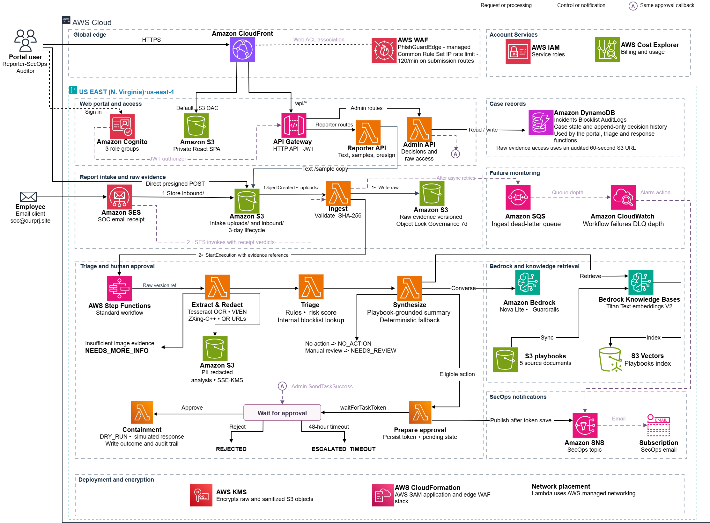

**PhishGuard AI · Tiếp nhận báo cáo phishing và phê duyệt xử lý**  
Đối tượng thí điểm là nhân viên gửi báo cáo và nhóm SecOps nội bộ. Hệ thống triển khai ở US East (N. Virginia). Chế độ xử lý trong bản demo là `DRY_RUN`.

## Vấn đề thực tế

Một nhân viên chuyển tiếp email đáng ngờ vào hộp thư chung. Người khác gửi ảnh chụp cùng một chiến dịch. Khi xem lại, chuyên viên cần biết ai gửi từng báo cáo, bản gốc nào đã được dùng, vì sao có đề xuất và ai đã duyệt. Chatbot có thể giúp đọc nội dung thư. Việc gắn bằng chứng, quyền xem, người quyết định và kết quả với nhau vẫn là công việc của đội vận hành.

## Phạm vi thí điểm

Portal dùng Cognito, nhận văn bản, ảnh và EML. Receipt rule của SES nhận thư chuyển tiếp từ người báo cáo đã xác minh. Ingest cấp mã sự cố, lưu phiên bản gốc. Chuyên viên xem bản đã che PII trong công việc thường ngày. Khi cần bản gốc, admin xin URL có thời hạn ngắn và hệ thống ghi audit.

Bộ luật chấm điểm dựa trên chỉ dấu và các luật nêu tên. Bedrock có thể truy xuất playbook và giải thích kết quả. Khi khâu tổng hợp gặp lỗi, hồ sơ vẫn có kết quả theo luật và lý do fallback. Nếu có đề xuất, Step Functions đặt hạn duyệt, thông báo SecOps và tiếp tục khi nhận quyết định hợp lệ hoặc hết hạn. Bản demo mô phỏng hành động. Chế độ danh sách nội bộ có thể lưu miền đã xác nhận. Tích hợp cưỡng chế trên gateway hoặc firewall nằm ngoài phạm vi thí điểm.

## Sản phẩm và tiêu chí nghiệm thu

| Giai đoạn | Sản phẩm | Cách nghiệm thu |
|---|---|---|
| Tiếp nhận và lưu chứng cứ | Portal, SES và kho bằng chứng riêng | Gửi văn bản UTF-8 và ảnh, đối chiếu mã sự cố với phiên bản S3. Gửi lại cùng yêu cầu của một reporter trả cùng mã. |
| Phân tích | OCR, che PII, luật và tóm tắt có căn cứ | Kiểm tra chữ tiếng Việt, luật kích hoạt và dẫn chứng. Ảnh thiếu nội dung đi vào nhánh cần bổ sung. Ghi trạng thái tổng hợp thực tế. |
| Phê duyệt | Quyết định admin, callback và audit | Duyệt mẫu demo tạo audit. Yêu cầu bỏ qua sẽ hết hạn. API từ chối quyết định muộn bằng HTTP 409. |
| Vận hành và bàn giao | Phân quyền, cảnh báo, Workshop và dự toán | Reporter thứ hai bị từ chối khi đọc sự cố người khác. Chỉ ra đích của alarm, cách dựng lại và các giả định chi phí. |

## Giới hạn

Object Lock Governance bảo vệ phiên bản raw trong bảy ngày với ngoại lệ cho người có quyền bypass. OCR có thể đọc nhầm dấu, bản che PII có thể còn tên hoặc địa chỉ. Header bên trong thư forward là dữ liệu được cung cấp. Kết quả xác thực của SES thuộc lớp thư bên ngoài. Hiệu quả phát hiện ngoài bộ mẫu vẫn cần được đo bằng tập có nhãn độc lập.

**Phạm vi đã triển khai.** Distribution CloudFront đã gắn Web ACL PhishGuardEdge. Trình duyệt tải file trực tiếp lên S3. Bước đọc ảnh xử lý OCR tiếng Việt/Anh và mã QR chứa URL. Kho tri thức có năm playbook nguồn. Triage đề xuất hành động theo luật, Bedrock giải thích và trích dẫn.

## Chi phí và điều kiện mở rộng

Với 300 báo cáo trong 30 ngày, gồm 90 ảnh và 60 email đến, dự toán là **9,37 USD**, đã tính WAF và một hosted zone. Báo cáo Cost Explorer từ 1–23/11/2026 làm tròn thành **0,00 USD** trong phạm vi bản xuất. Trước khi mở rộng, dùng tập mẫu được gán nhãn độc lập để so thời gian phân loại, số báo nhầm, số bỏ sót và tỷ lệ cần người xem với quy trình xử lý qua hộp thư.

[Giải thích sơ đồ](../5-workshop/overview/) · [Dự toán và minh chứng chi phí](../5-workshop/cost/)
