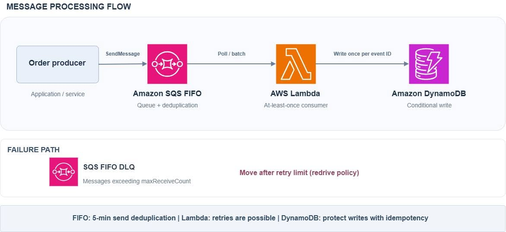

# DOES SQS FIFO REALLY GUARANTEE “EXACTLY-ONCE PROCESSING”?

An interesting scenario when studying asynchronous systems on AWS: an application receives the event “Order #1042 has been created”. AWS Lambda processes the message from Amazon SQS FIFO and writes to DynamoDB successfully, but the function times out just before deleting the message from SQS. The same message is received again afterward. Even when using a FIFO queue, why can duplicate processing still happen? This post clarifies the difference between duplicate-send prevention, order preservation, and preventing duplicate business effects, based on AWS Documentation.

Key points to remember:

- Standard Queue delivers high throughput and at-least-once delivery, but messages may arrive more than once or out of order. FIFO Queue preserves ordering per `MessageGroupId` and provides message deduplication, while allowing different groups to be processed in parallel.
- SQS FIFO’s “exactly-once” applies to duplicate-send prevention at the messaging layer, not end-to-end execution of the entire business workflow inside Lambda.
- Deduplication has only a 5-minute window: resending the same `MessageDeduplicationId` within 5 minutes prevents another copy from entering the queue, whereas resending after 5 minutes may be treated as a new message.
- When content-based deduplication is enabled, SQS computes the deduplication ID using a SHA-256 hash of the **message body** only (excluding message attributes), so changing attributes alone does not create a distinct message for deduplication.
- Lambda + SQS event source mappings follow at-least-once semantics: if processing fails or times out, the message reappears after the visibility timeout and is processed again, even if the write already succeeded.
- Idempotency means running the same operation multiple times yields the same business outcome as running it once—for example, using DynamoDB `PutItem` with `ConditionExpression: attribute_not_exists(eventId)` to prevent overwriting an existing record.
- A conditional `PutItem` only protects that specific item write; if the workflow also sends emails, calls payment APIs, or updates external systems, you still need design patterns such as outbox/transactions, processing state tracking, or downstream idempotency keys.
- For batch retries, enable `ReportBatchItemFailures` to avoid retrying already-succeeded messages unnecessarily; on FIFO queues, stop at the first failure and include remaining unprocessed messages in `batchItemFailures` to preserve order.
- Configure a redrive policy with `maxReceiveCount` to route repeatedly failing messages to a FIFO Dead-Letter Queue (DLQ); DLQs help isolate and diagnose issues, though redriving later can break strict ordering and does not automatically fix logic errors.
- Review four core design questions for async systems:
  1. Is strict ordering required per group, and does `MessageGroupId` match the business entity (such as `orderId`)?
  2. Is reprocessing safe if a message reappears after the 5-minute window or due to a Lambda retry?
  3. Are visibility timeout, partial batch handling, and retry settings aligned with real-world processing duration?
  4. How will operators detect permanent failures, inspect payloads, and redrive messages from the DLQ?

Conclusion: “Exactly-once delivery/deduplication” at the queue layer is not the same as “exactly-once business effect” at the application layer. Reliable event-driven workflows require combining FIFO ordering/deduplication, visibility timeout tuning, retry/DLQ handling, idempotency, and side-effect control.

https://www.facebook.com/groups/awsstudygroupfcj/permalink/2344641672967458/