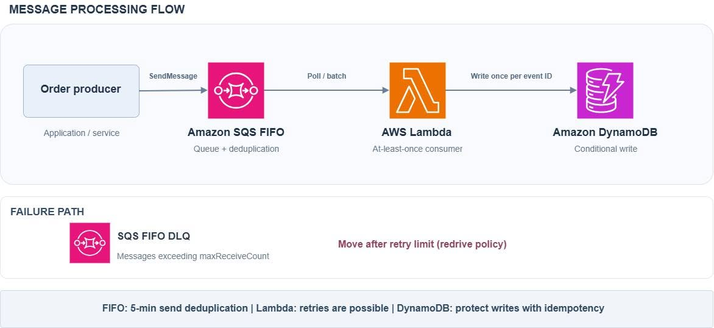

{}
⚠️ **Lưu ý:** Thông tin bên dưới chỉ mang tính chất tham khảo. Vui lòng **không sao chép nguyên văn** vào báo cáo của bạn, bao gồm cả cảnh báo này.
{}

# SQS FIFO CÓ THỰC SỰ ĐẢM BẢO “EXACTLY-ONCE PROCESSING”?

Một tình huống thú vị khi tìm hiểu các hệ thống bất đồng bộ trên AWS: ứng dụng nhận sự kiện “Đơn hàng #1042 đã được tạo”. AWS Lambda xử lý message từ Amazon SQS FIFO và ghi dữ liệu vào DynamoDB thành công, nhưng hàm bị timeout ngay trước khi xóa message khỏi SQS. Sau đó, cùng message đó lại được nhận thêm lần nữa. Dù đã sử dụng FIFO queue, tại sao việc xử lý lặp lại vẫn có thể xảy ra? Bài viết này làm rõ sự khác biệt giữa chống gửi trùng, bảo toàn thứ tự và ngăn chặn tác động nghiệp vụ trùng lặp dựa trên AWS Documentation.

Những điểm chính cần nhớ:

- Standard Queue cung cấp thông lượng rất cao và cơ chế gửi at-least-once, nhưng message có thể đến nhiều lần hoặc không đúng thứ tự. FIFO Queue bảo toàn thứ tự trong từng `MessageGroupId` và hỗ trợ chống trùng lặp message, đồng thời cho phép các nhóm khác nhau xử lý song song.
- Cơ chế “exactly-once” của SQS FIFO là khả năng chống gửi trùng ở tầng messaging, không đồng nghĩa toàn bộ luồng nghiệp vụ bên trong Lambda chỉ chạy đúng một lần.
- Cơ chế deduplication chỉ có cửa sổ 5 phút: nếu producer gửi lại cùng `MessageDeduplicationId` trong vòng 5 phút, SQS sẽ không thêm bản sao vào queue; nhưng nếu gửi lại sau 5 phút, message có thể bị xem là thông điệp mới.
- Khi bật content-based deduplication, SQS tạo deduplication ID từ mã băm SHA-256 của **message body** (không bao gồm message attributes), vì vậy chỉ thay đổi attributes sẽ không tạo ra một message khác về mặt chống trùng lặp.
- Event source mapping giữa Lambda và SQS vận hành theo cơ chế at-least-once: nếu quá trình xử lý gặp lỗi hoặc timeout, message sẽ xuất hiện lại sau khi hết visibility timeout và được xử lý lại, ngay cả khi dữ liệu trước đó đã được ghi thành công.
- Idempotency nghĩa là thực thi cùng một yêu cầu nhiều lần nhưng vẫn giữ nguyên kết quả nghiệp vụ như chạy một lần — ví dụ dùng DynamoDB `PutItem` kèm `ConditionExpression: attribute_not_exists(eventId)` để tránh ghi đè bản ghi đã tồn tại.
- Điều kiện `PutItem` chỉ bảo vệ thao tác ghi trùng cho riêng item đó; nếu luồng xử lý còn gửi email, gọi API thanh toán hoặc cập nhật nhiều hệ thống khác, bạn vẫn cần bổ sung mô hình outbox/transaction, lưu trạng thái xử lý hoặc dùng idempotency key cho API đích.
- Với cơ chế retry theo batch, hãy bật `ReportBatchItemFailures` để tránh chạy lại các message đã thành công; riêng với FIFO queue, cần dừng ngay tại lỗi đầu tiên và đưa toàn bộ message chưa xử lý phía sau vào `batchItemFailures` để không phá vỡ thứ tự.
- Cấu hình redrive policy với `maxReceiveCount` để chuyển các message lỗi liên tục sang FIFO Dead-Letter Queue (DLQ); DLQ giúp cô lập và điều tra sự cố, nhưng việc redrive lại sau đó có thể làm lệch thứ tự nghiệp vụ nghiêm ngặt và không tự động sửa được lỗi logic.
- Rà soát 4 câu hỏi cốt lõi khi thiết kế hệ thống bất đồng bộ:
  1. Các sự kiện có bắt buộc phải xử lý đúng thứ tự trong từng nhóm không, và `MessageGroupId` đã đại diện đúng thực thể nghiệp vụ (như `orderId`) chưa?
  2. Logic xử lý có an toàn để chạy lại nếu message xuất hiện sau cửa sổ 5 phút hoặc khi Lambda retry không?
  3. Visibility timeout, cơ chế xử lý lỗi từng phần trong batch và chính sách retry đã khớp với thời gian xử lý thực tế chưa?
  4. Đội vận hành sẽ phát hiện lỗi vĩnh viễn, kiểm tra dữ liệu và redrive message từ DLQ như thế nào?

Kết luận: “Exactly-once delivery/deduplication” ở tầng queue khác với “exactly-once business effect” ở tầng ứng dụng. Một quy trình hướng sự kiện đáng tin cậy đòi hỏi thiết kế đồng bộ giữa ngữ nghĩa FIFO, tối ưu visibility timeout, xử lý retry/DLQ, idempotency và kiểm soát các tác động phụ (side effects).

https://www.facebook.com/groups/awsstudygroupfcj/permalink/2344641672967458/