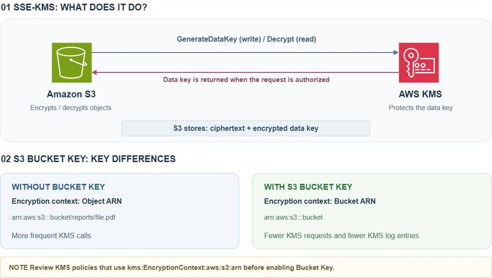

# AWS KMS & ENVELOPE ENCRYPTION: IS DATA ENCRYPTION ALREADY SECURE ENOUGH?

An insightful question when studying AWS security: if an object in Amazon S3 is encrypted with AWS KMS (SSE-KMS), why can an authorized principal still download and read it normally? And a deeper question: why does enabling S3 Bucket Keys reduce requests to KMS while potentially breaking policies tied to an object ARN? Based on official AWS documentation, this post analyzes the underlying mechanics and security trade-offs rather than lab deployments or simulated results.

Key points to remember:

- Envelope encryption uses two key layers: a symmetric data key encrypts the object payload, while a KMS key protects (encrypts) the data key. S3 requests a data key via `GenerateDataKey`, uses the plaintext data key briefly in memory to encrypt/decrypt data, and stores the encrypted data key with object metadata (while KMS `Encrypt` directly only supports small payloads up to 4,096 bytes for `SYMMETRIC_DEFAULT`).
- Encryption at rest does not replace authorization: reading an SSE-KMS object still requires valid S3 permissions plus `kms:Decrypt` (and uploading requires `kms:GenerateDataKey`), governed by IAM and KMS key policies. Compromised credentials with valid permissions can still read data through authorized APIs.
- Encryption context is a non-secret key-value map used as Additional Authenticated Data (AAD) and in policy conditions, and it can appear in plaintext in AWS CloudTrail—so never store secrets, passwords, or tokens in it.
- Without S3 Bucket Keys, S3 SSE-KMS includes the object ARN in the default encryption context (`aws:s3:arn`), enabling object-level policy conditions.
- S3 Bucket Keys can reduce KMS request costs by up to 99% using a time-bounded bucket-level key, but shift default `aws:s3:arn` in the encryption context from the object ARN to the bucket ARN and reduce per-object KMS CloudTrail events (without removing S3 access logs or bypassing S3 object permission checks).
- Cached bucket-level key operations do not trigger new KMS calls or re-evaluate the KMS key policy during those cached operations, and S3 Bucket Keys do not support DSSE-KMS.
- Four security review questions for KMS/S3 designs: (1) Are `s3:GetObject` and `kms:Decrypt` scoped to least privilege? (2) Do policies enforce object-, prefix-, or bucket-level access and rely on specific encryption context keys? (3) Do KMS policy assumptions and CloudTrail granularity still hold if S3 Bucket Keys are enabled? (4) Are key management, credential protection, and activity monitoring designed together?

Conclusion: Encryption is not a silver bullet against unauthorized use of valid credentials. AWS KMS adds value through key lifecycle management, access control, and auditability—meaning every cost or performance optimization must be reviewed for security control and traceability trade-offs.

https://www.facebook.com/groups/awsstudygroupfcj/permalink/2342975263134099/