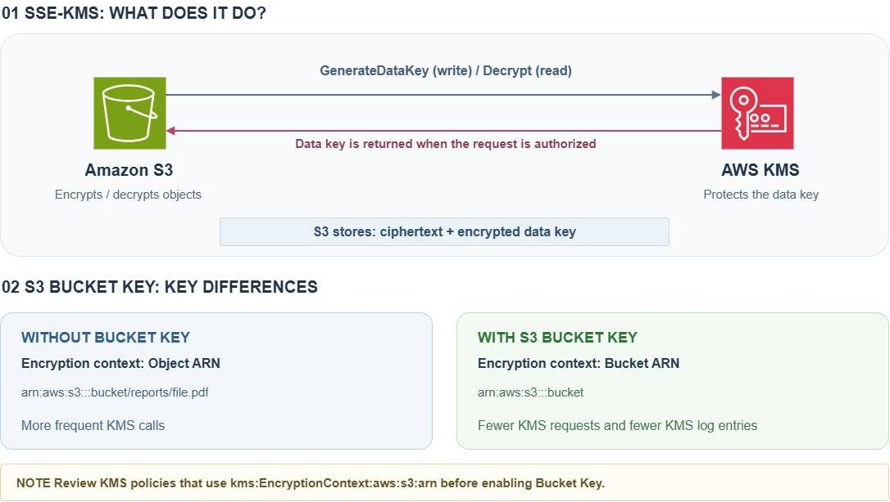

# AWS KMS & ENVELOPE ENCRYPTION: MÃ HÓA DỮ LIỆU ĐÃ ĐỦ AN TOÀN CHƯA?

Một câu hỏi đáng suy nghĩ khi tìm hiểu bảo mật trên AWS: nếu một object trong Amazon S3 đã được mã hóa bằng AWS KMS (SSE-KMS), vì sao người có đủ quyền hợp lệ vẫn có thể tải và đọc nó bình thường? Và sâu hơn, vì sao bật S3 Bucket Keys giúp giảm số yêu cầu tới KMS nhưng có thể làm các policy gắn với object ARN không còn khớp? Dựa trên tài liệu chính thức của AWS, bài viết phân tích cơ chế hoạt động và các đánh đổi bảo mật thay vì triển khai hay giả lập kết quả lab.

Key points to remember:

- Envelope encryption dùng hai lớp khóa: data key đối xứng mã hóa nội dung object, còn KMS key bảo vệ (mã hóa) data key. S3 gọi `GenerateDataKey` để nhận data key dạng plaintext (dùng tạm trong bộ nhớ rồi xóa) và bản mã hóa lưu cùng metadata object (trong khi API `Encrypt` của KMS chỉ mã hóa trực tiếp dữ liệu nhỏ tối đa 4.096 byte với `SYMMETRIC_DEFAULT`).
- Mã hóa dữ liệu lưu trữ (encryption at rest) không thay thế phân quyền (authorization): đọc object SSE-KMS vẫn cần quyền S3 cùng `kms:Decrypt` (ghi cần `kms:GenerateDataKey`), chịu chi phối của IAM policy và KMS key policy. Nếu credentials có đủ quyền hợp lệ bị lộ, dữ liệu vẫn có thể bị đọc qua API được phép.
- Encryption context là tập key-value không bí mật dùng làm Additional Authenticated Data (AAD) và điều kiện policy, có thể xuất hiện dạng clear text trên AWS CloudTrail—tuyệt đối không đưa mật khẩu, token hay dữ liệu nhạy cảm vào đây.
- Khi không dùng S3 Bucket Keys, SSE-KMS mặc định đưa object ARN vào encryption context (`aws:s3:arn`), làm nền tảng cho các điều kiện policy theo từng object.
- S3 Bucket Keys có thể giảm chi phí gọi KMS lên đến 99% nhờ bucket-level key theo thời gian giới hạn, nhưng đổi mặc định `aws:s3:arn` trong encryption context từ object ARN sang bucket ARN và làm giảm số sự kiện KMS trên CloudTrail theo từng object (không làm mất nhật ký truy cập S3 hay bỏ qua kiểm tra quyền S3).
- Các thao tác dùng bucket-level key tạm lưu không gọi KMS mới nên không đánh giá lại KMS key policy ở chính các lần đó, đồng thời S3 Bucket Keys không hỗ trợ DSSE-KMS.
- Bốn câu hỏi rà soát bảo mật khi thiết kế: (1) `s3:GetObject` và `kms:Decrypt` đã tuân thủ least privilege chưa? (2) Chính sách kiểm soát theo object, prefix hay bucket và phụ thuộc encryption context nào? (3) Giả định về KMS policy và độ chi tiết CloudTrail còn đúng không khi bật S3 Bucket Keys? (4) Quản trị khóa, bảo vệ credentials và giám sát hoạt động đã được thiết kế đồng bộ chưa?

Conclusion: Mã hóa không phải “lá chắn tuyệt đối” trước mọi hành vi dùng quyền hợp lệ. Giá trị của AWS KMS nằm ở quản trị vòng đời khóa, kiểm soát quyền sử dụng khóa và khả năng audit—do đó mọi tối ưu chi phí hay hiệu năng đều cần được đánh giá lại về kiểm soát và khả năng truy vết bảo mật.

https://www.facebook.com/groups/awsstudygroupfcj/permalink/2342975263134099/