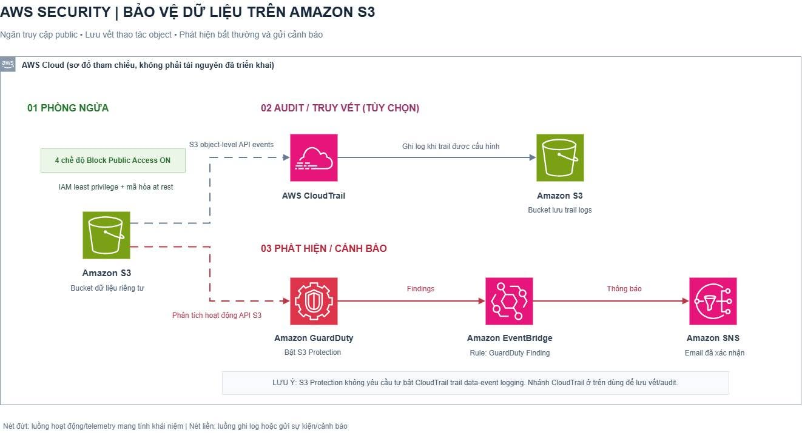

# HAS AMAZON S3 BLOCK PUBLIC ACCESS ALREADY MADE YOUR DATA SAFE?

When learning AWS security, Amazon S3 Block Public Access is one of the first controls you encounter. Yet an important question arises: if a valid IAM access key with S3 read permissions is exposed, will Block Public Access stop unauthorized data access? Not necessarily—it primarily blocks public access granted via bucket policies or ACLs, not authorized calls made with leaked credentials or missing least-privilege controls. This post frames S3 data protection across three layers: Prevention, Auditing, and Detection & Alerting.

Key points to remember:

- **Prevention:** Enable all four Block Public Access settings (`BlockPublicAcls`, `IgnorePublicAcls`, `BlockPublicPolicy`, `RestrictPublicBuckets`), where S3 applies the most restrictive combination across levels; remember that private buckets still allow principals with valid `s3:GetObject` permissions, so enforce least privilege. Note also that new buckets default to *Bucket owner enforced* (ACLs disabled) and default SSE-S3 encryption (since January 5, 2023), which protects data at rest without replacing access control.
- **Auditing:** Investigating unexpected reads or deletions requires object-level API logs (`GetObject`, `PutObject`, `DeleteObject`) via AWS CloudTrail S3 Data Events, which are not enabled by default on trails—route logs to a dedicated audit bucket and scope tracked events/buckets to control cost.
- **Detection & Alerting:** GuardDuty S3 Protection analyzes S3 object-level API activity for anomalies such as `Exfiltration:S3/AnomalousBehavior` without requiring you to manually enable S3 Data Events on your CloudTrail trail; route findings via EventBridge to SNS (with confirmed email subscriptions and realistic filtering) and verify evidence before taking action.
- **CLI & Safe Testing:** Inspect settings read-only with `aws s3api get-public-access-block --bucket YOUR_BUCKET_NAME`, test alert pipelines safely using GuardDuty *Generate sample findings*, and watch costs for CloudTrail data events and GuardDuty S3 Protection.

Conclusion: Turning on Block Public Access is only a starting point. Combining Prevention, Auditing, and Detection & Alerting provides defense in depth so you can restrict access, trace actions, and spot anomalous behavior together.

https://www.facebook.com/groups/awsstudygroupfcj/permalink/2341941026570856/