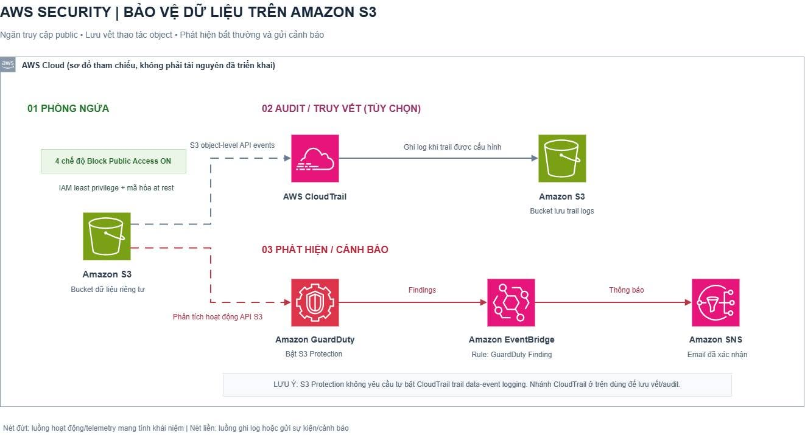

# S3 ĐÃ BẬT BLOCK PUBLIC ACCESS THÌ DỮ LIỆU ĐÃ AN TOÀN CHƯA?

Khi tìm hiểu AWS Security, Amazon S3 Block Public Access là cấu hình thường được nhắc đến đầu tiên. Tuy nhiên, nếu một IAM access key hợp lệ có quyền đọc S3 bị lộ, Block Public Access không hẳn ngăn được việc truy cập dữ liệu—vì cấu hình này chủ yếu chặn truy cập công khai qua bucket policy hoặc ACL, chứ không thay thế phân quyền IAM hay giám sát hành vi dùng thông tin xác thực hợp lệ. Bài viết nhìn nhận việc bảo vệ dữ liệu S3 theo 3 lớp: Prevention, Auditing và Detection & Alerting.

Key points to remember:

- **Prevention:** Bật cả 4 tùy chọn Block Public Access (`BlockPublicAcls`, `IgnorePublicAcls`, `BlockPublicPolicy`, `RestrictPublicBuckets`), nơi S3 áp dụng tổ hợp hạn chế nhất giữa các cấp; bucket private vẫn cho phép principal có quyền `s3:GetObject` hợp lệ, nên cần áp dụng least privilege. Lưu ý thêm bucket mới mặc định bật *Bucket owner enforced* (tắt ACL) và mã hóa mặc định SSE-S3 (từ 05/01/2023), giúp bảo vệ dữ liệu lưu trữ nhưng không thay thế kiểm soát truy cập.
- **Auditing:** Khi cần truy vết ai đọc hoặc xóa object, dùng AWS CloudTrail S3 Data Events (`GetObject`, `PutObject`, `DeleteObject`); tính năng này không bật mặc định trên trail, nên cần cấu hình gửi về bucket audit riêng và chọn lọc phạm vi để tối ưu chi phí.
- **Detection & Alerting:** GuardDuty S3 Protection phân tích hoạt động API cấp object trên S3 để phát hiện bất thường như `Exfiltration:S3/AnomalousBehavior` mà không bắt buộc người dùng tự bật S3 Data Events trên CloudTrail trail; kết nối qua EventBridge tới SNS (nhớ xác nhận subscription email và lọc sự kiện phù hợp), đồng thời luôn kiểm chứng bằng chứng trước khi kết luận tấn công.
- **Kiểm tra & thử nghiệm an toàn:** Dùng lệnh chỉ đọc `aws s3api get-public-access-block --bucket TEN_BUCKET_CUA_BAN` để kiểm tra cấu hình, dùng *Generate sample findings* của GuardDuty để thử luồng cảnh báo an toàn, và lưu ý chi phí phát sinh từ CloudTrail data events cũng như GuardDuty S3 Protection.

Conclusion: Bật Block Public Access chỉ là bước nền tảng. Kết hợp đủ ba lớp Prevention, Auditing và Detection & Alerting giúp ngăn chặn rủi ro, lưu vết điều tra và phát hiện bất thường bổ trợ cho nhau.

https://www.facebook.com/groups/awsstudygroupfcj/permalink/2341941026570856/