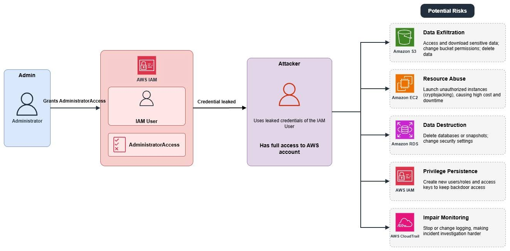

# HOW CAN A SINGLE IAM PERMISSION CAUSE MAJOR RISKS? ANALYZING ADMINISTRATORACCESS ON AWS

In AWS operations, access control is foundational to cloud security, and AWS IAM lets administrators manage user permissions across services and resources. However, granting overly broad permissions—especially `AdministratorAccess`—creates severe risks if credentials leak or an identity is compromised. What happens when an IAM identity with full administrative privileges is taken over? This post examines the key blast-radius risks across AWS services and practical controls to reduce them.

Key points to remember:

- `AdministratorAccess` is an AWS Managed Policy granting near-full administrative control across the account; if compromised, attackers can exfiltrate or delete S3 data, launch unauthorized EC2 instances (such as for cryptojacking) or disrupt running workloads, modify/delete RDS instances or snapshots, create persistent IAM users/roles/access keys, and tamper with or disable CloudTrail logging.
- Reduce blast radius by enforcing least privilege instead of defaulting to `AdministratorAccess`, requiring MFA on privileged identities, and preferring temporary credentials via IAM roles over long-lived access keys.
- Use permission boundaries to cap maximum permissions an IAM user or role can obtain, monitor IAM and security configuration changes via AWS CloudTrail (with independent log protection), and conduct regular access reviews to revoke unused or overly broad permissions.

https://www.facebook.com/groups/awsstudygroupfcj/permalink/2346868572744768/