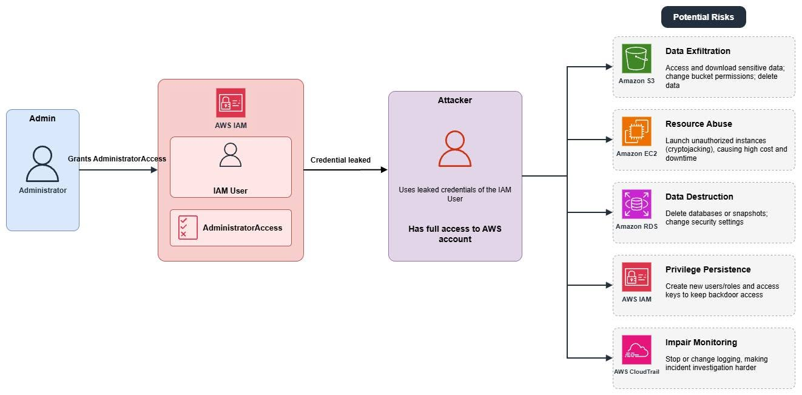

# MỘT QUYỀN IAM NHỎ CÓ THỂ GÂY RA RỦI RO LỚN NHƯ THẾ NÀO?

Trong vận hành hệ thống trên AWS, quản lý quyền truy cập là nền tảng bảo mật thông qua AWS IAM. Tuy nhiên, cấp quyền quá rộng—đặc biệt là `AdministratorAccess`—tiềm ẩn rủi ro rất lớn nếu thông tin xác thực bị lộ hoặc tài khoản bị chiếm quyền. Điều gì xảy ra khi một tài khoản IAM có quyền quản trị rộng bị xâm nhập? Bài viết tổng hợp các rủi ro chính trên các dịch vụ AWS và những biện pháp kiểm soát giúp giảm thiểu thiệt hại.

Key points to remember:

- `AdministratorAccess` là AWS Managed Policy trao quyền quản trị gần như toàn bộ tài khoản; nếu bị chiếm quyền, kẻ tấn công có thể truy xuất/xóa dữ liệu S3, tạo EC2 trái phép (như đào tiền mã hóa / cryptojacking) hoặc làm gián đoạn máy chủ, xóa/sửa RDS instance và snapshot, tạo thêm IAM user/role/access key để duy trì truy cập, và can thiệp hoặc tắt ghi log CloudTrail.
- Hạn chế phạm vi ảnh hưởng bằng cách áp dụng least privilege thay vì lạm dụng `AdministratorAccess`, bật MFA cho các tài khoản quan trọng, và ưu tiên temporary credentials qua IAM roles thay vì access key dài hạn.
- Thiết lập permission boundaries để giới hạn trần quyền tối đa cho IAM user/role, giám sát thay đổi IAM và cấu hình bảo mật qua AWS CloudTrail (kết hợp bảo vệ log độc lập), và rà soát quyền định kỳ để thu hồi quyền dư thừa hoặc quá rộng.

https://www.facebook.com/groups/awsstudygroupfcj/permalink/2346868572744768/