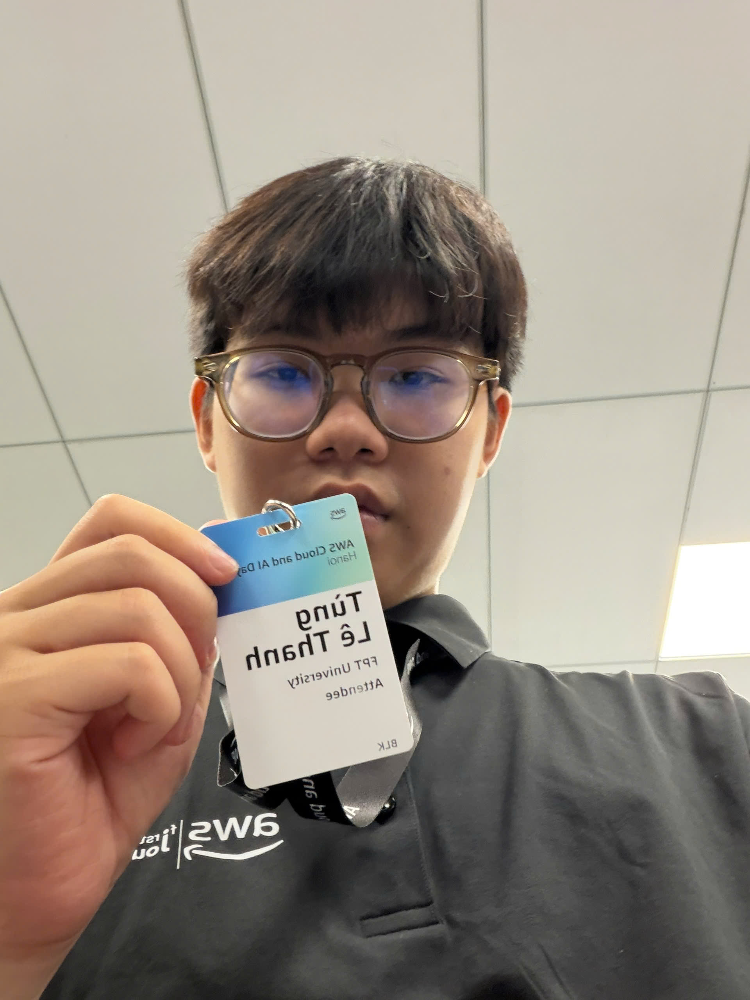

# Báo cáo tổng hợp: “AWS Cloud & AI Day Hanoi 2026”

- **Tên sự kiện:** AWS Cloud & AI Day Hanoi 2026
- **Ngày & Giờ:** 09:00-17:00, ngày 29/09/2026 
- **Địa điểm:** Tầng 26 Bitexco Financial Tower, 2 Đ. Hải Triều, Sài Gòn, Hồ Chí Minh 700000, Việt Nam 
- **Vai trò:** Người tham dự

### Mục tiêu sự kiện

- Hiểu cách cloud, Generative AI và Agentic AI đang chuyển từ công nghệ thử nghiệm thành các năng lực có thể triển khai trong môi trường doanh nghiệp thực tế
- Tìm hiểu các phương pháp hiện đại về phát triển cloud-native, hạ tầng, nền tảng dữ liệu, workload identity, bảo mật và quản trị AI
- Học hỏi từ các case thực tế của AWS và doanh nghiệp Việt Nam về quá trình hiện đại hóa hệ thống và vận hành ở quy mô lớn
- Hiểu cách bảo mật, governance, observability và human oversight cần phát triển song song với mức độ tự chủ ngày càng cao của AI
- Kết nối các nội dung của sự kiện với định hướng học tập của bản thân trong lĩnh vực cybersecurity và cloud security

### Diễn giả

- **Dr. Werner Vogels** – Giám đốc Công nghệ (CTO), Amazon.com (diễn giả keynote)
- **Eric Yeo** – Tổng Giám đốc quốc gia phụ trách Malaysia, Việt Nam và Đông Dương, AWS
- **Mai Le** – Giám đốc Quản lý Sản phẩm (Director of Product Management), Katalon
- **Dr. Jens Lottner** – Tổng Giám đốc (CEO), Techcombank
- Các chuyên gia AWS, kỹ sư, kiến trúc sư và lãnh đạo công nghệ đến từ Katalon, Techcombank, TCBS, Techcom Life, VPBank và các tổ chức khác

### Điểm nổi bật

#### Từ Cloud-Native Architecture đến Agentic AI

- Chuyển dịch từ việc chỉ đưa workload lên cloud sang xây dựng hệ thống cloud-native, tự động hóa và tự chủ hơn bằng **containers**, **Kubernetes**, **serverless**, **event-driven architectures** và **managed cloud services**
- **Platform Engineering** và **Internal Developer Platforms (IDPs)** tạo ra các **“Golden Path”** chuẩn hóa giúp giảm thao tác hạ tầng thủ công và điểm nghẽn **TicketOps**
- Các công nghệ như **Amazon EKS**, **Crossplane**, **Terragrunt**, **Backstage**, **FluxCD** và **GitOps** giúp triển khai hạ tầng và ứng dụng lặp lại được, tự động, nhất quán, dễ truy vết và kiểm soát

#### Agentic AI: Từ Proof of Concept đến Production

- Xây dựng AI agent dễ hơn vận hành an toàn trong production, đòi hỏi bốn yêu cầu chính:
  - **Operational excellence**: Độ tin cậy, xử lý lỗi, độ trễ và giám sát vận hành
  - **Data governance**: Quyền sở hữu dữ liệu, độ mới, chất lượng và phân quyền truy cập
  - **Security and trust**: Kiểm soát danh tính, công cụ, quyền hạn và thông tin nhạy cảm
  - **Human oversight**: Duy trì trách nhiệm của con người với các hành động tác động lớn hoặc không thể đảo ngược
- Các phiên về **Amazon Bedrock**, **Amazon Bedrock AgentCore**, **Strands Agents**, **Model Context Protocol (MCP)**, mô hình **ReAct**, quản lý trạng thái và tích hợp công cụ cho thấy cách agent suy luận, truy xuất thông tin, gọi tool, giữ ngữ cảnh và hành động trong ranh giới phân quyền rõ ràng

#### Identity, Least Privilege, và AI Security

- Đi xa hơn việc loại bỏ long-lived access keys sang **workload identity** có thể xác minh xuyên qua các trust boundary
- Các cơ chế chính: **AWS IAM**, **AWS STS** (credentials và session ngắn hạn), **trust policies**, **session policies và session tags**, **source identity**, và **ABAC** trên **EC2**, **ECS/Fargate**, **Lambda**, **EKS**, **CI/CD**, workload đa tài khoản và **AI agents**

#### AI Governance, Data Security, và Trust

- AI doanh nghiệp là bài toán về dữ liệu và quản trị song song với model: độ chính xác, độ mới, nguồn gốc, quyền sở hữu, phân quyền truy cập, bằng chứng cho câu trả lời, khả năng truy vết quyết định và xử lý quyết định không an toàn
- Tập trung vào data lineage, freshness, quality, permissions và provenance, khái quát thành chuỗi bảo mật: **Identity → Data → Model → Tools → Agent → Action → Audit**

#### Security Observability cho AI Applications

- Mở rộng giám sát truyền thống (**Four Golden Signals**: Latency, Errors, Traffic, Saturation) sang các chiều của AI:
  - **Cost**: Lượng token tiêu thụ và mức sử dụng bất thường
  - **Safety**: Lộ PII, prompt injection và thực thi tool không an toàn
  - **Quality**: Hallucination và đầu ra không chính xác
- Kết hợp telemetry hạ tầng, sự kiện bảo mật, truy cập dữ liệu và hành vi AI agent

#### Secure AI-Assisted Software Development

- **Kiro** và **AI-DLC** mở rộng AI sang toàn bộ SDLC (lập kế hoạch và thiết kế, sinh mã và kiểm thử, tài liệu và triển khai, quản lý nợ kỹ thuật, di chuyển và hiện đại hóa), với case **TCBS** ghi nhận giảm **26%** thời gian phát triển
- Cần kiểm chứng, rà soát bảo mật, quản trị, phê duyệt của con người và tích hợp **DevSecOps**

#### Cloud Modernization và Enterprise Security

- Các case từ **Techcombank**, **Techcom Life**, **TCBS**, **VPBank** và **Katalon** làm nổi bật hiện đại hóa ứng dụng/database, containerization, hợp nhất nền tảng dữ liệu, tự động hóa hạ tầng, observability, bảo mật, tuân thủ, data residency và khả năng phục hồi vận hành
- Đề cập **AWS Local Zone tại Hà Nội** và **AWS Outposts (thế hệ thứ hai)** cho yêu cầu lưu trữ dữ liệu tại chỗ (data residency) và tuân thủ quy định, cân bằng **Security + Compliance + Reliability + Performance + Cost + Business Agility**

### Bài học chính

#### Tư duy bảo mật

- **Identity là một ranh giới bảo mật**: Mọi workload, pipeline, dịch vụ và AI agent đều cần danh tính rõ ràng với credentials ngắn hạn theo nguyên tắc đặc quyền tối thiểu
- **Bảo mật toàn chuỗi AI và giám sát của con người**: Bao phủ toàn bộ chuỗi (**Identity → Data → Model → Tools → Agent → Action → Audit**) và giữ sự giám sát của con người cho hành động rủi ro cao hoặc không thể đảo ngược
- **Mở rộng khả năng quan sát AI**: Giám sát cả hành vi, truy cập dữ liệu, an toàn AI, chất lượng và chi phí bên cạnh các chỉ số truyền thống

#### Kiến trúc Cloud & Kỹ thuật

- **Hạ tầng có thể tái lập và truy vết**: Ưu tiên managed services, containers, Kubernetes, serverless, tự động hóa, **GitOps** và **IDP** thay vì sửa thủ công qua SSH
- **Nền tảng danh tính và dữ liệu vững chắc**: Kết hợp **IAM**, **STS**, workload identity, **ABAC**, truy cập đa tài khoản, dữ liệu đáng tin cậy và governance

#### AI & An ninh mạng

- **Vận hành an toàn bên cạnh năng lực**: Đánh giá xem agent có thực hiện tác vụ an toàn với đúng danh tính, quyền, dữ liệu và bằng chứng hay không trước các bề mặt tấn công mới (prompt injection, lộ dữ liệu nhạy cảm, thừa quyền, hành động trái phép, hallucination, chi phí khó kiểm soát)
- **Giao thoa các mảng chuyên môn**: Kết nối **Cloud Security**, **DevSecOps**, **AI Security** và **Security Operations**

### Áp dụng vào công việc

- **Áp dụng IAM đặc quyền tối thiểu và credentials ngắn hạn**: Rèn thực hành **AWS IAM**, **STS**, assume role, trust policies, **ABAC** và truy cập đa tài khoản (ví dụ lab nhỏ gồm role, trust policy và session tags rồi kiểm tra trên audit logs)
- **Mở rộng giám sát bảo mật**: Kết hợp log hạ tầng, sự kiện danh tính, telemetry ứng dụng và hoạt động của AI agent, đồng thời tìm hiểu mở rộng **Wazuh** và **SIEM** sang bảo mật cloud và AI
- **Áp dụng GitOps, IaC và ranh giới cho AI agent**: Giữ thay đổi hạ tầng dễ truy vết, kiểm toán, và đặt ranh giới rõ ràng về danh tính, quyền, truy cập dữ liệu, ghi log và phê duyệt khi thử nghiệm AI agent
- **Duy trì rà soát của con người khi dùng công cụ AI**: Tăng năng suất phát triển với công cụ AI nhưng vẫn giữ kiểm chứng bảo mật và phê duyệt của con người, kết nối bảo mật mạng/endpoint với bảo mật cloud-native

### Trải nghiệm sự kiện

Tham dự workshop **“AWS Cloud & AI Day Hanoi 2026”** rất giá trị, mang lại cho mình góc nhìn toàn diện về cách hiện đại hóa ứng dụng, cơ sở dữ liệu, agentic AI và bảo mật ở quy mô doanh nghiệp. Những trải nghiệm chính bao gồm:

#### Học hỏi từ chuyên gia trong ngành
- Các chia sẻ từ lãnh đạo AWS và doanh nghiệp (**Techcombank**, **TCBS**, **VPBank**, **Techcom Life** và **Katalon**) giúp thấy cách doanh nghiệp hiện đại hóa hệ thống và cân bằng công nghệ với governance, vận hành, bảo mật và thay đổi tổ chức.
- Các case thực tế giúp gắn kiến thức cloud và AI với quy mô sản xuất thực tế và yêu cầu tuân thủ.

#### Tiếp cận kiến thức kỹ thuật
- Làm quen ở mức khái niệm với **Amazon EKS**, **Kubernetes**, **GitOps**, **IAM**, **STS**, **Bedrock**, **AgentCore**, **MCP**, **AI-DLC**, data governance và **AI observability**.
- Hiểu sâu hơn về workload identity, nguyên tắc đặc quyền tối thiểu, tự động hóa hạ tầng và giám sát độ an toàn, chất lượng lẫn chi phí của AI.

#### Bài học rút ra
- Tự động hóa thiếu governance có thể làm tăng rủi ro nhanh không kém năng suất.
- Hệ thống càng tự chủ thì kiểm soát danh tính và phân quyền càng phải chặt chẽ, dựa trên dữ liệu đáng tin cậy và bảo mật xuyên suốt vòng đời cũng như quản trị AI.
- Người làm bảo mật cần biết cách bảo vệ, giám sát và quản trị chính các hệ thống AI bên cạnh việc phát hiện tấn công.

#### Một số hình ảnh sự kiện

> Nhìn chung, sự kiện không chỉ mang lại kiến thức kỹ thuật và bảo mật rộng mở, mà còn giúp định hình tư duy của mình về cloud security, governance, observability và ứng dụng AI an toàn.
