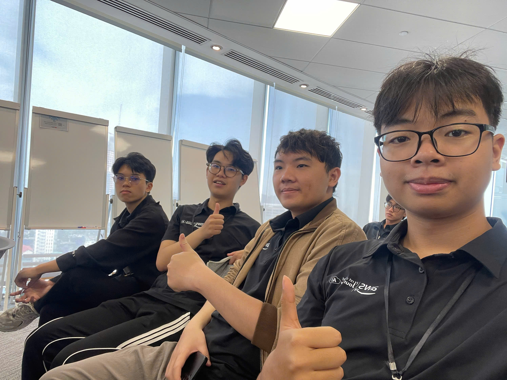

# Báo cáo tổng hợp: “First Cloud AI Journey: Weekly Meet Up”

- **Tên sự kiện:** First Cloud AI Journey: Weekly Meet Up  
- **Ngày & Giờ:** 09:00 – 12:00, ngày 24/10/2026  
- **Địa điểm:** Tầng 26 Bitexco Financial Tower, 2 Đ. Hải Triều, Sài Gòn, Hồ Chí Minh 700000, Việt Nam  
- **Vai trò:** Người tham dự  

### Mục tiêu sự kiện

- Học hỏi kinh nghiệm triển khai thực tế về Cloud và AI Agents trực tiếp từ các Tech Lead và kỹ sư doanh nghiệp
- Khám phá các góc nhìn thực tế từ Voice AI tiếng Việt độ trễ thấp, chia sẻ tài nguyên đa tài khoản, kiểm thử bảo mật sớm đến nền tảng đưa Agent lên production
- Liên hệ các bài học về tối ưu chi phí, quản trị context/memory, lớp chặn bảo mật và vận hành agent 24/7 vào lộ trình học tập của bản thân
- Rèn sự tự tin giao lưu, chủ động kết nối và tăng cường nỗ lực học hỏi cùng cộng đồng

### Diễn giả

- **Anh Kiệt Trần** – Revve AI
- **Anh Long Huỳnh** – Styl Solution
- **Anh Thịnh Nguyễn** – Styl Solution
- **Anh Xuân An** – Leader AWS Student Builder Group HCMUTE
- **Anh Khoa Kiều** – Tech Lead ACB
- **Anh Nghi Danh** – AWS Community Builder

### Điểm nổi bật

#### 1. Hear, Think, Speak – Xây dựng tổng đài Voice-AI tiếng Việt trên AWS (Anh Kiệt Trần – Revve AI)

- Khám phá kiến trúc **Voice AI** với bài toán giảm độ trễ phản hồi xuống khoảng **~1.8s** để cuộc trò chuyện diễn ra mượt mà
- Phần live demo hệ thống AI gọi điện trực tiếp để phỏng vấn sơ tuyển vị trí **Cloud Engineer** bằng tiếng Việt ấn tượng và tự nhiên

#### 2. AWS Resource Access Manager (Anh Long Huỳnh – Styl Solution)

- Chia sẻ cách chia sẻ tài nguyên an toàn giữa các tài khoản trong tổ chức **AWS Organization**
- Giải pháp giúp tiết kiệm chi phí, gom cụm quản trị mạng và kết hợp chặt chẽ giữa **IAM policy** với **SCP** để không ai vượt quá trần quyền hạn

#### 3. AWS Pentest with AWS Continuum / Security Agent (Anh Thịnh Nguyễn – Styl Solution)

- Giới thiệu bộ giải pháp đánh giá an toàn hạ tầng từ sớm: review code **Terraform**, gắn trực tiếp vào **GitLab/GitHub PR** để bắt lỗi sớm
- Cho **Security Agent** đóng vai người dùng thực để pentest tự động trên môi trường **SIT/UAT** trước khi deploy thật

#### 4. Amazon Bedrock AgentCore (Anh Xuân An – Leader AWS Student Builder Group HCMUTE)

- Mang lại cái nhìn toàn diện về hai nền tảng đưa Agent lên production:
  - **Agent Runtime**: Chạy **MicroVM** trên **EC2 Spot** giúp tiết kiệm chi phí tính toán
  - **Memory**: Phân tầng **Short-term** đồng bộ và **Long-term** bất đồng bộ để Agent hiểu sâu ngữ cảnh người dùng

#### 5. Kiro Crew (Anh Khoa Kiều – Tech Lead ACB & Anh Nghi Danh – AWS Community Builder)

- Session tâm đắc nhất với bài toán để AI Agent chạy **24/7** hỗ trợ review code và kiểm tra hệ thống, cùng phần hỏi đáp kỹ thuật cuốn hút cuối giờ:
  - **Artifacts**: Tự động cào dữ liệu việc làm thực tế và dựng biểu đồ thống kê trực quan ngay trong khung chat
  - **Quản trị Context Window**: Cơ chế **Auto Compact** khi ngữ cảnh chạm ngưỡng **70–90%** và tính năng **Break down context** để kiểm tra chi tiết lượng token tiêu thụ của từng thành phần
  - **Quản lý Memory & Guardrails**: Dọn dẹp các memory cũ tránh bị phình chi phí, đồng thời thiết lập lớp chặn bảo mật không để AI tự ý xóa hạ tầng hay làm lộ secret/credential của máy chủ

### Bài học chính

#### Quản trị đa tài khoản & Đánh giá bảo mật sớm

- **Trần quyền hạn khi chia sẻ tài nguyên**: Kết hợp chặt chẽ **IAM policy** với **SCP** cùng chia sẻ tài nguyên trong **AWS Organization** giúp tối ưu chi phí, quản lý mạng tập trung và giữ đúng giới hạn quyền
- **Bắt lỗi hạ tầng trước khi deploy thật**: Review mã **Terraform** ngay trên **GitLab/GitHub PR** và chạy pentest tự động bằng **Security Agent** trên **SIT/UAT** giúp phát hiện rủi ro từ sớm

#### Vận hành Agent lên Production, Chi phí & Lớp chặn bảo mật

- **Runtime và phân tầng bộ nhớ**: Đưa Agent lên production gắn với việc chạy **MicroVM** trên **EC2 Spot** tối ưu chi phí và kết hợp bộ nhớ **Short-term** đồng bộ cùng **Long-term** bất đồng bộ để giữ ngữ cảnh sâu
- **Kiểm soát chi phí và ngăn rủi ro khi chạy 24/7**: Quản trị context window (**Auto Compact**, **Break down context**), dọn memory cũ và thiết lập guardrails giúp tránh phình chi phí, xóa nhầm hạ tầng hoặc lộ secret/credential

### Áp dụng vào công việc

- **Kết hợp IAM policy và SCP**: Áp dụng cơ chế kiểm soát trần quyền hạn khi chia sẻ tài nguyên giữa các tài khoản trong **AWS Organization**
- **Gắn kiểm tra bảo mật từ sớm**: Áp dụng review **Terraform** trên PR và pentest tự động trên **SIT/UAT** trước khi triển khai thực tế
- **Quản trị context, memory và guardrails cho Agent**: Kiểm soát lượng token, dọn memory cũ và đặt lớp chặn bảo vệ hạ tầng, secret và credential khi làm việc với AI Agent
- **Tự tin giao lưu và chủ động học hỏi**: Rèn sự tự tin khi giao tiếp, chủ động kết nối với diễn giả/bạn bè và nỗ lực học hỏi nhiều hơn mỗi ngày

### Trải nghiệm sự kiện

Sáng thứ Bảy ngày 24/10/2026 tại lầu 26, Bitexco Financial Tower tuy chỉ diễn ra từ 9:00 – 12:00 AM nhưng đọng lại rất nhiều kiến thức thực tế và năng lượng khi được lắng nghe các anh Tech Lead và kỹ sư chia sẻ về Cloud và AI Agent. Những trải nghiệm chính bao gồm:

#### Học hỏi từ các anh Tech Lead và diễn giả
- Các chia sẻ từ **Revve AI**, **Styl Solution**, **AWS Student Builder Group HCMUTE**, **ACB** và **AWS Community Builder** giúp mình thấy kiến thức ngoài thực tế rộng lớn và thú vị ra sao.
- **Kiro Crew** là session tâm đắc nhất của mình, đặc biệt là phần hỏi đáp kỹ thuật về tạo **Artifacts**, **Auto Compact**, **Break down context**, dọn memory và thiết lập **Guardrails** cho Agent chạy **24/7**.

#### Tiếp cận thực hành và kiến trúc thực tế
- Được tiếp cận các bài toán rất cụ thể: giảm độ trễ **Voice AI** xuống **~1.8s** với live demo phỏng vấn sơ tuyển **Cloud Engineer** bằng tiếng Việt, **AWS Resource Access Manager** kết hợp **IAM** và **SCP**, kiểm tra **Terraform** trên PR và pentest tự động trên **SIT/UAT**, cùng **Amazon Bedrock AgentCore** (**Agent Runtime** trên **EC2 Spot** MicroVM và phân tầng **Memory**).

#### Kết nối và tinh thần cộng đồng
- Không gian chia sẻ cởi mở tại lầu 26 Bitexco giúp mình có thêm nhiều động lực trên hành trình học Cloud và AI.
- Sau buổi meet-up, mình càng thấy rõ cần phải tự tin giao lưu, chủ động kết nối và nỗ lực học hỏi nhiều hơn nữa.

#### Bài học kinh nghiệm
- Hệ thống AI và Cloud thực tế đòi hỏi cân bằng giữa khả năng xử lý (như độ trễ giọng nói, ngữ cảnh sâu), chi phí vận hành và lớp chặn an toàn.
- Khi để AI Agent chạy dài hạn hoặc **24/7**, việc quản lý context/memory và thiết lập guardrails ngăn xóa hạ tầng hay lộ secret/credential là yếu tố then chốt.
- Sự tự tin kết nối, tính chủ động và sự kiên trì học hỏi sẽ giúp hành trình Cloud của bản thân thêm vững vàng và nhiều động lực.

#### Một số hình ảnh sự kiện

> Nhìn chung, buổi meet-up mang lại rất nhiều “chất xám” thực tế qua 5 session chất lượng—từ Voice AI và quản trị đa tài khoản đến pentest sớm và guardrails cho Agent—đồng thời tiếp thêm động lực để mình tự tin kết nối và học hỏi nhiều hơn.