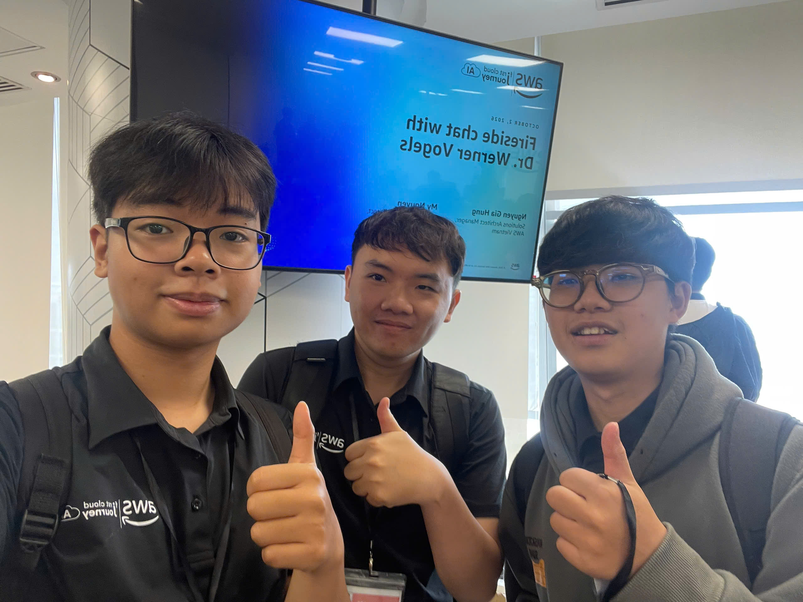

# Summary Report: “Fireside Chat with Dr. Werner”

- **Event Name:** Fireside Chat with Dr. Werner
- **Date & Time:** 08:30 – 12:00, October 2, 2026
- **Location:** 26th Floor Bitexco Financial Tower, 2 Hai Trieu Street, Saigon, Ho Chi Minh City 700000, Vietnam
- **Role:** Attendee

### Event Objectives

- Gain firsthand insights from Amazon CTO Dr. Werner Vogels on cloud computing, artificial intelligence, and the future of technology
- Learn lessons from building and operating systems at global scale
- Explore innovation, leadership, and emerging technology trends shaping digital transformation
- Engage through interactive Q&A and connect with students, developers, architects, engineers, and industry professionals

### Speakers

- **Dr. Werner Vogels** – Chief Technology Officer (CTO), Amazon.com

### Key Highlights

#### Insights from Amazon CTO Dr. Werner Vogels

- Heard firsthand perspectives from one of the most influential technology leaders and a pioneer in cloud computing
- Connected cloud foundations with emerging trends in artificial intelligence and digital transformation

#### Global-Scale Systems, Innovation & Leadership

- Explored lessons learned from building and operating systems at global scale
- Reflected on innovation, technical leadership, and how organizations prepare for the next generation of technology

#### Interactive Q&A & Community Networking

- Participated in interactive Q&A and community discussion around Cloud, AI, and building technology
- Connected with students, software engineers, developers, solution architects, DevOps engineers, data engineers, and AI practitioners

### Key Takeaways

#### Systems & Architecture at Scale

- **Global-scale engineering perspective**: Looking beyond isolated features to how systems are built, operated, and evolved at global scale
- **Cloud and AI direction**: Connecting foundational cloud principles with how AI and digital transformation are shaping future systems

#### Leadership, Innovation & Community

- **Learning from seasoned builders**: Hearing directly from an experienced technology leader clarifies how innovation and pragmatic engineering come together
- **Cross-role community exchange**: Comparing perspectives across students, developers, architects, DevOps/data engineers, and AI practitioners broadens how you view technical problems

### Applying to Work

- **Think about scale, reliability, and operations early**: Keep global-scale design and operational resilience in mind when building or evaluating cloud workloads
- **Stay close to Cloud and AI evolution**: Connect foundational cloud concepts with new AI capabilities rather than treating them in isolation
- **Engage actively in technical communities**: Take part in Q&A and discussions with peers from different engineering roles to sharpen problem-solving

### Event Experience

Attending the **“Fireside Chat with Dr. Werner”** session at Bitexco Financial Tower was a memorable opportunity to hear directly from Amazon CTO Dr. Werner Vogels alongside builders from across the community. Key experiences included:

#### Learning from a cloud pioneer
- Listening to Dr. Werner Vogels share insights on cloud computing, AI, innovation, leadership, and global-scale systems made large-scale engineering concepts feel much closer and clearer.
- The session offered valuable context on how technology trends translate into long-term system design and digital transformation.

#### Broad community perspective
- Being in a room with students, developers, architects, DevOps and data engineers, and AI practitioners created a strong environment for sharing ideas and viewpoints.
- Interactive Q&A helped bridge high-level architectural thinking with practical questions from builders.

#### Lessons learned
- Building and operating systems at scale requires looking at architecture, innovation, and leadership together rather than focusing on a single tool.
- Engaging with diverse builders and asking questions during Q&A helps turn big-picture talks into concrete takeaways for personal growth.

#### Some event photos

> Overall, the fireside chat offered inspiring perspectives from Dr. Werner Vogels on global-scale systems, Cloud, AI, and innovation, while enriching my connection with the builder community.