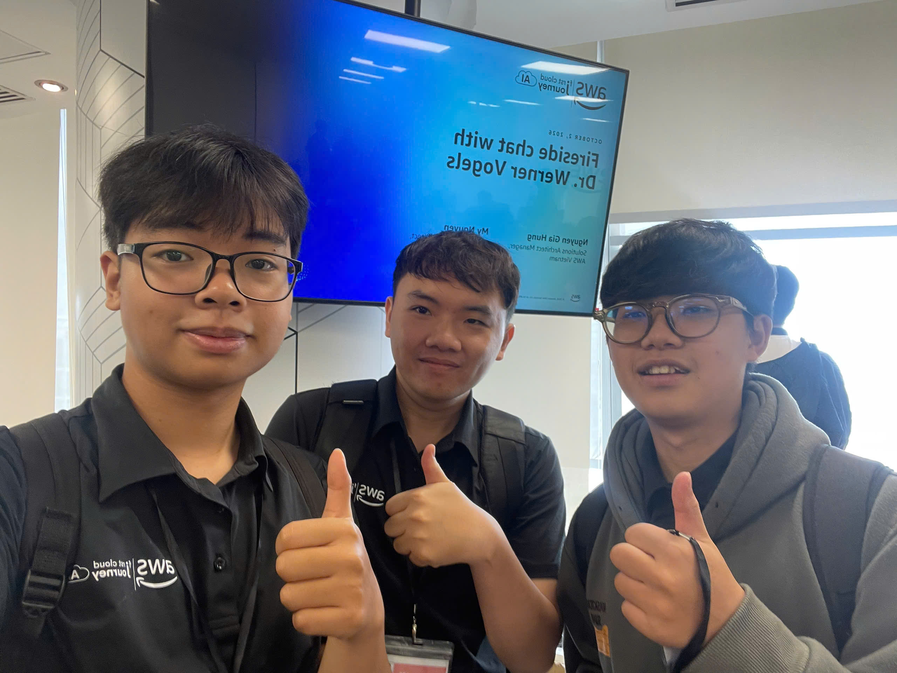

# Báo cáo tổng hợp: “Fireside Chat with Dr. Werner”

- **Tên sự kiện:** Fireside Chat with Dr. Werner
- **Ngày & Giờ:** 08:30 – 12:00, ngày 02/10/2026
- **Địa điểm:** Tầng 26 Bitexco Financial Tower, 2 Đ. Hải Triều, Sài Gòn, Hồ Chí Minh 700000, Việt Nam 
- **Vai trò:** Người tham dự

### Mục tiêu sự kiện

- Lắng nghe góc nhìn trực tiếp từ CTO của Amazon, Dr. Werner Vogels, về điện toán đám mây, trí tuệ nhân tạo và tương lai công nghệ
- Học hỏi kinh nghiệm xây dựng và vận hành các hệ thống ở quy mô toàn cầu
- Tìm hiểu về đổi mới sáng tạo, tư duy lãnh đạo và các xu hướng công nghệ định hình làn sóng chuyển đổi số tiếp theo
- Tham gia hỏi đáp tương tác và giao lưu, kết nối cùng sinh viên, lập trình viên, kiến trúc sư giải pháp, kỹ sư và người làm công nghệ

### Diễn giả

- **Dr. Werner Vogels** – Chief Technology Officer (CTO), Amazon.com

### Điểm nổi bật

#### Góc nhìn từ CTO Amazon – Dr. Werner Vogels

- Tiếp nhận chia sẻ trực tiếp từ một trong những nhà lãnh đạo công nghệ có tầm ảnh hưởng lớn và là người tiên phong trong điện toán đám mây
- Gắn kết nền tảng cloud với các xu hướng mới về trí tuệ nhân tạo và chuyển đổi số

#### Hệ thống quy mô toàn cầu, Đổi mới & Lãnh đạo

- Khám phá các bài học từ việc xây dựng và vận hành hệ thống ở quy mô toàn cầu
- Nhìn nhận rõ hơn về đổi mới sáng tạo, vai trò lãnh đạo công nghệ và cách các tổ chức thích ứng với thế hệ công nghệ tiếp theo

#### Hỏi đáp tương tác & Kết nối cộng đồng

- Tham gia phiên Q&A và trao đổi trực tiếp xoay quanh Cloud, AI và hành trình làm công nghệ
- Giao lưu cùng cộng đồng sinh viên, software engineers, developers, solution architects, DevOps engineers, data engineers và AI practitioners

### Bài học chính

#### Hệ thống & Kiến trúc ở quy mô lớn

- **Tư duy xây dựng và vận hành ở quy mô toàn cầu**: Nhìn nhận bài toán hệ thống rộng hơn việc làm ra một tính năng đơn lẻ, chú trọng cách hệ thống vận hành và phát triển ở quy mô lớn
- **Mối liên hệ giữa Cloud và AI**: Đặt các kiến thức nền tảng về cloud cạnh sự phát triển của AI và chuyển đổi số để có bức tranh tổng thể

#### Lãnh đạo, Đổi mới & Cộng đồng

- **Học từ người đi trước dày dạn kinh nghiệm**: Lắng nghe chia sẻ thực tế từ lãnh đạo công nghệ giúp hiểu cách kết hợp đổi mới sáng tạo với kỹ thuật vững chắc
- **Trao đổi đa góc nhìn trong cộng đồng**: Tiếp xúc với nhiều vai trò từ sinh viên đến kỹ sư, kiến trúc sư giúp mở rộng cách nhìn nhận vấn đề

### Áp dụng vào công việc

- **Chú trọng quy mô, tính ổn định và khả năng vận hành**: Mang tư duy về vận hành và khả năng mở rộng vào quá trình học tập, làm lab và xây dựng hệ thống trên cloud
- **Kết nối kiến thức Cloud với xu hướng AI**: Theo dõi cách cloud và AI bổ trợ cho nhau thay vì học tách rời từng mảng
- **Chủ động tham gia thảo luận và kết nối cộng đồng**: Tận dụng các buổi Q&A và giao lưu để học hỏi thêm kinh nghiệm thực tế từ người cùng ngành

### Trải nghiệm sự kiện

Tham dự buổi **“Fireside Chat with Dr. Werner”** tại Bitexco Financial Tower là một cơ hội đáng nhớ khi được lắng nghe trực tiếp CTO của Amazon, Dr. Werner Vogels, cùng trao đổi với cộng đồng những người làm công nghệ. Những trải nghiệm chính bao gồm:

#### Học hỏi từ người tiên phong trong mảng Cloud
- Các chia sẻ của Dr. Werner Vogels về điện toán đám mây, AI, đổi mới sáng tạo, lãnh đạo và hệ thống quy mô toàn cầu giúp những khái niệm về hệ thống lớn trở nên rõ ràng và truyền cảm hứng hơn.
- Buổi trò chuyện mang lại nhiều góc nhìn thực tế về cách các xu hướng công nghệ tác động đến kiến trúc hệ thống và chuyển đổi số.

#### Góc nhìn đa dạng từ cộng đồng
- Không gian quy tụ sinh viên, lập trình viên, kiến trúc sư giải pháp, kỹ sư DevOps/dữ liệu và người làm AI tạo nên bầu không khí trao đổi cởi mở và nhiều năng lượng.
- Phần hỏi đáp tương tác giúp kết nối các ý tưởng lớn với những câu hỏi thực tế của người làm kỹ thuật.

#### Bài học rút ra
- Xây dựng và vận hành hệ thống ở quy mô lớn đòi hỏi nhìn đồng bộ cả kiến trúc, đổi mới sáng tạo lẫn cách tổ chức và lãnh đạo.
- Chủ động lắng nghe, đặt câu hỏi trong Q&A và kết nối với cộng đồng giúp biến những buổi chia sẻ định hướng thành bài học cụ thể cho bản thân.

#### Một số hình ảnh sự kiện

> Nhìn chung, buổi fireside chat mang lại những góc nhìn sâu sắc từ Dr. Werner Vogels về hệ thống quy mô toàn cầu, Cloud, AI và đổi mới sáng tạo, đồng thời giúp mình kết nối thêm với cộng đồng công nghệ.