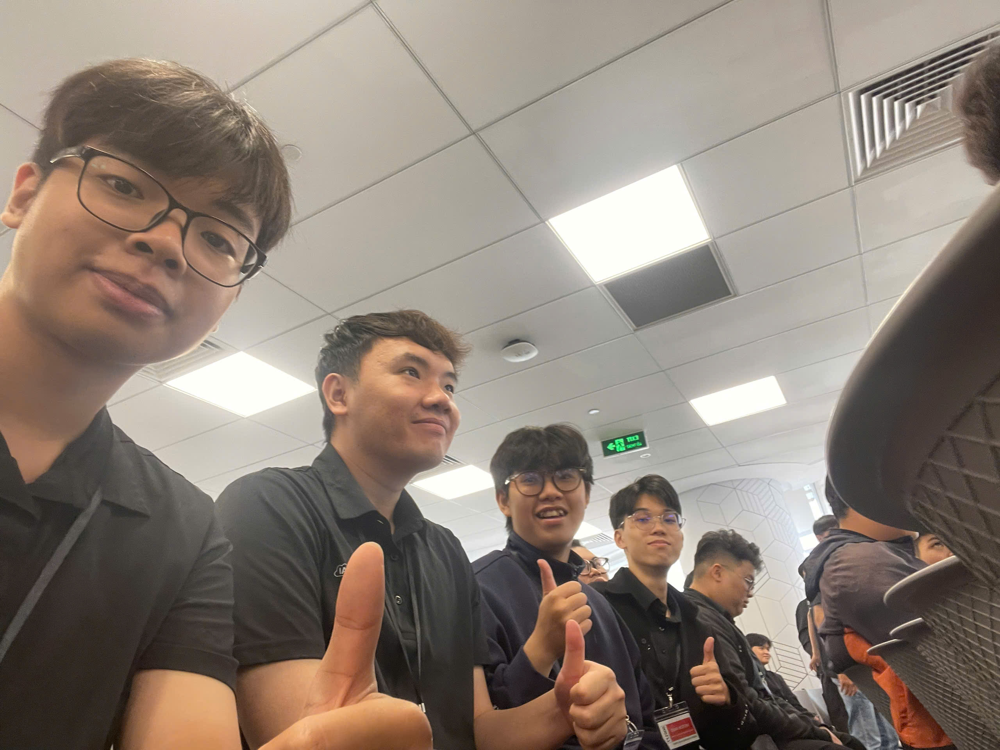

# Summary Report: “First Cloud AI Journey: Weekly Meet Up 14/11”

- **Event Name:** First Cloud AI Journey: Weekly Meet Up 14/11
- **Date & Time:** November 14, 2026
- **Location:** AWS Vietnam Office, Ho Chi Minh City, Vietnam
- **Organizers:** AWS First Cloud Journey (FCJ) & AWS Study Group
- **Role:** Attendee

### Event Objectives

- Understand how to evolve AI agent solutions from early prototypes into secure, reliable, and scalable production systems
- Explore the architecture and core building blocks of *Amazon Bedrock AgentCore* for large-scale enterprise environments
- Learn how Multi-AZ AWS infrastructure, access control, and memory management support production AI agents
- Engage in interactive Q&A, reinforce concepts through a live quiz, and connect with the AWS First Cloud Journey (FCJ) community

### Speakers

- **Nguyễn Lâm Anh** – AWS First Cloud Journey (FCJ) Member
- **Trần Phương Huyền** – AWS First Cloud Journey (FCJ) Member
- **Phúc Khang** – AWS First Cloud Journey (FCJ) Member
- **Huỳnh An Khương** – AWS First Cloud Journey (FCJ) Member
- **Nguyễn Quốc Bảo** – AWS First Cloud Journey (FCJ) Member

### Key Highlights

#### Transitioning AI Solutions from Prototype to Production

- Explored the theme *"From Prototype to Production: Secure, Reliable, Scalable Enterprise AI on the Cloud,"* emphasizing that building a working chatbot is only the starting point
- Highlighted three core operational challenges: balancing latency and inference/infrastructure costs, enforcing strict access boundaries when integrating external systems, and monitoring/evaluating agent reasoning and actions

#### Scalable Enterprise Architecture with Amazon Bedrock AgentCore

- Examined how *Amazon Bedrock AgentCore* supports deployments spanning hundreds of agents, thousands of tools, hundreds of MCP servers, and over 100,000 tenants
- Reviewed the reusable *Universal 5-Step Skeleton* for inbound and outbound security using *Bedrock AgentCore Gateway* and *AgentCore Identity* (verifying JWT or IAM credentials before allowing tool or MCP server calls)
- Covered *AgentCore Memory* across *Short-term Memory* (synchronous session context) and *Long-term Memory* (asynchronous extraction into *Semantic*, *User Preferences*, *Summarization*, and *Episodic* categories)
- Discussed *Multi-AZ* AWS infrastructure practices including public/private subnet isolation, load balancing, an agent orchestration layer, and end-to-end observability

#### Interactive Q&A, Quiz & Community Networking

- Participated in practical Q&A covering how to scope agent permissions for production backends, manage operational costs, and prepare for careers in Cloud and AI
- Reinforced key concepts through an *Interactive Quiz* on Gateway authorization, AgentCore memory types, and Multi-AZ deployment
- Learned about the upcoming *AWS Student Community Day Vietnam 2026* event for broader community learning and networking

### Key Takeaways

#### Architecture & Security for AI Agents

- **Production readiness goes beyond chat**: Enterprise AI agents require upfront design for access control (Gateway and Identity), structured long-term memory, and continuous behavioral monitoring
- **Pairing AgentCore with resilient AWS infrastructure**: Running *Amazon Bedrock AgentCore* on a Multi-AZ VPC foundation provides high availability and reliable scalability

#### Community & Continuous Growth

- **Learning from practical engineering walkthroughs**: Insights from FCJ speakers clarified real-world trade-offs across security, performance, and cost
- **Active participation reinforces understanding**: Joining Q&A discussions and the closing quiz helped lock in core architectural patterns on the spot

### Applying to Work

- **Enforce strict permission boundaries for AI workflows**: Apply identity verification and least-privilege access controls whenever connecting AI or automated agents to backend services
- **Monitor observability and costs early**: Track latency, token consumption, and infrastructure usage from early testing phases so workloads scale predictably
- **Stay engaged with the AWS & AI community**: Continue attending technical meetups and community events such as AWS Student Community Day to keep pace with evolving cloud architectures

### Event Experience

Attending the **“First Cloud AI Journey: Weekly Meet Up 14/11”** session at the AWS Vietnam office was a valuable opportunity to learn how AI agents are engineered for real-world production environments. Key experiences included:

#### Practical Architecture Walkthrough from FCJ Builders
- The speakers clearly laid out the journey from simple AI prototypes to production-ready systems, making *Amazon Bedrock AgentCore* concepts concrete and approachable.
- Breaking down security layers, memory management, and Multi-AZ infrastructure provided a well-rounded architectural view.

#### Energetic Q&A and Interactive Quiz
- Students and attendees raised practical questions around backend permission scoping and Cloud/AI career paths, sparking lively two-way discussions.
- The closing interactive quiz kept the energy high while providing a quick check on key architectural takeaways.

#### Lessons Learned
- Running reliable AI systems depends not only on model responses, but also on authentication boundaries, context management, Multi-AZ resilience, and observability underneath.
- Regular participation in community meetups helps translate emerging cloud capabilities into practical engineering habits.

#### Some event photos

> Overall, the November 14 Weekly Meet Up offered a clear architectural blueprint for taking AI agents from prototype to secure, reliable, and scalable production with *Amazon Bedrock AgentCore*.