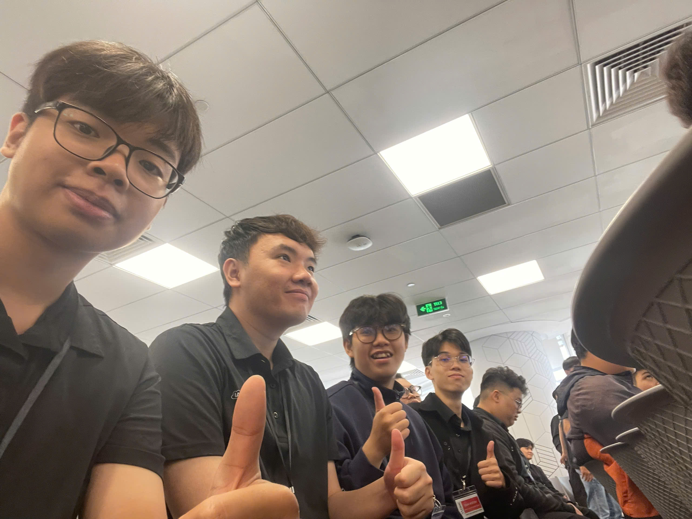

# Báo cáo tổng hợp: “First Cloud AI Journey: Weekly Meet Up 14/11”

- **Tên sự kiện:** First Cloud AI Journey: Weekly Meet Up 14/11
- **Ngày & Giờ:** Ngày 14/11/2026
- **Địa điểm:** Văn phòng AWS Việt Nam, TP. Hồ Chí Minh
- **Ban tổ chức:** AWS First Cloud Journey (FCJ) & AWS Study Group
- **Vai trò:** Người tham dự

### Mục tiêu sự kiện

- Tìm hiểu lộ trình đưa các ứng dụng AI Agent từ bản thử nghiệm (prototype) lên môi trường vận hành thực tế (production) một cách an toàn, tin cậy và có khả năng mở rộng
- Khám phá kiến trúc và các thành phần cốt lõi của *Amazon Bedrock AgentCore* trong môi trường doanh nghiệp quy mô lớn
- Nắm bắt cách tổ chức hạ tầng AWS Multi-AZ, cơ chế phân quyền và quản lý bộ nhớ cho hệ thống AI Agent
- Tham gia hỏi đáp tương tác, ôn tập kiến thức qua quiz và kết nối cùng cộng đồng AWS First Cloud Journey (FCJ)

### Diễn giả

- **Nguyễn Lâm Anh** – Thành viên AWS First Cloud Journey (FCJ)
- **Trần Phương Huyền** – Thành viên AWS First Cloud Journey (FCJ)
- **Phúc Khang** – Thành viên AWS First Cloud Journey (FCJ)
- **Huỳnh An Khương** – Thành viên AWS First Cloud Journey (FCJ)
- **Nguyễn Quốc Bảo** – Thành viên AWS First Cloud Journey (FCJ)

### Điểm nổi bật

#### Chuyển dịch giải pháp AI từ Prototype lên Production

- Phân tích chủ đề *"From Prototype to Production: Secure, Reliable, Scalable Enterprise AI on the Cloud"*, làm rõ lý do vì sao một chatbot chạy được mới chỉ là bước khởi đầu
- Chỉ ra ba thách thức trọng tâm khi vận hành thực tế: tối ưu hiệu năng và chi phí suy luận mô hình, kiểm soát chặt quyền truy cập khi tích hợp hệ thống bên ngoài, và giám sát/đánh giá chất lượng suy luận của agent

#### Kiến trúc mở rộng quy mô với Amazon Bedrock AgentCore

- Giới thiệu mô hình đáp ứng quy mô hàng trăm agent, hàng nghìn công cụ, hàng trăm MCP server và hơn 100.000 tenant
- Trình bày khung xác thực & phân quyền *Universal 5-Step Skeleton* qua *Bedrock AgentCore Gateway* và *AgentCore Identity* (sử dụng JWT hoặc IAM trước khi gọi công cụ/MCP server)
- Phân tích cơ chế quản lý ngữ cảnh với *AgentCore Memory* gồm *Short-term Memory* (đồng bộ theo phiên) và *Long-term Memory* (bất đồng bộ theo 4 nhóm: *Semantic*, *User Preferences*, *Summarization*, *Episodic*)
- Đề cập kiến trúc hạ tầng AWS *Multi-AZ* với phân tách public/private subnet, load balancing, lớp điều phối agent và giám sát toàn diện (observability)

#### Hỏi đáp tương tác, Quiz & Kết nối cộng đồng

- Tham gia phiên Q&A sôi nổi xoay quanh việc giới hạn quyền cho AI agent khi kết nối backend production, tối ưu chi phí vận hành và định hướng nghề nghiệp mảng Cloud & AI
- Củng cố kiến thức qua phần *Interactive Quiz* cuối buổi về Gateway authorization, AgentCore Memory và triển khai Multi-AZ
- Cập nhật thông tin về sự kiện lớn sắp tới *AWS Student Community Day Vietnam 2026*

### Bài học chính

#### Kiến trúc & Bảo mật cho AI Agent

- **Sẵn sàng cho Production vượt xa một chatbot cơ bản**: Thiết kế AI agent doanh nghiệp cần đặt kiểm soát truy cập (Gateway & Identity), quản lý bộ nhớ có cấu trúc và cơ chế giám sát hành vi ngay từ đầu
- **Kết hợp AgentCore với hạ tầng AWS vững chắc**: Việc gắn *Amazon Bedrock AgentCore* trên nền tảng VPC Multi-AZ giúp đảm bảo tính sẵn sàng cao và khả năng mở rộng ổn định

#### Cộng đồng & Phát triển chuyên môn

- **Học hỏi từ trải nghiệm triển khai thực tế**: Các chia sẻ trực tiếp từ thành viên FCJ giúp nhìn rõ những đánh đổi kỹ thuật giữa chi phí, hiệu năng và bảo mật
- **Tương tác giúp nhớ lâu hơn**: Thảo luận Q&A và làm quiz trực tiếp giúp hệ thống hóa lại các mảnh ghép kiến trúc ngay tại buổi học

### Áp dụng vào công việc

- **Thiết lập ranh giới phân quyền chặt chẽ cho AI**: Áp dụng tư duy kiểm soát danh tính và quyền truy cập tối thiểu khi tích hợp AI hoặc dịch vụ tự động hóa vào hệ thống backend
- **Chú trọng giám sát và dự toán chi phí sớm**: Theo dõi mức tiêu thụ token, độ trễ và chi phí hạ tầng ngay từ giai đoạn thử nghiệm để tránh phát sinh ngoài kiểm soát
- **Tiếp tục bám sát hệ sinh thái AWS & AI**: Tích cực tham gia các buổi chia sẻ chuyên môn và sự kiện cộng đồng như AWS Student Community Day để cập nhật kiến trúc mới

### Trải nghiệm sự kiện

Tham dự buổi **“First Cloud AI Journey: Weekly Meet Up 14/11”** tại văn phòng AWS Việt Nam mang lại nhiều kiến thức thực tiễn về cách xây dựng và vận hành AI Agent trên đám mây. Những trải nghiệm đáng nhớ bao gồm:

#### Tiếp cận kiến trúc thực tế từ cộng đồng FCJ
- Các diễn giả trình bày mạch lạc hành trình đưa AI từ bản demo lên hệ thống production, giúp các khái niệm về *Amazon Bedrock AgentCore* trở nên dễ hình dung và sát thực tế hơn.
- Cách phân tích rõ ràng từng lớp bảo mật, bộ nhớ và hạ tầng Multi-AZ mang lại góc nhìn tổng thể khi thiết kế ứng dụng AI.

#### Không khí học hỏi cởi mở và năng động
- Các bạn sinh viên và người tham dự đặt nhiều câu hỏi thực tế về phân quyền backend và lộ trình nghề nghiệp Cloud/AI, tạo nên buổi thảo luận hai chiều rất sôi nổi.
- Phần quiz cuối giờ giúp không khí thêm hào hứng đồng thời kiểm tra lại nhanh những điểm kỹ thuật cốt lõi vừa nghe.

#### Bài học rút ra
- Một hệ thống AI tốt không chỉ nằm ở mô hình trả lời thông minh mà còn ở lớp xác thực, quản lý ngữ cảnh, khả năng chịu lỗi Multi-AZ và giám sát vận hành phía sau.
- Việc duy trì tham gia các buổi meet-up định kỳ giúp cập nhật nhanh công nghệ mới và mở rộng kết nối với những người cùng đam mê Cloud & AI.

#### Một số hình ảnh sự kiện

> Nhìn chung, buổi Weekly Meet Up 14/11 đã mang lại bức tranh rõ nét về kiến trúc *Amazon Bedrock AgentCore* và những tiêu chuẩn cần có để đưa AI Agent từ thử nghiệm lên vận hành thực tế an toàn, bền vững.