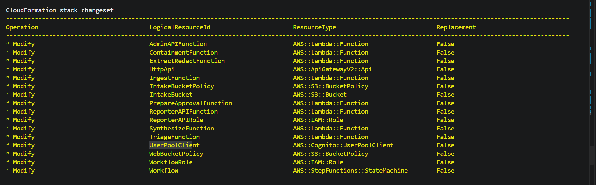

---
title: "Deploy the backend"
weight: 3
chapter: false
---

Open `template.yaml` in the lab directory. Identify the eight functions, three DynamoDB tables, five ordinary S3 buckets, KMS key, Standard state machine, SNS topic and dead-letter queue. The CloudFront distribution and SES receipt rules are separate setup steps. On a new account, enter the verified reporter **sender** domain as the allowed domain. SAM creates a managed packaging bucket when needed.

```powershell
$pgSenderDomain = Read-Host 'Mien email cua reporter, vi du congty.vn'
sam validate --lint --template-file template.yaml --region $pgRegion --profile $pgProfile
if ($LASTEXITCODE -ne 0) { throw 'Template chua hop le.' }
sam build --template-file template.yaml
if ($LASTEXITCODE -ne 0) { throw 'Build that bai.' }
sam deploy --template-file .aws-sam/build/template.yaml --stack-name $pgStack --region $pgRegion --profile $pgProfile --resolve-s3 --capabilities CAPABILITY_NAMED_IAM --parameter-overrides "AllowedSenderDomains=$pgSenderDomain" "ContainmentMode=DRY_RUN" --confirm-changeset
if ($LASTEXITCODE -ne 0) { throw 'Kiem tra su kien CloudFormation.' }
```



Review the change set. A fresh stack creates resources. For an update, examine replacements and removals of buckets/tables before confirming. If native dependencies fail to build, use Docker with `sam build --use-container` and deploy that build.

```powershell
function Get-PgStack {
  $raw = aws cloudformation describe-stacks --stack-name $pgStack --region $pgRegion --profile $pgProfile --output json --no-cli-pager
  if ($LASTEXITCODE -ne 0) { throw 'Khong doc duoc stack.' }
  (($raw -join "`n") | ConvertFrom-Json).Stacks[0]
}
$pg = Get-PgStack
$pgOut = @{}
foreach ($o in $pg.Outputs) { $pgOut[$o.OutputKey] = $o.OutputValue }
$pg.StackStatus
$pgOut['WebBucketName']
([uri]$pgOut['HttpApiEndpoint']).Host
```

Record the web bucket, HTTP API host, user pool/client IDs and SecOps topic ARN from Outputs. Continue after CREATE_COMPLETE or UPDATE_COMPLETE.

