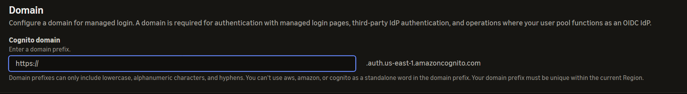
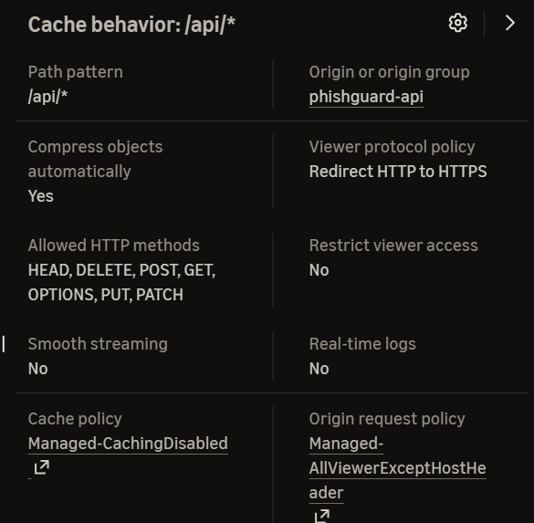

---
title: "Triển khai cổng báo cáo"
weight: 4
chapter: false
---

1. Trong **Cognito → User pools → PhishGuard-Users → Domain**, chọn prefix còn trống trong `us-east-1`. Ghi domain đầy đủ. Dùng public app client `PhishGuard-Web` có authorization code flow và PKCE. Khi tạo hosted domain bằng CLI, lựa chọn classic hosted UI cũng dùng được với ứng dụng này. Nếu chọn managed login v2, bảo đảm đã gán branding cho app client.
2. Trong **CloudFront**, tạo hoặc mở distribution cho web. Dùng tên bucket và hostname API từ Outputs. Với hai origin cùng trỏ S3, chọn origin có **Origin access control**, kiểm tra tên target trên behavior; chỉ cần một origin khác cho API. Đặt default root object là `index.html`.

| Behavior | Origin / protocol | Cache và header |
|---|---|---|
| `Default (*)` | Bucket web, endpoint S3 REST, OAC ký request, redirect HTTP sang HTTPS | Cache tối ưu cho static asset. Nếu dùng deep link, publish CloudFront Function `frontend/deploy/cloudfront-spa-router.js` và liên kết **viewer-request** riêng ở behavior này. |
| `/api/*` | Host `…execute-api.us-east-1.amazonaws.com`, HTTPS only, Origin path rỗng vì stage là `$default` | Cho phép mọi HTTP method của preset để có POST; chọn **CachingDisabled** và **AllViewerExceptHostHeader**. JWT từ trình duyệt đi đến HTTP API. Đặt behavior này trước default. |



*Hình 3. Nhập phần prefix, sau đó dùng toàn bộ hostname do Cognito cấp khi build frontend.*

3. Ghi Distribution ID và domain `d….cloudfront.net`. Dùng hàm dưới đây để cập nhật SAM ở lab này và lab Bedrock. Hàm đọc tham số **đang chạy**, rồi thay đúng các mục yêu cầu. Có thể dùng hàm này cho stack hiện có sau khi xác nhận mình đang cầm đúng bản source của stack.

```powershell
function Update-PgStack([hashtable] $changes) {
  $all = @{}
  foreach ($p in (Get-PgStack).Parameters) {
    if ($null -ne $p.ParameterValue -and "$($p.ParameterValue)" -ne '') {
      $all[$p.ParameterKey] = [string]$p.ParameterValue
    }
  }
  foreach ($name in $changes.Keys) { $all[$name] = [string]$changes[$name] }
  $overrides = @(foreach ($name in $all.Keys) { "$name=$($all[$name])" })
  sam deploy --template-file .aws-sam/build/template.yaml --stack-name $pgStack --region $pgRegion --profile $pgProfile --resolve-s3 --capabilities CAPABILITY_NAMED_IAM --parameter-overrides @overrides --confirm-changeset --no-fail-on-empty-changeset
  if ($LASTEXITCODE -ne 0) { throw 'Kiem tra change set va su kien stack.' }
}
$pgDist = (Read-Host 'CloudFront distribution ID').Trim()
$pgSite = 'https://' + (Read-Host 'Chi nhap hostname CloudFront').Trim().TrimEnd('/')
Update-PgStack @{CloudFrontDistributionId=$pgDist; CloudFrontOrigin=$pgSite; DashboardUrl="$pgSite/"}
```

Cùng một lần cập nhật sẽ cho OAC quyền đọc đúng web bucket, cho phép origin của web POST trực tiếp tới intake và đăng ký URL callback/logout trên Cognito. Kiểm tra 2 URL kết thúc bằng `/`. [CloudFront OAC cho S3](https://docs.aws.amazon.com/AmazonCloudFront/latest/DeveloperGuide/private-content-restricting-access-to-s3.html) · [Managed origin request policies](https://docs.aws.amazon.com/AmazonCloudFront/latest/DeveloperGuide/using-managed-origin-request-policies.html)

4. Tạo người dùng demo và seed ba mẫu đã cố định theo SHA-256. Script yêu cầu ba email thuộc quyền quản lý của nhóm và nhập mật khẩu ẩn. Để chạy H02, vào Cognito → Users, tạo `demo-reporter-2` với email riêng, thêm vào nhóm `REPORTER` rồi đăng nhập lần đầu để đổi mật khẩu tạm. Mở **SNS → Topics → PhishGuard-SecOps → Create subscription**, chọn `Email`, nhập địa chỉ SecOps, rồi bấm **Confirm subscription** trong thư. Kiểm tra trạng thái `Confirmed`.

```powershell
.\.venv\Scripts\python.exe scripts/create_demo_users.py --profile $pgProfile
.\.venv\Scripts\python.exe scripts/seed_demo_fixtures.py --profile $pgProfile
```

5. Nhập prefix Cognito vừa chọn để build cấu hình live. Các biến `VITE_*` dưới đây là cấu hình công khai của SPA; secret và thông tin xác thực AWS thuộc về môi trường triển khai.

```powershell
$pgPrefix = (Read-Host 'Prefix Cognito da tao').Trim()
$pgEvidence = $pgOut['EvidenceBucketName']
$envFile = @"
VITE_USE_MOCK=false
VITE_COGNITO_REGION=$pgRegion
VITE_COGNITO_USER_POOL_ID=$($pgOut['UserPoolId'])
VITE_COGNITO_CLIENT_ID=$($pgOut['UserPoolClientId'])
VITE_COGNITO_DOMAIN=https://$pgPrefix.auth.$pgRegion.amazoncognito.com
VITE_COGNITO_REDIRECT_URI=$pgSite/
VITE_COGNITO_LOGOUT_URI=$pgSite/
VITE_COGNITO_SCOPES=openid email profile
VITE_EVIDENCE_ALLOWED_HOSTS=$pgEvidence.s3.$pgRegion.amazonaws.com,$pgEvidence.s3.amazonaws.com
"@
[IO.File]::WriteAllText((Join-Path $PWD 'frontend/.env.production.local'), $envFile)
Push-Location frontend
try {
  npm ci
  if ($LASTEXITCODE -ne 0) { throw 'npm ci that bai.' }
  npm run build
  if ($LASTEXITCODE -ne 0) { throw 'Build web that bai.' }
  $web = 's3://' + $pgOut['WebBucketName'] + '/'
  aws s3 sync dist/ $web --exclude index.html --region $pgRegion --profile $pgProfile
  if ($LASTEXITCODE -ne 0) { throw 'Upload assets that bai. Kiem tra ListBucket va PutObject tren web bucket.' }
  aws s3 cp dist/index.html ($web + 'index.html') --content-type text/html --cache-control no-cache --region $pgRegion --profile $pgProfile
  if ($LASTEXITCODE -ne 0) { throw 'Upload index that bai.' }
} finally { Pop-Location }
aws cloudfront create-invalidation --distribution-id $pgDist --paths "/" "/index.html" --profile $pgProfile
```

**Mốc kiểm tra.** Mở URL CloudFront, đăng nhập và gửi thông báo nội bộ “Máy in tầng hai đang được bảo trì. Có thể dùng máy in ở tầng một.” Trong Network, `POST /api/reports` trả 202. Với ảnh PNG khác, chờ `/api/uploads/presign` trả 201, sau đó POST tới S3 trả 204. Lưu mã incident để đối chiếu khi mở trang chi tiết.

### Kiểm tra đường API

Trong Behaviors, mở /api/*. Ảnh cho thấy origin phishguard-api nhận POST, dùng CachingDisabled và AllViewerExceptHostHeader. Đây là ba mục cần đối chiếu khi web đã mở được nhưng gửi báo cáo lỗi.



