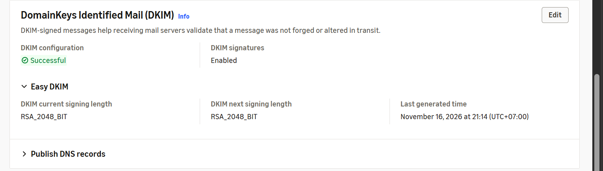
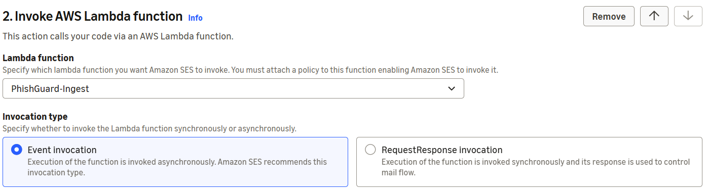

---
title: "Receive email and connect Bedrock"
weight: 5
chapter: false
---

Choose a dedicated receiving subdomain and verify the identity/DKIM records in SES in us-east-1. Point its MX (priority 10) to `inbound-smtp.us-east-1.amazonaws.com`. In the active receipt rule set add an enabled rule for the lab recipient. First deliver to the stack intake bucket under `inbound/`, then invoke PhishGuard-Ingest asynchronously. Forward a benign email from an allowed, verified reporter. Check the S3 object and a matching SES_EMAIL incident. For an unverified sender inspect the outer message identity, allowed domains and verdict.

Sync the bundled playbooks. The prerequisite template creates a vector bucket, a 1,024-dimensional cosine index and the setup role/policy. The commands below apply to a lab IAM user. For Identity Center use the equivalent role-based setup with your administrator.

```powershell
$kbDocs = $pgOut['KbDocsBucketName']
aws s3 sync .\kb-docs\playbooks\ "s3://$kbDocs/playbooks/" --region $pgRegion --profile $pgProfile
if ($LASTEXITCODE -ne 0) { throw 'Upload playbook that bai.' }
$kbUser = Read-Host 'Ten IAM user thuc hien setup KB trong tai khoan lab'
aws cloudformation deploy --template-file infra/phishguard-kb-prereqs.yaml --stack-name phishguard-kb-prereqs --capabilities CAPABILITY_NAMED_IAM --parameter-overrides "SetupUserName=$kbUser" --region $pgRegion --profile $pgProfile
if ($LASTEXITCODE -ne 0) { throw 'Chua tao duoc tai nguyen KB.' }
.\.venv\Scripts\python.exe scripts/setup_phishguard_kb.py --profile $pgProfile
```

Look for PHISHGUARD_KB_RETRIEVE_PASS and a playbook citation. In Bedrock create an input prompt-attack filter in a guardrail, publish a numbered version and record its ID. Confirm model or inference profile availability for Nova Lite. When using a profile, specify the profile ID and the invocation resource ARNs required for it.

```powershell
$kb = Read-Host 'KnowledgeBaseId'
$gr = Read-Host 'GuardrailId'
$gv = Read-Host 'GuardrailVersion da phat hanh'
Update-PgStack @{KnowledgeBaseId=$kb; GuardrailId=$gr; GuardrailVersion=$gv}
```

Run DEMO_2 and inspect its synthesis source and fallback_reason. A successful KB retrieval, a model response and an observed guardrail intervention are three separate observations. Capture each outcome that occurred.

### Verify the receiving domain

The SES identity shows DKIM configuration Successful and signatures Enabled. Next, verify the receipt rule in the active rule set and trace one forwarded email to an incident.



### Invoke Ingest after the S3 action

In step 2 of the receipt rule, choose PhishGuard-Ingest and Event invocation. The preceding action must have written the MIME object to inbound/. The screenshot shows the selected settings during setup.



