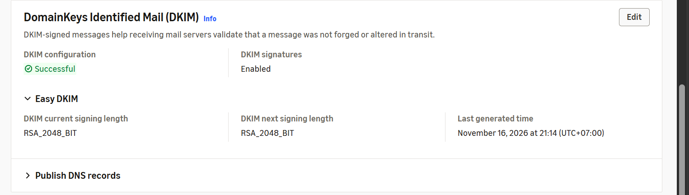
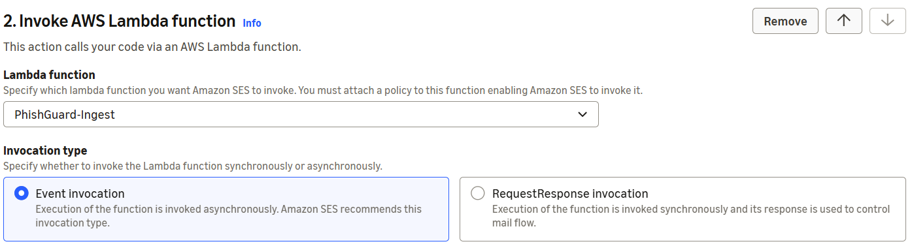

---
title: "Nhận email và kết nối Bedrock"
weight: 5
chapter: false
---

**Email qua SES.** Chọn SES ở **us-east-1**, tạo domain identity bạn quản lý, xuất bản bản ghi xác minh/DKIM được console cấp và đợi `Verified`. Tại DNS thêm MX với priority 10 trỏ `inbound-smtp.us-east-1.amazonaws.com` cho domain **nhận**. Nếu miền chính đang nhận thư qua hệ thống khác, dùng một subdomain lab, rồi dùng địa chỉ `soc@` của subdomain đó. Giữ nguyên MX của miền chính.

1. Trong **Email receiving → Receipt rule sets**, mở bộ rule đang active hoặc tạo cho môi trường lab. Nếu đã có mail nghiệp vụ, thêm rule vào bộ đang dùng và xem thứ tự rule trước đó.
2. Tạo rule cho đúng một địa chỉ nhận. Action đầu là **Deliver to S3**, chọn intake bucket của stack và prefix `inbound/`. Action tiếp theo là **Invoke Lambda**, chọn `PhishGuard-Ingest` và kiểu `Event` (asynchronous). Rule phải Enabled; stack cấp quyền nhận từ SES và ghi đúng prefix.
3. Từ hộp thư Cognito đã xác minh và thuộc `AllowedSenderDomains`, forward một thư vô hại. Tìm object mới trong `inbound/`, rồi tra cùng incident trong dashboard. Các trường mong đợi là `source_channel=SES_EMAIL` và `reporter_identity_status=VERIFIED_SES_DMARC`. Nếu log hiện `UNVERIFIED_SENDER`, đối chiếu email lớp ngoài, miền cho phép, email_verified và verdict SES.

[Cấu hình MX cho SES](https://docs.aws.amazon.com/ses/latest/dg/receiving-email-mx-record.html) · [Receipt rules](https://docs.aws.amazon.com/ses/latest/dg/receiving-email-receipt-rules-console-walkthrough.html)

**Knowledge Base, Guardrail và model.** Nội dung ảnh đi qua Tesseract ở ExtractRedact. Bedrock nhận dữ liệu đã qua xử lý để tổng hợp. Lưu một lượt Retrieve có nguồn playbook và một kết quả tổng hợp để kiểm chứng hai bước độc lập này.

1. Đồng bộ các playbook trong gói. File `infra/phishguard-kb-prereqs.yaml` tạo vector bucket, index `playbooks` 1.024 chiều cosine, role cho KB và policy setup gắn với IAM user được chỉ định. Với môi trường IAM Identity Center, quản trị viên triển khai các tài nguyên tương ứng và gán quyền setup cho role được dùng, thay phần đính kèm vào IAM user.
2. Với người triển khai dùng IAM user của lab, chạy các lệnh sau sau khi stack chính đã tạo bucket KB. Script kiểm index, tạo hoặc tái sử dụng KB/data source, đợi đồng bộ rồi thử Retrieve.

```powershell
$kbDocs = $pgOut['KbDocsBucketName']
aws s3 sync .\kb-docs\playbooks\ "s3://$kbDocs/playbooks/" --region $pgRegion --profile $pgProfile
if ($LASTEXITCODE -ne 0) { throw 'Upload playbook that bai.' }
$kbUser = Read-Host 'Ten IAM user thuc hien setup KB trong tai khoan lab'
aws cloudformation deploy --template-file infra/phishguard-kb-prereqs.yaml --stack-name phishguard-kb-prereqs --capabilities CAPABILITY_NAMED_IAM --parameter-overrides "SetupUserName=$kbUser" --region $pgRegion --profile $pgProfile
if ($LASTEXITCODE -ne 0) { throw 'Chua tao duoc tai nguyen KB.' }
.\.venv\Scripts\python.exe scripts/setup_phishguard_kb.py --profile $pgProfile
```

| Trường cần đối chiếu ở Bedrock và S3 Vectors | Giá trị của lab |
|---|---|
| Vector store và index | Amazon S3 Vectors · `playbooks` |
| Embedding | Titan Text Embeddings V2, float32, 1.024 chiều, cosine |
| Nguồn tài liệu và minh chứng | Prefix `playbooks/` trong bucket KB docs. Lần ingestion gần nhất COMPLETE, kết quả Retrieve dẫn về một tài liệu trong prefix. |

3. Ghi `KnowledgeBaseId` khi script báo `GATE: PHISHGUARD_KB_RETRIEVE_PASS`. Trong **Bedrock → Guardrails**, tạo guardrail với bộ lọc **Prompt attacks** trên input, đặt hành vi chặn, tạo phiên bản và ghi ID/version. Trong Model catalog xác nhận tài khoản có thể gọi Nova Lite v1 hoặc đúng inference profile được cấp cho vùng. Nếu dùng inference profile, điền `ModelId` của profile và `ModelInvokeResourceArns` gồm chính xác các ARN cần cho profile và model đích.
4. Cập nhật backend, sau đó chạy `DEMO_2` để xem phần tổng hợp. Khi gặp `FALLBACK`, đọc `fallback_reason`, kiểm tra trạng thái đồng bộ dữ liệu, ID/version Guardrail và quyền Retrieve/InvokeModel của Synthesize trước khi kết luận model đã chạy thành công.

```powershell
$kb = Read-Host 'KnowledgeBaseId'
$gr = Read-Host 'GuardrailId'
$gv = Read-Host 'GuardrailVersion da phat hanh'
Update-PgStack @{KnowledgeBaseId=$kb; GuardrailId=$gr; GuardrailVersion=$gv}
```

### Kiểm tra domain nhận thư

SES hiển thị DKIM configuration là Successful và chữ ký Enabled. Tiếp theo, kiểm tra rule trong bộ đang active rồi đối chiếu một email chuyển tiếp với incident.



### Gọi Ingest sau khi giao thư vào S3

Ở action thứ hai của receipt rule, chọn PhishGuard-Ingest và Event invocation. Action thứ nhất phải lưu thư MIME vào inbound/. Ảnh ghi nhận lựa chọn trong lúc cấu hình.



