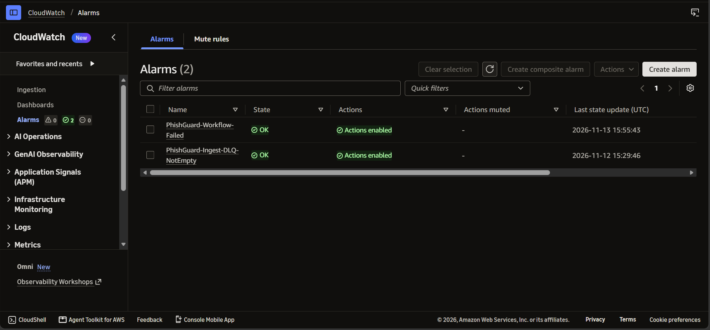

---
title: "Reconcile the AWS account"
weight: 6
chapter: false
---

## Snapshot from the demo account

20 November 2026, 14:16 UTC (21:16 Vietnam). The caller could read the following configuration.

| Result | Observation |
|---|---|
| MATCH | Stack UPDATE_COMPLETE in us-east-1. Approval timeout 172800 seconds (48 hours), DRY_RUN, configured model amazon.nova-lite-v1:0. |
| OBSERVED | Main stack has 8 Lambda functions, 5 S3 buckets, 3 DynamoDB tables, 1 Standard workflow and 2 CloudWatch alarms. Resources created outside the stack require their own check. |
| MATCH | Four public-access blocks set on web, one intake CORS rule allowing the stack origin for POST, raw evidence versioning + SSE-KMS + 7-day Governance retention. OCR layer present, 512 MiB, x86_64. |
| MATCH | One confirmed SNS email. Both alarms OK with actions enabled and the SecOps topic as target. |
| UNVERIFIED / MANUAL | CloudFront routes, policies/OAC, WAF association and plan; active SES rule, Bedrock resources and Budgets. The CLI identity encountered read restrictions. The WAF template flag was false. |

With an authorized reader, inspect the actual distribution’s Default and /api/* behaviors, S3 origin OAC, attached Web ACL/rules, and plan or subscription. In the active SES receipt rules inspect recipient and ordered actions (S3 then Ingest). In Bedrock check KB ID, last sync, Retrieve and published guardrail version. In Billing check monthly budget, scope and notification thresholds. Record resource name, observed time and a cropped screenshot, then attach that evidence to the corresponding check. Keep the original JSON as produced.

From lab/ run the bundled read-only tool. Optionally provide --distribution-id if the stack has no ID, or --budget-name to select a specific budget.

```powershell
$recipient = Read-Host 'SES lab recipient'
.\.venv\Scripts\python.exe ..\tools\audit_phishguard.py --profile phishguard --region us-east-1 --stack phishguard-ai --recipient $recipient --output .\phishguard-account.json
```



An OK alarm confirms current state. To attest email delivery, retain an actual notification matched to the incident. To attest model traffic, use the runtime metrics in the cost chapter.


**Additional evidence from the implementation notes.** The General screenshot shows PAYG at capture time. The Behaviors screenshot documents /api/*. Check the attached web ACL in Security and the OAC on the S3 origin to complete the account record.

