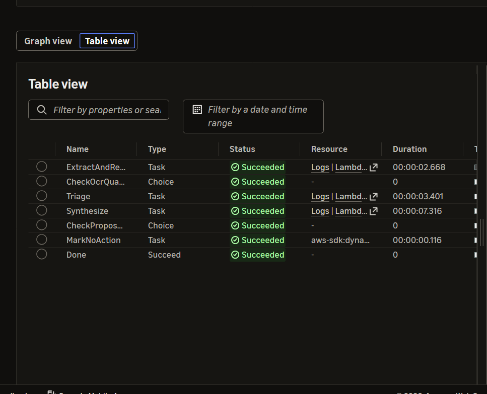
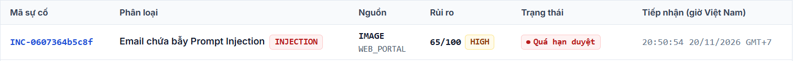
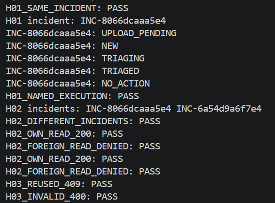
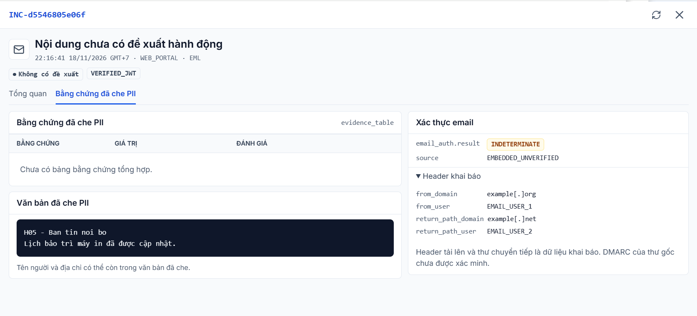
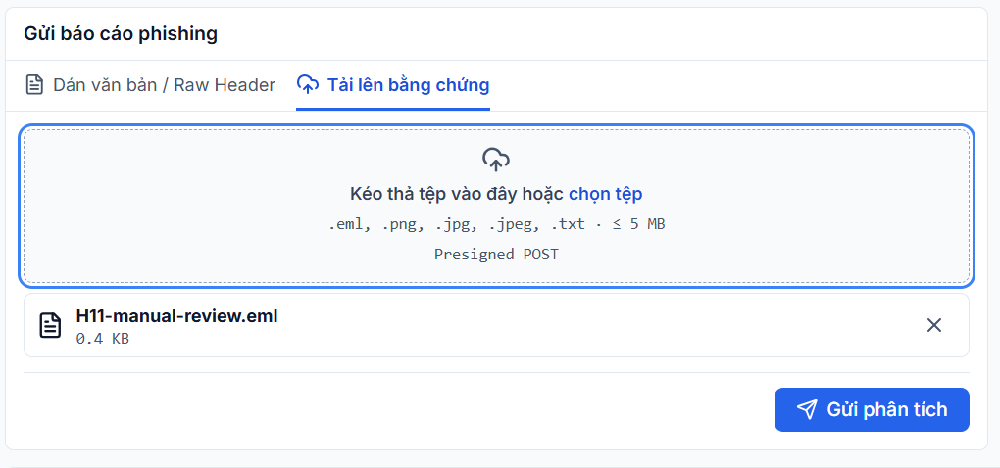
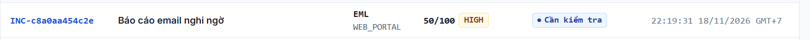
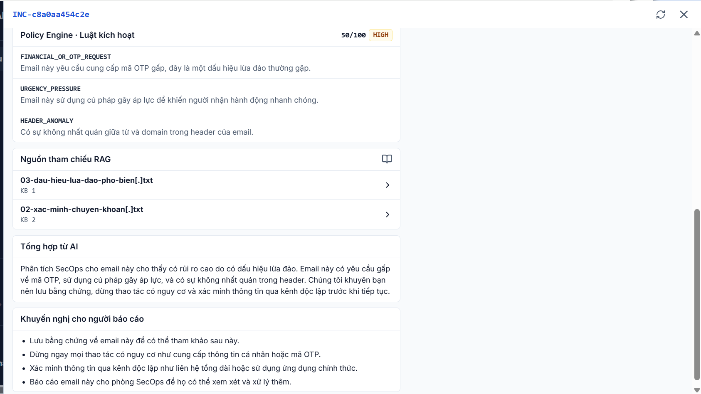
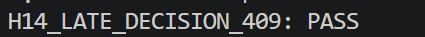

---
title: "Kiểm chứng H01–H15"
weight: 7
chapter: false
---

Đối chiếu từng ca với ảnh hoặc log đúng lần chạy. Bảng dưới ghi **điều kiện đạt để tái hiện**. Khi nộp, đặt mỗi ảnh hoặc log thực tế cạnh đúng mã H, thời gian, bản code và incident ID nếu có. Giữ nguyên thông tin về môi trường chạy (AWS, cục bộ hoặc cả hai).

| Ca | Kết quả cần đối chiếu |
|---|---|
| H01 | Cùng reporter, key và nội dung → hai lần nhận cùng ID; một execution có tên theo ID. H01 đã ghi `INC-8066dcaaa5e4` trên terminal. |
| H02 | Hai reporter, cùng key/nội dung → hai incident. Chủ sở hữu đọc được; đọc chéo bị từ chối cả hai chiều. |
| H03 | Dùng lại key cho nội dung khác → 409; key sai định dạng → 400. |
| H04 | Test cục bộ gián đoạn sau khi ghi evidence; thử lại bảo toàn một phiên bản bằng chứng và một lần khởi tạo workflow. |
| H05 | EML có Return-Path khác From → xác thực gốc `INDETERMINATE`, không suy diễn `AUTH_DMARC_FAIL`. |
| H06 | Thư từ danh tính không hợp lệ → log/metric `UNVERIFIED_SENDER`/`UnverifiedSender`; tra cùng nguồn không có incident. |
| H07 | Câu cảnh báo người dùng giữ kín OTP → 0 điểm trên mẫu chuẩn. |
| H08 | Câu có yêu cầu OTP đi kèm liên kết mẫu → xuất hiện luật `FINANCIAL_OR_OTP_REQUEST`. |
| H09 | Ảnh trắng → `NEEDS_MORE_INFO`; điểm còn trống. |
| H10 | So sánh DEMO_2/3; mẫu 3 có cờ prompt injection. Guardrail có can thiệp thì ghi lý do fallback. Tách kết quả dò cờ và kết quả Guardrail thực tế. |
| H11 | Báo cáo HIGH, thiếu mục tiêu hành động → `NEEDS_REVIEW`, SNS và execution cùng incident. |
| H12 | Năm hostname trong bộ kiểm thử cục bộ cho đúng kết quả nhận diện miền. |
| H13 | Quyết định lặp được xử lý nhất quán, một audit/callback thành công; kiểm thử lỗi giữa chừng dùng mô phỏng cục bộ. |
| H14 | Hết thời gian phê duyệt → `ESCALATED_TIMEOUT`; quyết định muộn → 409. Khôi phục timeout đã ghi trước khi test. |
| H15 | Reporter/auditor chỉ nhận dữ liệu theo quyền. Phản hồi và SNS không lộ token workflow, key raw hoặc header gốc. |

```powershell
.\.venv\Scripts\python.exe scripts/check_phase_h_local.py
.\.venv\Scripts\python.exe scripts/check_phase_h_live.py --profile phishguard --other-reporter demo-reporter-2
.\.venv\Scripts\python.exe scripts/verify_group1_upload.py --profile phishguard
```

Hai lệnh sau lệnh chạy cục bộ tạo dữ liệu thử trên account lab. Người đã có minh chứng đúng phiên bản có thể dùng lại. Với bộ mẫu cần phê duyệt, dùng `verify_admin_api.py` cho DEMO_1 và `verify_group2_samples.py` cho DEMO_2/3 trên stack ở `DRY_RUN`. Khi script ghi `SKIPPED` hoặc `UNVERIFIED`, dùng đúng trạng thái này cho phần chưa quan sát.



*Hình 6. Ở nhánh thông báo nội bộ, MarkNoAction rồi Done giải thích vì sao Step Functions báo Succeeded trong khi nghiệp vụ là NO_ACTION.*



Lưu riêng ảnh “Quá hạn duyệt” và phản hồi 409 khi thử quyết định muộn. Dòng 172800 giây trong kết quả audit xác nhận giá trị hiện tại.

## Tái hiện trên web

Đăng nhập reporter, upload riêng từng file `fixtures/phase-h/H05-return-path.eml` (H05) và `H11-manual-review.eml` (H11). Đối chiếu mã incident H11 với thông báo SNS. H07 và H08 dùng hai báo cáo văn bản riêng. H07 dùng “Ngân hàng không yêu cầu cung cấp OTP hoặc mật khẩu.” H08 dùng “Ngân hàng không yêu cầu cung cấp OTP. Tình huống mô phỏng: nhập OTP tại hxxps://example[.]org/test.”

Với H14 trên stack demo, ghi lại timeout cũ, dùng hàm `Update-PgStack` ở mục triển khai portal để thay duy nhất `ApprovalTimeoutSeconds` thành 60. Sau UPDATE_COMPLETE, tạo một DEMO_1 mới, chờ từ lúc execution vào PrepareAndWaitApproval. Khi hồ sơ quá hạn, dùng `scripts/check_phase_h_live.py --profile phishguard --expired <incident-id>` với Python trong .venv. Lưu dòng H14_LATE_DECISION_409 rồi khôi phục timeout đã ghi, kể cả khi phép thử trả lỗi.

### H01–H03 · Đọc kết quả theo mã sự cố

Tìm hai mã trên dòng H02, rồi đọc hai cặp kiểm tra quyền ngay dưới. H01 kiểm tra gửi lặp của cùng người. H02 kiểm tra quyền giữa hai người báo cáo. H03 ghi nhận đúng hai phản hồi 409 và 400.



### H05 · Đọc kết quả xác thực email

Trong bảng xác thực, hai miền From và Return-Path khác nhau. Hệ thống ghi INDETERMINATE với nguồn EMBEDDED_UNVERIFIED cho các header khai báo.



### H11 · Gửi mẫu cần kiểm tra

Đăng nhập Reporter, chọn H11-manual-review.eml ở tab tải bằng chứng, bấm Gửi phân tích một lần và lưu mã sự cố.



### H11 · Tìm kết quả

Dòng tương ứng trên dashboard hiện 50/100 và trạng thái Cần kiểm tra. Mở chính dòng này để đọc các luật đã kích hoạt.



### H11 · Giải thích kết quả

Trang chi tiết có ba luật kích hoạt và hai tham chiếu playbook. Dùng các luật để giải thích điểm. Đối chiếu riêng thư SNS bằng cùng mã sự cố.



### H14 · Kiểm tra quyết định muộn

Sau khi INC-0607364b5c8f quá hạn, terminal hiện H14_LATE_DECISION_409: PASS. Ghép kết quả này với dòng Quá hạn duyệt trên dashboard để chứng minh cả hai điều kiện H14.



