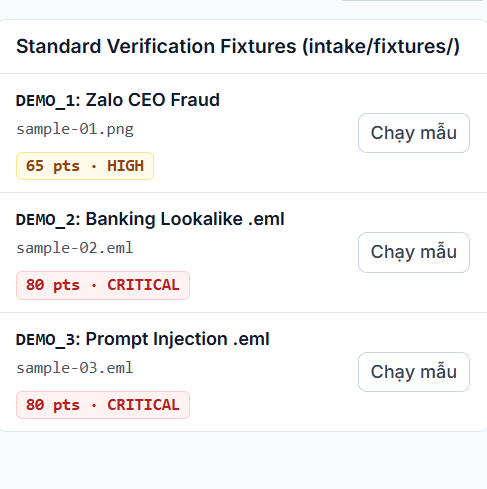
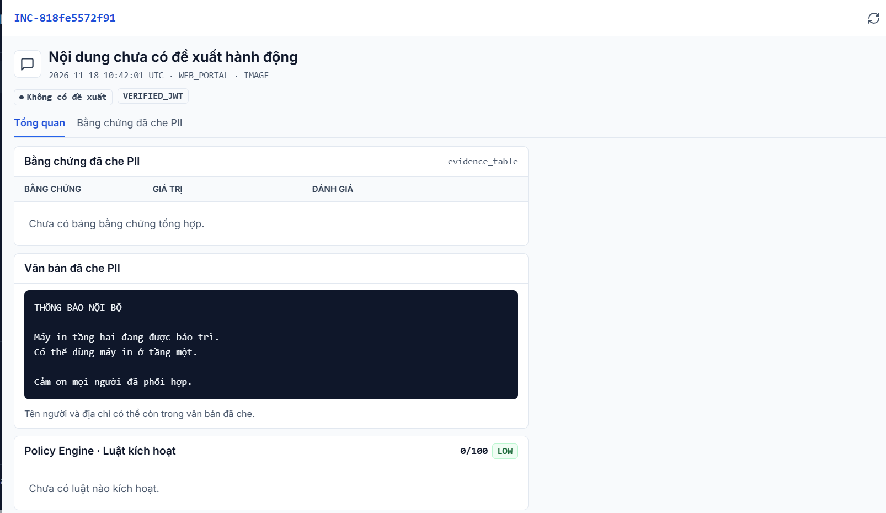

---
title: "Present the demo and close the lab"
weight: 9
chapter: false
---

For a three-minute demonstration, use DEMO_1 to show the image, OCR, triggered rules, target and the admin approval. Follow its incident ID into the audit. For the standard reference the intended outcome is 65/HIGH, then SIMULATED in dry-run. For DEMO_2, show the 80/CRITICAL lookalike report and internal domain proposal. For DEMO_3, show the injection flag and the actual guardrail status. Prior confirmed indicators can change the score. Finish with the separate billing observation and monthly estimate.

## After grading

Export the evidence, calculator estimate and cost report while the demo is available. When the owner authorizes decommissioning, stop new submissions, review waiting executions and remove only the lab SES receipt rule. Disable the dedicated CloudFront distribution, wait for deployment, and review its subscription and any standalone WAF or DNS charges. Delete KB/data sources before vector storage. Inspect retained resources in both stacks. Keep raw versions for the promised retention period and keep decryption keys until all retained data is accounted for. Check ongoing log storage, domain renewal and billing after the next update.

A pilot should measure false positives and false negatives on an independently labelled set, p50/p95 turnaround and operator time to retrieve the decision trail. These outcomes measure the value of a repeatable review process.

