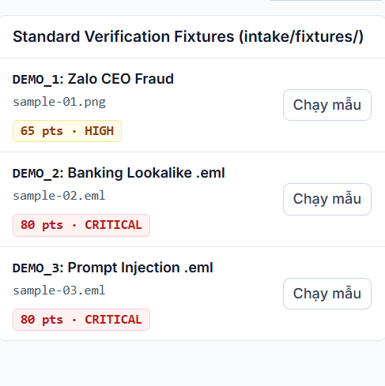
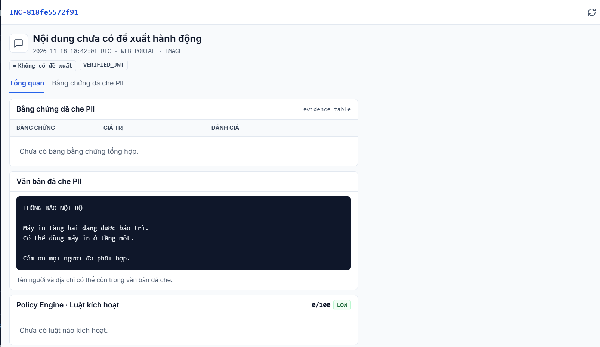

---
title: "Trình bày và thu dọn"
weight: 9
chapter: false
---

*Hình 7. Các fixture giúp hai người chạy trên cùng một bản deploy so sánh cùng đầu vào.*

| Mẫu | Đường đi cần cho người xem thấy | Dữ kiện để chốt |
|---|---|---|
| **1 · Ảnh giả danh lãnh đạo** | Đăng nhập reporter, chạy mẫu ảnh, mở nội dung OCR và từng luật. Chuyển sang admin, đọc mục tiêu và chế độ rồi duyệt. | Mẫu chuẩn kỳ vọng 65/HIGH, `FINANCE_VERIFICATION_ALERT`, SNS và audit, kết thúc `SIMULATED`. Chất lượng OCR có thể làm thay đổi luật. |
| **2 · Email giả mạo ngân hàng** | Mở IOC đã đổi sang dạng văn bản an toàn, chỉ ra vì sao miền giống thương hiệu, rồi mở đề xuất chặn miền. | Mẫu chuẩn 80/CRITICAL, `BLOCK_DOMAIN`, sau duyệt DRY_RUN có bản ghi nội bộ `APPROVED_DRY_RUN`. Chưa có chặn ở firewall/email gateway. |
| **3 · Email chứa prompt injection** | So các luật và điểm với mẫu 2, kiểm cờ injection, trạng thái tổng hợp và lý do fallback nếu có. Cho xem quyền của Synthesize và role được phép duyệt. | Model không tự thay điểm hoặc thực thi containment. Ghi đúng kết quả Guardrail của lần chạy. IOC có nguồn SEED/APPROVED_CONFIRMED từ lần trước có thể làm điểm lên 100. |

Khi chỉ có ba phút, dùng mẫu 1 trong khoảng 90 giây, rồi cho xem một lượt H02 và nhật ký của đúng incident trong khoảng 60 giây. Dùng phần còn lại để mở chi phí và nói rõ hiệu lực của `DRY_RUN`. Đính kèm link video hoặc live demo do nhóm kiểm soát.

*Hình 8. Thông báo bảo trì máy in cho thấy hệ thống đọc được dấu tiếng Việt và hiển thị rủi ro thấp trên đầu vào đối chứng.*

PhishGuard đặt ra một câu hỏi ở cấp tổ chức: “Báo cáo này đã được ai xử lý, theo căn cứ nào và kết quả có truy lại được không?” Với một email đơn lẻ, một chatbot có thể giải thích các dấu hiệu đáng ngờ rất tốt. Trong môi trường nhiều nhân viên, việc gắn báo cáo với đúng người, giữ một phiên bản bằng chứng, kiểm quyền đọc, chờ phê duyệt và đối chiếu nhật ký là những phần việc nhóm đang giải quyết. AI trong project hỗ trợ viết giải thích từ những bằng chứng và tài liệu mà hệ thống cung cấp.

**Hạn chế nên trình bày thẳng.** Fixture cho thấy hệ thống đi đúng một số nhánh xác định. H01–H15 đo hành vi, phân quyền và khả năng phục hồi của MVP. Độ chính xác trên thư ngoài tập mẫu, tỷ lệ cảnh báo nhầm và thời gian tiết kiệm cho SecOps vẫn cần đo. Tên và địa chỉ trong nội dung đã che PII có thể còn sót; S3 Governance có quyền bypass; containment của demo ghi mô phỏng trong phạm vi hệ thống.

**Cải thiện có thể kiểm chứng.** Đầu tiên, cho người xem theo **một incident ID** qua bốn dấu mốc *tiếp nhận → thu bằng chứng → đề xuất → người duyệt/kết quả*. Có thể dùng giao diện và nhật ký hiện có hoặc thêm timeline trong trang chi tiết. Tiếp theo, lập một tập đánh giá độc lập với ba fixture, có mẫu lành, đáng ngờ và khó phân loại, gán nhãn trước khi chạy. Báo cáo số dương tính giả, âm tính giả, tỷ lệ yêu cầu bổ sung và p50/p95 thời gian từ gửi đến có kết quả. Khi so với chatbot, dùng cùng văn bản đã che PII, rubric chấm và các tác vụ tương đương. Đo riêng thời gian con người cần để tạo hồ sơ, xin duyệt và tra lại quyết định.

1. Giữ môi trường hoạt động nếu giám khảo còn cần dùng đường dẫn. Xuất bằng chứng kiểm thử, estimate và số Billing. Ghi danh sách tài nguyên theo stack chính, stack KB và các tài nguyên tạo ngoài stack.
2. Khi đến thời điểm dọn, dừng nhận báo cáo mới, rà execution đang chờ duyệt và xử lý theo chính sách lab. Gỡ **riêng** receipt rule của lab. Nếu dùng DNS hoặc domain chung, bảo toàn MX và các rule phục vụ email khác.
3. Gỡ liên kết resource ở CloudFront khi phù hợp, disable distribution, đợi **Deployed** rồi xóa khi đã sẵn sàng. Kiểm tra subscription flat-rate, WAF/Web ACL và phí theo kỳ. Hủy đăng ký email demo nếu topic được giữ lại.
4. Xóa data source/KB trước các tài nguyên vector liên quan. Rà stack và tài nguyên có `Retain` hoặc `RetainExceptOnCreate`, gồm bảng, bucket, khóa, user pool. Với S3 versioned, kiểm tra cả version lẫn delete marker. Giữ evidence đến hết retention đã cam kết, rồi dọn bằng quy trình đã được nhóm cho phép.
5. Rà CloudFormation, S3, S3 Vectors, Bedrock Guardrail, IAM role, Cognito domain, CloudWatch logs/alarms, SQS, SNS, Route 53, Budgets và bucket artifact SAM nếu dành riêng cho lab. Chỉ lên lịch xóa KMS key sau khi xác định dữ liệu nào còn cần giải mã. Kiểm tra Bills/Cost Explorer lại sau khi số liệu cập nhật, gồm phí domain gia hạn tự động nếu mua riêng.

**Hồ sơ nộp.** Workshop và sơ đồ chỉnh sửa được, minh chứng H01–H15, ảnh hai alarm, kết quả đối chiếu WAF/CloudFront, estimate có link hoặc bản xuất, số chi theo kỳ và video hoặc link demo. Sáu tiêu chí trình bày dùng theo barem FCAJ mà nhóm cung cấp. [Barem Workshop](https://hcm-rules.awsfcaj.com/scoring/workshop) · [Quy định về Workshop](https://hcm-rules.awsfcaj.com/3-project/)

