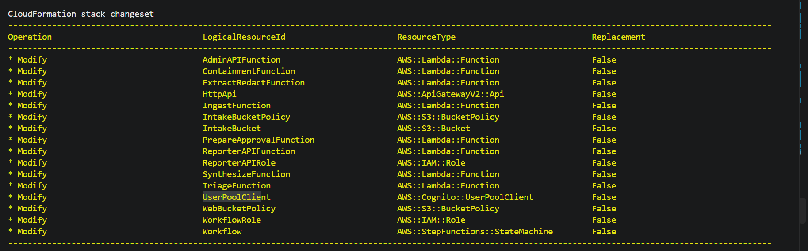

---
title: "5.3.1 · Backend và xử lý ảnh"
weight: 1
chapter: false
aliases:
  - /vi/5-workshop/03-backend/
---

1. Mở `template.yaml`. Kiểm tra vùng, 8 Lambda, 3 bảng DynamoDB on-demand có PITR, 5 bucket S3 thường, KMS, workflow Standard, SNS và SQS DLQ. File `layers/ocr-vie-py312-x86_64.zip` gắn vào riêng ExtractRedact. S3 Vectors, distribution CloudFront, receipt rule SES, domain đăng nhập và Guardrail được cấu hình ở các bước sau.
2. Trên **tài khoản lab mới**, build và tạo stack đầu tiên. Nhập miền email của **người báo cáo đã đăng ký**, ví dụ miền email nội bộ của nhóm. Địa chỉ nhận thư sẽ được cấu hình riêng ở SES. `--resolve-s3` cho SAM dùng bucket đóng gói trước khi bucket intake của ứng dụng tồn tại.

```powershell
$pgSenderDomain = Read-Host 'Mien email cua reporter, vi du congty.vn'
sam validate --lint --template-file template.yaml --region $pgRegion --profile $pgProfile
if ($LASTEXITCODE -ne 0) { throw 'Template chua hop le.' }
sam build --template-file template.yaml
if ($LASTEXITCODE -ne 0) { throw 'Build that bai.' }
sam deploy --template-file .aws-sam/build/template.yaml --stack-name $pgStack --region $pgRegion --profile $pgProfile --resolve-s3 --capabilities CAPABILITY_NAMED_IAM --parameter-overrides "AllowedSenderDomains=$pgSenderDomain" "ContainmentMode=DRY_RUN" --confirm-changeset
if ($LASTEXITCODE -ne 0) { throw 'Kiem tra su kien CloudFormation.' }
```

Nếu Python cục bộ thiếu native dependency phù hợp cho Lambda, khởi động Docker rồi dùng `sam build --use-container` và triển khai lại bản vừa build. Kiểm tra change set trước khi xác nhận. Trên stack mới, việc tạo tài nguyên là dự kiến. Với stack đang có dữ liệu, xem kỹ bất kỳ mục `Remove` hoặc `Replacement=True` nào liên quan đến bảng và bucket.



*Change set của một lần cập nhật trên bản demo. Stack mới sẽ hiện Add; hình minh họa vị trí đọc tác động của thay đổi.*

3. Đọc Outputs của stack. Giữ đoạn này để dùng lại ở các lab sau.

```powershell
function Get-PgStack {
  $raw = aws cloudformation describe-stacks --stack-name $pgStack --region $pgRegion --profile $pgProfile --output json --no-cli-pager
  if ($LASTEXITCODE -ne 0) { throw 'Khong doc duoc stack.' }
  (($raw -join "`n") | ConvertFrom-Json).Stacks[0]
}
$pg = Get-PgStack
$pgOut = @{}
foreach ($o in $pg.Outputs) { $pgOut[$o.OutputKey] = $o.OutputValue }
$pg.StackStatus
$pgOut['WebBucketName']
([uri]$pgOut['HttpApiEndpoint']).Host
```

**Mốc kiểm tra.** CloudFormation hiện `CREATE_COMPLETE` hoặc `UPDATE_COMPLETE`. Ghi tên web bucket, hostname HTTP API, UserPoolId, UserPoolClientId và SecOpsTopicArn từ **chính stack của bạn**.

### Kiểm hai layer đã gắn cho Lambda

```powershell
aws lambda get-function-configuration --function-name PhishGuard-ExtractRedact --region $pgRegion --profile $pgProfile --query "{Memory:MemorySize,Architecture:Architectures,Layers:Layers[*].Arn}"
```

Kiểm hai phiên bản layer OCR và QR, bộ nhớ 512 MiB, kiến trúc x86_64. Nếu không xuất bản được layer, xem sự kiện CREATE_FAILED đầu tiên, lấy action và resource bị từ chối để rà quyền của danh tính triển khai trước khi chạy lại. Thử giải mã sau khi dựng portal ở 5.5.3.

