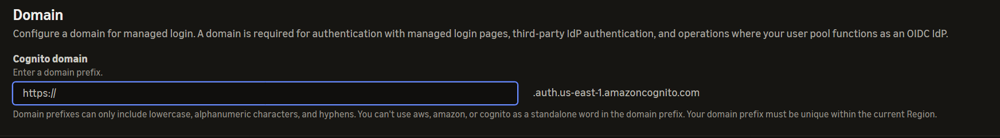
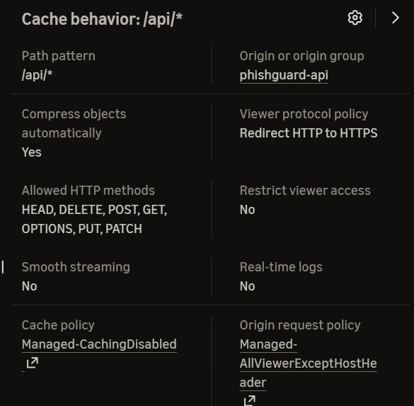

---
title: "5.3.2 · Portal and access control"
weight: 2
chapter: false
aliases:
  - /5-workshop/04-portal/
---

1. In Cognito, open the PhishGuard user pool, create an available domain prefix and use the public Web app client with authorization code + PKCE. Managed login v2 requires branding for the client.



2. Configure the CloudFront default root object as `index.html`. Add the two origins and behaviors below.

| Behavior | Origin | Settings |
|---|---|---|
| Default (*) | S3 REST endpoint of the web bucket | Sign with OAC, redirect HTTP to HTTPS. For deep links publish `frontend/deploy/cloudfront-spa-router.js` at viewer-request on this behavior. |
| /api/* | HTTP API execute-api host, empty origin path for the default stage | HTTPS only, allow required methods including POST, CachingDisabled, AllViewerExceptHostHeader. |

3. Set the distribution ID, site origin and dashboard URL using the live stack parameters. Enter the domain without https:// in the hostname prompt.

```powershell
function Update-PgStack([hashtable] $changes) {
  $all = @{}
  foreach ($p in (Get-PgStack).Parameters) {
    if ($null -ne $p.ParameterValue -and "$($p.ParameterValue)" -ne '') {
      $all[$p.ParameterKey] = [string]$p.ParameterValue
    }
  }
  foreach ($name in $changes.Keys) { $all[$name] = [string]$changes[$name] }
  $overrides = @(foreach ($name in $all.Keys) { "$name=$($all[$name])" })
  sam deploy --template-file .aws-sam/build/template.yaml --stack-name $pgStack --region $pgRegion --profile $pgProfile --resolve-s3 --capabilities CAPABILITY_NAMED_IAM --parameter-overrides @overrides --confirm-changeset --no-fail-on-empty-changeset
  if ($LASTEXITCODE -ne 0) { throw 'Kiem tra change set va su kien stack.' }
}
$pgDist = (Read-Host 'CloudFront distribution ID').Trim()
$pgSite = 'https://' + (Read-Host 'Chi nhap hostname CloudFront').Trim().TrimEnd('/')
Update-PgStack @{CloudFrontDistributionId=$pgDist; CloudFrontOrigin=$pgSite; DashboardUrl="$pgSite/"}
```

4. Create demo users and seed the three SHA-256-checked fixtures. Create a second reporter, put them in REPORTER and complete initial sign-in. For the SecOps topic create an Email subscription and follow the confirmation link.

```powershell
.\.venv\Scripts\python.exe scripts/create_demo_users.py --profile $pgProfile
.\.venv\Scripts\python.exe scripts/seed_demo_fixtures.py --profile $pgProfile
```

5. Enter your Cognito prefix, build the React app and upload hashed assets before index.html. Invalidate the entry page.

```powershell
$pgPrefix = (Read-Host 'Prefix Cognito da tao').Trim()
$pgEvidence = $pgOut['EvidenceBucketName']
$envFile = @"
VITE_USE_MOCK=false
VITE_COGNITO_REGION=$pgRegion
VITE_COGNITO_USER_POOL_ID=$($pgOut['UserPoolId'])
VITE_COGNITO_CLIENT_ID=$($pgOut['UserPoolClientId'])
VITE_COGNITO_DOMAIN=https://$pgPrefix.auth.$pgRegion.amazoncognito.com
VITE_COGNITO_REDIRECT_URI=$pgSite/
VITE_COGNITO_LOGOUT_URI=$pgSite/
VITE_COGNITO_SCOPES=openid email profile
VITE_EVIDENCE_ALLOWED_HOSTS=$pgEvidence.s3.$pgRegion.amazonaws.com,$pgEvidence.s3.amazonaws.com
"@
[IO.File]::WriteAllText((Join-Path $PWD 'frontend/.env.production.local'), $envFile)
Push-Location frontend
try {
  npm ci
  if ($LASTEXITCODE -ne 0) { throw 'npm ci that bai.' }
  npm run build
  if ($LASTEXITCODE -ne 0) { throw 'Build web that bai.' }
  $web = 's3://' + $pgOut['WebBucketName'] + '/'
  aws s3 sync dist/ $web --exclude index.html --region $pgRegion --profile $pgProfile
  if ($LASTEXITCODE -ne 0) { throw 'Upload assets that bai. Kiem tra ListBucket va PutObject tren web bucket.' }
  aws s3 cp dist/index.html ($web + 'index.html') --content-type text/html --cache-control no-cache --region $pgRegion --profile $pgProfile
  if ($LASTEXITCODE -ne 0) { throw 'Upload index that bai.' }
} finally { Pop-Location }
aws cloudfront create-invalidation --distribution-id $pgDist --paths "/" "/index.html" --profile $pgProfile
```

Sign in via CloudFront. Submit an ordinary text report and observe POST /api/reports → 202. Choose a PNG and verify presign → 201 and direct S3 POST → 204. Open the resulting incident.

### Route the API separately

In Behaviors open /api/*. In this capture phishguard-api receives POST requests, caching is disabled and AllViewerExceptHostHeader forwards viewer headers. Compare these values if the portal loads but submitting a report fails.



