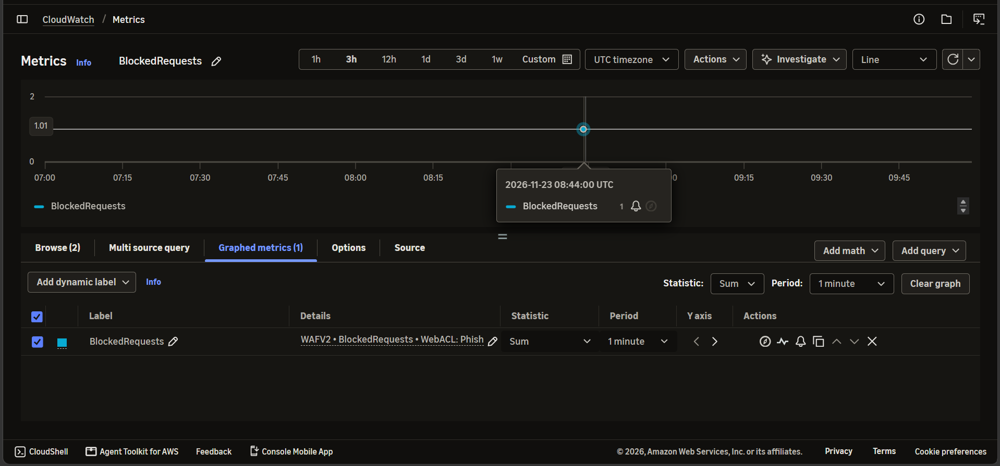

---
title: "5.3.3 · Protect CloudFront with WAF"
weight: 3
chapter: false
aliases:
  - /5-workshop/10-waf-rag-qr/
---

Associate the portal distribution with its web ACL. Two harmless GETs to the same page isolate the temporary header rule. PNG and EML file bytes go directly from the browser to S3 with a presigned POST.

```powershell
$awsOpts = @('--profile', $pgProfile, '--region', $pgRegion, '--no-cli-pager')
function Set-PgWaf([string]$mode, [string]$probe) {
  aws cloudformation deploy --stack-name phishguard-edge-waf --template-file .\infra\phishguard-waf.yaml --parameter-overrides "ProtectionMode=$mode" "ProbeMode=$probe" RequestsPerMinute=120 --no-fail-on-empty-changeset @awsOpts
  if ($LASTEXITCODE -ne 0) { throw 'Check CloudFormation stack events.' }
}
Set-PgWaf COUNT COUNT
aws cloudformation describe-stacks --stack-name phishguard-edge-waf --query "Stacks[0].Outputs[?OutputKey=='WebACLArn'].OutputValue | [0]" --output text @awsOpts
$pgDist
```

1. Run the block above from the lab directory after portal setup. In **WAF & Shield → Protection packs (web ACLs)** select CloudFront (Global), open **PhishGuardEdge → Manage resources → Add global resources**, and select the distribution recorded during portal setup. Check the association and allow time for propagation.
2. In **COUNT COUNT**, run the two GETs below. Both should return 200. In N. Virginia open **CloudWatch → Metrics → All metrics → AWS/WAFV2**. Select Rule **PhishGuardProbe**, WebACL **PhishGuardEdge**, **CountedRequests**, statistic **Sum** and period **1 minute**. One matching request gives a sum of one in its observation minute.

```powershell
curl.exe -s -o NUL -w "GET: %{http_code}\n" "$pgSite/"
curl.exe -s -o NUL -w "Probe: %{http_code}\n" -H "x-phishguard-workshop: verify-edge" "$pgSite/"
```

3. Run `Set-PgWaf COUNT BLOCK`, wait for propagation and repeat the GETs. Expect **200** for the ordinary request and **403** for the marked one. Match the time with **BlockedRequests** for the probe.
4. With `COUNT BLOCK`, sign in as a reporter. Submit text (202), upload an actual PNG file (presign 201 and S3 POST 204), submit an EML fixture, open its incident, then check the admin dashboard. Inspect the metric name configured for CommonRules. Record missing datapoints as such. Investigate any legitimate match at subrule level before enforcement.
5. After representative transactions pass, run `Set-PgWaf ENFORCE OFF`. The managed group uses its subrule actions. The configured rate is 120 per IP in a 60-second evaluation window on the two POST routes for reports and presigning. Repeat the business checks and both GETs. Both GETs should now return 200. If WAF disrupts a legitimate operation, use `Set-PgWaf COUNT OFF` while investigating the matching rule.



The demo returned 200/403 with the probe in Block and 200/200 once the probe was off. The graph records a header-rule match. The submission rate threshold was not measured in this test. [AWS WAF testing guide](https://docs.aws.amazon.com/waf/latest/developerguide/web-acl-testing.html)

[Knowledge base and playbooks](../../integrations/knowledge-base/) · [Image regression](../../verify/images/)

