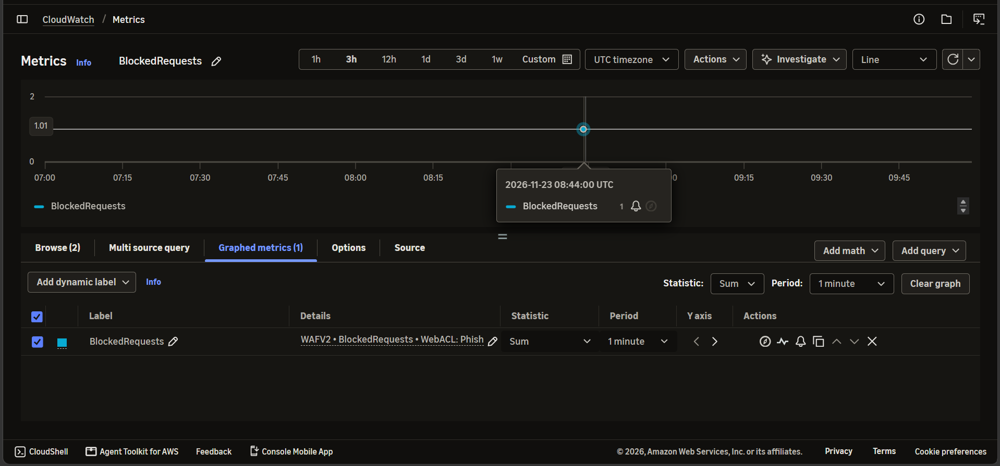

---
title: "5.3.3 · Bảo vệ CloudFront bằng WAF"
weight: 3
chapter: false
aliases:
  - /vi/5-workshop/10-waf-rag-qr/
---

Gắn Web ACL cho distribution của portal vừa tạo. Hai GET vô hại đến cùng trang sẽ cho thấy tác dụng riêng của luật thử. File PNG/EML đi thẳng từ trình duyệt đến S3 theo presigned POST.

```powershell
$awsOpts = @('--profile', $pgProfile, '--region', $pgRegion, '--no-cli-pager')
function Set-PgWaf([string]$mode, [string]$probe) {
  aws cloudformation deploy --stack-name phishguard-edge-waf --template-file .\infra\phishguard-waf.yaml --parameter-overrides "ProtectionMode=$mode" "ProbeMode=$probe" RequestsPerMinute=120 --no-fail-on-empty-changeset @awsOpts
  if ($LASTEXITCODE -ne 0) { throw 'Check CloudFormation stack events.' }
}
Set-PgWaf COUNT COUNT
aws cloudformation describe-stacks --stack-name phishguard-edge-waf --query "Stacks[0].Outputs[?OutputKey=='WebACLArn'].OutputValue | [0]" --output text @awsOpts
$pgDist
```

1. Chạy khối trên trong thư mục lab, sau bước portal. Vào **WAF & Shield → Protection packs (web ACLs)**, chọn phạm vi CloudFront (Global), mở ACL **PhishGuardEdge → Manage resources → Add global resources**. Chọn đúng distribution đã ghi ở mục portal. Kiểm tra association và chờ cấu hình lan truyền.
2. Ở chế độ **COUNT COUNT**, chạy hai GET dưới đây. Cả hai trả 200. Trong **CloudWatch → Metrics → All metrics → AWS/WAFV2** tại N. Virginia, chọn Rule **PhishGuardProbe**, WebACL **PhishGuardEdge**, **CountedRequests**, thống kê **Sum**, period **1 minute**. Một request có header cho Sum bằng 1 ở phút quan sát.

```powershell
curl.exe -s -o NUL -w "GET: %{http_code}\n" "$pgSite/"
curl.exe -s -o NUL -w "Probe: %{http_code}\n" -H "x-phishguard-workshop: verify-edge" "$pgSite/"
```

3. Chạy `Set-PgWaf COUNT BLOCK`, đợi cập nhật rồi chạy lại hai GET. Lượt thường trả **200**, lượt có header trả **403**. So thời điểm với **BlockedRequests** của probe. Đây là phép thử luật header.
4. Giữ nguyên `COUNT BLOCK`, đăng nhập reporter. Gửi văn bản (202), tải file PNG thật (presign 201, POST S3 204), gửi fixture EML, mở incident và dashboard admin. Xem tên metric cấu hình cho CommonRules trong template. Nếu chưa có điểm dữ liệu, ghi rõ điều quan sát được. Nếu có khớp hợp lệ, xác định subrule trước khi chuyển chế độ.
5. Khi các giao dịch hợp lệ đạt, chạy `Set-PgWaf ENFORCE OFF`. Managed group sử dụng hành động của subrule, luật rate có ngưỡng cấu hình 120/IP trong cửa sổ 60 giây trên hai route POST nộp báo cáo và xin presign. Lặp lại giao dịch và hai GET, cả hai GET kỳ vọng 200. Nếu gặp lỗi nghiệp vụ do WAF, chạy `Set-PgWaf COUNT OFF` rồi kiểm tra luật đã khớp.



Trong lần demo, hai GET lần lượt trả 200/403 khi probe ở Block, sau đó 200/200 khi probe tắt. Chỉ số trong hình minh họa lượt bị chặn; chưa có kết quả đo ngưỡng rate trên portal. [Hướng dẫn kiểm thử WAF](https://docs.aws.amazon.com/waf/latest/developerguide/web-acl-testing.html)

[Kho tri thức và playbook](../../integrations/knowledge-base/) · [Kiểm thử ảnh](../../verify/images/)

