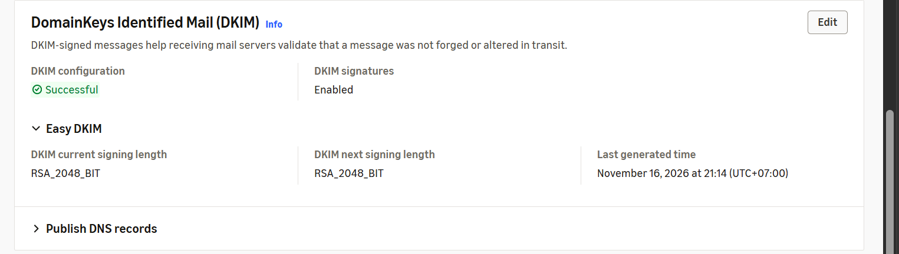
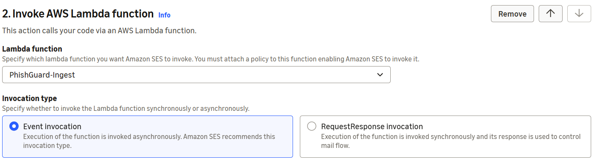

---
title: "5.4.1 · Receive email with SES"
weight: 1
chapter: false
---

Choose a dedicated receiving subdomain and verify the identity/DKIM records in SES in us-east-1. Point its MX (priority 10) to `inbound-smtp.us-east-1.amazonaws.com`. In the active receipt rule set add an enabled rule for the lab recipient. First deliver to the stack intake bucket under `inbound/`, then invoke PhishGuard-Ingest asynchronously. Forward a benign email from an allowed, verified reporter. Check the S3 object and a matching SES_EMAIL incident. For an unverified sender inspect the outer message identity, allowed domains and verdict.

### Verify the receiving domain

The SES identity shows DKIM configuration Successful and signatures Enabled. Next, verify the receipt rule in the active rule set and trace one forwarded email to an incident.

### Invoke Ingest after the S3 action

In step 2 of the receipt rule, choose PhishGuard-Ingest and Event invocation. The preceding action must have written the MIME object to inbound/. The screenshot shows the selected settings during setup.

