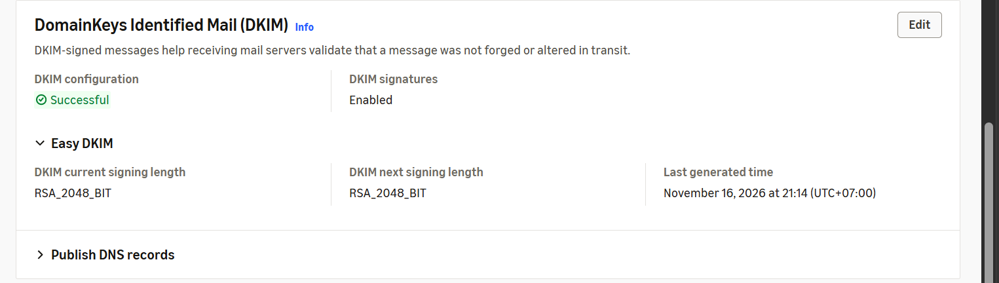
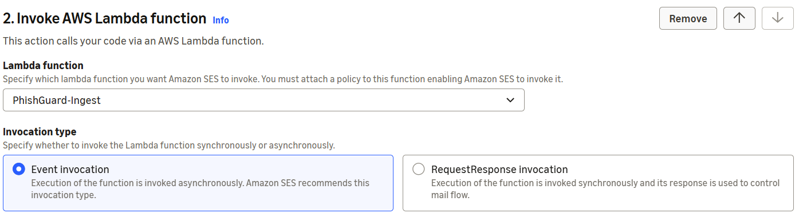

---
title: "5.4.1 · Nhận thư qua SES"
weight: 1
chapter: false
---

**Email qua SES.** Chọn SES ở **us-east-1**, tạo domain identity bạn quản lý, xuất bản bản ghi xác minh/DKIM được console cấp và đợi `Verified`. Tại DNS thêm MX với priority 10 trỏ `inbound-smtp.us-east-1.amazonaws.com` cho domain **nhận**. Nếu miền chính đang nhận thư qua hệ thống khác, dùng một subdomain lab, rồi dùng địa chỉ `soc@` của subdomain đó. Giữ nguyên MX của miền chính.

1. Trong **Email receiving → Receipt rule sets**, mở bộ rule đang active hoặc tạo cho môi trường lab. Nếu đã có mail nghiệp vụ, thêm rule vào bộ đang dùng và xem thứ tự rule trước đó.
2. Tạo rule cho đúng một địa chỉ nhận. Action đầu là **Deliver to S3**, chọn intake bucket của stack và prefix `inbound/`. Action tiếp theo là **Invoke Lambda**, chọn `PhishGuard-Ingest` và kiểu `Event` (asynchronous). Rule phải Enabled; stack cấp quyền nhận từ SES và ghi đúng prefix.
3. Từ hộp thư Cognito đã xác minh và thuộc `AllowedSenderDomains`, forward một thư vô hại. Tìm object mới trong `inbound/`, rồi tra cùng incident trong dashboard. Các trường mong đợi là `source_channel=SES_EMAIL` và `reporter_identity_status=VERIFIED_SES_DMARC`. Nếu log hiện `UNVERIFIED_SENDER`, đối chiếu email lớp ngoài, miền cho phép, email_verified và verdict SES.

[Cấu hình MX cho SES](https://docs.aws.amazon.com/ses/latest/dg/receiving-email-mx-record.html) · [Receipt rules](https://docs.aws.amazon.com/ses/latest/dg/receiving-email-receipt-rules-console-walkthrough.html)

### Kiểm tra domain nhận thư

SES hiển thị DKIM configuration là Successful và chữ ký Enabled. Tiếp theo, kiểm tra rule trong bộ đang active rồi đối chiếu một email chuyển tiếp với incident.

### Gọi Ingest sau khi giao thư vào S3

Ở action thứ hai của receipt rule, chọn PhishGuard-Ingest và Event invocation. Action thứ nhất phải lưu thư MIME vào inbound/. Ảnh ghi nhận lựa chọn trong lúc cấu hình.

