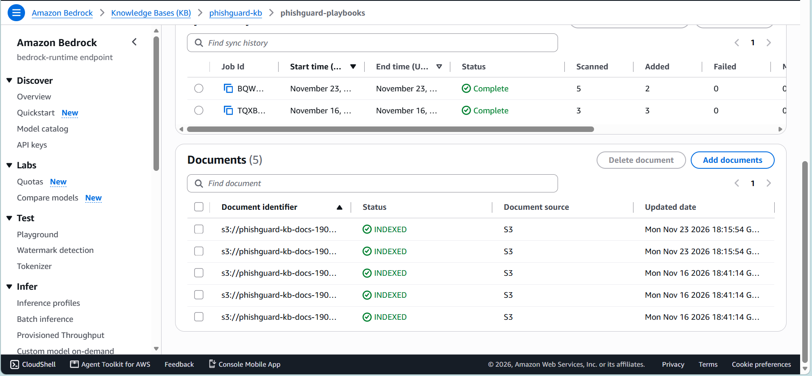

---
title: "5.4.2 · Playbooks and Bedrock"
weight: 2
chapter: false
---

Sync the bundled playbooks. The prerequisite template creates a vector bucket, a 1,024-dimensional cosine index and the setup role/policy. The commands below apply to a lab IAM user. For Identity Center use the equivalent role-based setup with your administrator.

```powershell
$kbDocs = $pgOut['KbDocsBucketName']
aws s3 sync .\kb-docs\playbooks\ "s3://$kbDocs/playbooks/" --region $pgRegion --profile $pgProfile
if ($LASTEXITCODE -ne 0) { throw 'Upload playbook that bai.' }
$kbUser = Read-Host 'Ten IAM user thuc hien setup KB trong tai khoan lab'
aws cloudformation deploy --template-file infra/phishguard-kb-prereqs.yaml --stack-name phishguard-kb-prereqs --capabilities CAPABILITY_NAMED_IAM --parameter-overrides "SetupUserName=$kbUser" --region $pgRegion --profile $pgProfile
if ($LASTEXITCODE -ne 0) { throw 'Chua tao duoc tai nguyen KB.' }
.\.venv\Scripts\python.exe scripts/setup_phishguard_kb.py --profile $pgProfile
```

Look for PHISHGUARD_KB_RETRIEVE_PASS and a playbook citation. In Bedrock create an input prompt-attack filter in a guardrail, publish a numbered version and record its ID. Confirm model or inference profile availability for Nova Lite. When using a profile, specify the profile ID and the invocation resource ARNs required for it.

```powershell
$kb = Read-Host 'KnowledgeBaseId'
$gr = Read-Host 'GuardrailId'
$gv = Read-Host 'GuardrailVersion da phat hanh'
Update-PgStack @{KnowledgeBaseId=$kb; GuardrailId=$gr; GuardrailVersion=$gv}
```

Run DEMO_2 and inspect its synthesis source and fallback_reason. A successful KB retrieval, a model response and an observed guardrail intervention are three separate observations. Capture each outcome that occurred.

### Verify all five source playbooks

Open the S3 bucket identified by `KbDocsBucketName` and its `playbooks/` prefix. The first three documents cover the SecOps handbook, transfer verification and common phishing indicators. Document 04 covers forwarded mail and DMARC. Document 05 covers high-risk reports that lack a valid action target. To upload using the console, open that prefix and choose **Upload → Add files → Upload**. In **Bedrock → Knowledge Bases → phishguard-kb → Data sources → phishguard-playbooks**, choose **Sync**.

Inspect the completed job’s added and failed counts. The demo job scanned five documents, added two and reported zero failures, while the Documents table still displayed its three earlier entries. To check actual retrieval, use **Test knowledge base** in retrieval mode and inspect the source passages for both questions below. The bundled script also prints the filenames of the top three sources and whether the expected playbook appears.

```powershell
.\.venv\Scripts\python.exe .\scripts\check_playbooks.py --kb $kb --profile $pgProfile
```

| Test question | Source and interpretation |
|---|---|
| Does Return-Path differing from From prove that the original forwarded email failed DMARC? | Look for playbook 04. Distinguish the outer message authentication from headers supplied in a forwarded message. |
| What should the analyst do when a HIGH case has no domain eligible for a block proposal? | Look for playbook 05. Review the indicators and route the case to manual review. |

Record the filename and passage returned. Then inspect the actual citations or fallback reason for H05/H11 in the portal. The application generates its own query, so its citations can differ from the interactive test.



