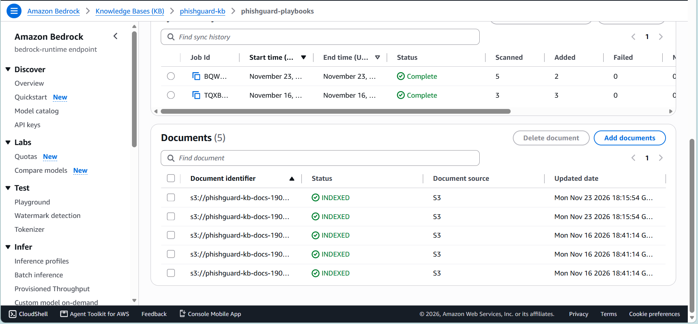

---
title: "5.4.2 · Playbook và Bedrock"
weight: 2
chapter: false
---

**Knowledge Base, Guardrail và model.** Nội dung ảnh đi qua Tesseract ở ExtractRedact. Bedrock nhận dữ liệu đã qua xử lý để tổng hợp. Lưu một lượt Retrieve có nguồn playbook và một kết quả tổng hợp để kiểm chứng hai bước độc lập này.

1. Đồng bộ các playbook trong gói. File `infra/phishguard-kb-prereqs.yaml` tạo vector bucket, index `playbooks` 1.024 chiều cosine, role cho KB và policy setup gắn với IAM user được chỉ định. Với môi trường IAM Identity Center, quản trị viên triển khai các tài nguyên tương ứng và gán quyền setup cho role được dùng, thay phần đính kèm vào IAM user.
2. Với người triển khai dùng IAM user của lab, chạy các lệnh sau sau khi stack chính đã tạo bucket KB. Script kiểm index, tạo hoặc tái sử dụng KB/data source, đợi đồng bộ rồi thử Retrieve.

```powershell
$kbDocs = $pgOut['KbDocsBucketName']
aws s3 sync .\kb-docs\playbooks\ "s3://$kbDocs/playbooks/" --region $pgRegion --profile $pgProfile
if ($LASTEXITCODE -ne 0) { throw 'Upload playbook that bai.' }
$kbUser = Read-Host 'Ten IAM user thuc hien setup KB trong tai khoan lab'
aws cloudformation deploy --template-file infra/phishguard-kb-prereqs.yaml --stack-name phishguard-kb-prereqs --capabilities CAPABILITY_NAMED_IAM --parameter-overrides "SetupUserName=$kbUser" --region $pgRegion --profile $pgProfile
if ($LASTEXITCODE -ne 0) { throw 'Chua tao duoc tai nguyen KB.' }
.\.venv\Scripts\python.exe scripts/setup_phishguard_kb.py --profile $pgProfile
```

| Trường cần đối chiếu ở Bedrock và S3 Vectors | Giá trị của lab |
|---|---|
| Vector store và index | Amazon S3 Vectors · `playbooks` |
| Embedding | Titan Text Embeddings V2, float32, 1.024 chiều, cosine |
| Nguồn tài liệu và minh chứng | Prefix `playbooks/` trong bucket KB docs. Lần ingestion gần nhất COMPLETE, kết quả Retrieve dẫn về một tài liệu trong prefix. |

3. Ghi `KnowledgeBaseId` khi script báo `GATE: PHISHGUARD_KB_RETRIEVE_PASS`. Trong **Bedrock → Guardrails**, tạo guardrail với bộ lọc **Prompt attacks** trên input, đặt hành vi chặn, tạo phiên bản và ghi ID/version. Trong Model catalog xác nhận tài khoản có thể gọi Nova Lite v1 hoặc đúng inference profile được cấp cho vùng. Nếu dùng inference profile, điền `ModelId` của profile và `ModelInvokeResourceArns` gồm chính xác các ARN cần cho profile và model đích.
4. Cập nhật backend, sau đó chạy `DEMO_2` để xem phần tổng hợp. Khi gặp `FALLBACK`, đọc `fallback_reason`, kiểm tra trạng thái đồng bộ dữ liệu, ID/version Guardrail và quyền Retrieve/InvokeModel của Synthesize trước khi kết luận model đã chạy thành công.

```powershell
$kb = Read-Host 'KnowledgeBaseId'
$gr = Read-Host 'GuardrailId'
$gv = Read-Host 'GuardrailVersion da phat hanh'
Update-PgStack @{KnowledgeBaseId=$kb; GuardrailId=$gr; GuardrailVersion=$gv}
```

### Kiểm tra năm playbook sau khi đồng bộ

Trong S3, mở bucket do `KbDocsBucketName` trả về và prefix `playbooks/`. Ba tài liệu đầu là sổ tay SecOps, xác minh chuyển khoản và dấu hiệu lừa đảo. File 04 hướng dẫn đọc email chuyển tiếp và đánh giá kết quả DMARC. File 05 hướng dẫn xem xét cảnh báo HIGH chưa có mục tiêu hành động đủ căn cứ. Nếu dùng Console, có thể vào đúng prefix, chọn **Upload → Add files → Upload**, sau đó mở **Bedrock → Knowledge Bases → phishguard-kb → Data sources → phishguard-playbooks → Sync**.

Khi job báo Complete, xem số tài liệu thêm và số lỗi. Trong ảnh demo, job quét năm file, thêm hai và lỗi bằng 0; bảng Documents phía dưới vẫn đang hiện ba bản ghi cũ. Để biết tài liệu có được trả về khi tìm kiếm, mở **Test knowledge base**, chọn truy xuất nguồn rồi thử hai câu hỏi dưới đây. Có thể dùng công cụ trong bộ lab để xem tên tối đa ba file nguồn và kiểm tra playbook mong đợi có xuất hiện.

```powershell
.\.venv\Scripts\python.exe .\scripts\check_playbooks.py --kb $kb --profile $pgProfile
```

| Câu hỏi thử | Nguồn cần tìm và cách đọc |
|---|---|
| Return-Path trong EML khác From. Có đủ căn cứ kết luận DMARC của thư gốc thất bại không? | Tìm playbook 04. Phân biệt xác thực của email lớp ngoài với header do người gửi chuyển tiếp cung cấp. |
| Sự cố HIGH thiếu domain đủ căn cứ để chặn. Chuyên viên nên làm gì tiếp? | Tìm playbook 05. Đối chiếu các chỉ dấu và chuyển kiểm tra thủ công. |

Ghi lại tên file và đoạn nguồn trả về. Sau đó mở H05/H11 trên portal, xem nguồn trích thực tế và lý do fallback nếu có. Kết quả của câu hỏi thử KB và câu truy vấn do ứng dụng tự tạo có thể khác nhau.



