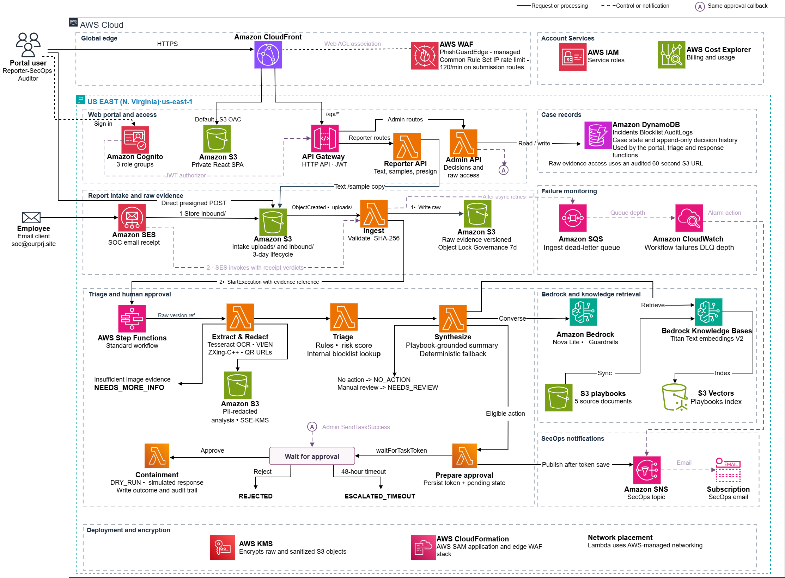

---
title: "5.1 · Problem and architecture"
weight: 1
chapter: false
aliases:
  - /5-workshop/01-architecture/
---

An employee forwards a suspicious email while a colleague submits a screenshot of the same campaign. SecOps needs to preserve both originals, establish who can read each report and record the reason for a decision. This lab builds that process in US East (N. Virginia).

[Open the full-resolution diagram](/images/phishguard/architecture-final.png) · [draw.io](/downloads/PhishGuard-Architecture.drawio)

### How to read the diagram

1. The browser loads React through CloudFront. Cognito issues a JWT. The HTTP API validates it for the Reporter and Admin APIs. The APIs use DynamoDB to check ownership, read incidents and record decisions.
2. A browser uploads an image or EML directly to S3 using a presigned POST returned by the Reporter API. For pasted text or a demo fixture the Reporter API writes/copies the object. All three web paths produce `uploads/{uuid}/raw`. An S3 ObjectCreated notification calls Ingest. SES uses a separate receipt rule: store the original MIME in `inbound/`, then invoke Ingest with receipt verdicts.
3. Ingest validates, computes SHA-256 and saves the raw object in the **evidence** bucket with versioning, SSE-KMS and seven-day Governance retention. After the save it starts the execution named for the incident, passing evidence references including `raw_s3_key`, `raw_s3_version_id` when available, and `evidence_sha256`. The **sanitized** bucket holds a separate redacted analysis copy. The SQS dead-letter queue receives failed async Ingest deliveries.
4. Extract & Redact reads the evidence, runs Vietnamese/English Tesseract for images, and masks detectable PII. Insufficient usable text and QR evidence leads to `NEEDS_MORE_INFO`. Triage scores rules and checks indicators. Synthesize retrieves playbook passages and requests a Bedrock summary when configured. A deterministic fallback stays visible when synthesis fails.
5. A high/critical report without a valid action goes to `NEEDS_REVIEW` with an SNS notice. A lower-risk report without a proposal ends at `NO_ACTION`. With a valid proposal, PrepareApproval persists the token and `PENDING_APPROVAL` **before** notifying SecOps. The Standard workflow holds the wait. The Lambda invocation returns.
6. An admin reads the proposal and submits a decision. Admin API checks state and role, then calls `SendTaskSuccess` with the decision. Rejection ends at `REJECTED`. Expiry follows the timeout path to `ESCALATED_TIMEOUT`. An approval in the observed `DRY_RUN` mode records the simulated result and audit trail. Any blocklist entry is internal. External mail/firewall enforcement is outside this deployment.

**Two boundaries to point out.** PhishGuardEdge protects traffic through CloudFront. The signed upload goes directly to S3. Lambda uses AWS-managed networking in this SAM template. The region and the service groups indicate placement and responsibility. QR extraction reads a URL locally, strips query and fragment for display, and supplies an indicator to Triage. The approval callback belongs to the Step Functions task that invokes PrepareApproval.

