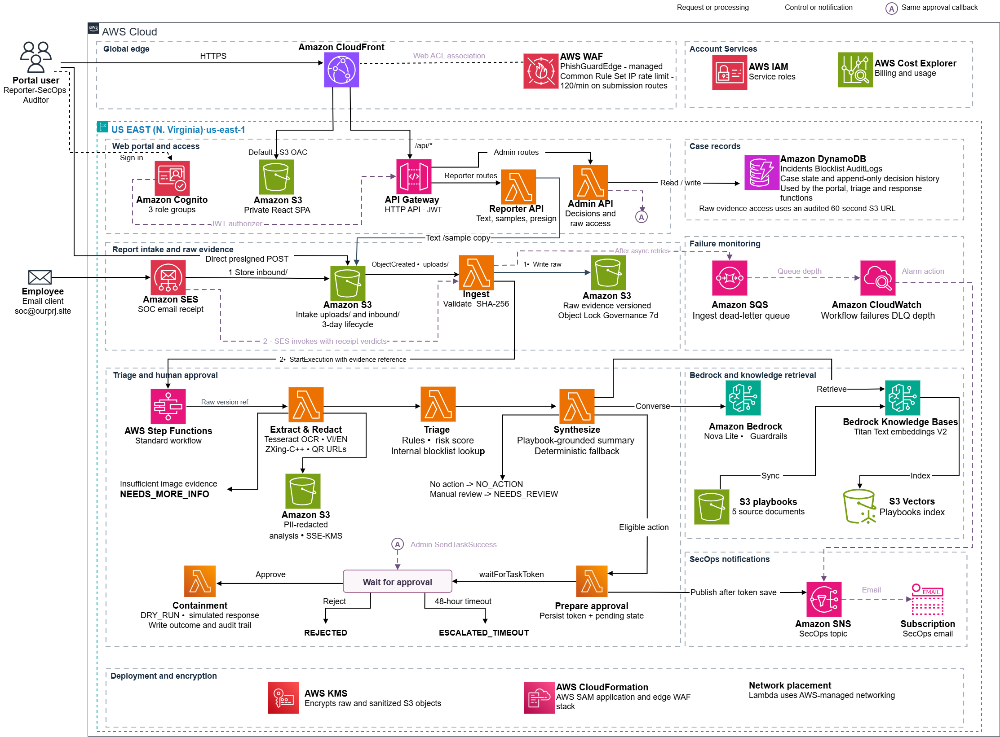

---
title: "5.1 · Bài toán và kiến trúc"
weight: 1
chapter: false
aliases:
  - /vi/5-workshop/01-architecture/
---

Một nhân viên chuyển tiếp thư nghi lừa đảo, còn đồng nghiệp gửi ảnh chụp cùng chiến dịch. SecOps cần giữ bản gốc của từng báo cáo, biết ai được xem và truy lại lý do xử lý. Workshop dựng quy trình này tại US East (N. Virginia).

[Mở sơ đồ đúng độ phân giải](/images/phishguard/architecture-final.png) · [draw.io](/downloads/PhishGuard-Architecture.drawio)

### Cách đọc sơ đồ

1. Trình duyệt tải React qua CloudFront, đăng nhập Cognito và gửi JWT đến HTTP API. Reporter API và Admin API đọc/ghi DynamoDB để tra hồ sơ, kiểm quyền và ghi quyết định.
2. Với ảnh hoặc EML, trình duyệt nhận form ký rồi POST trực tiếp đến S3. Với văn bản và mẫu demo, Reporter API ghi hoặc sao chép file. Cả ba đường web tạo `uploads/{uuid}/raw`, sự kiện S3 gọi Ingest. Email đi đường riêng: SES lưu MIME vào `inbound/` rồi gọi Ingest kèm thông tin xác thực lần nhận.
3. Ingest kiểm dữ liệu, tính SHA-256 và ghi bản gốc vào bucket **evidence**, có versioning, SSE-KMS và Object Lock Governance 7 ngày. Sau khi lưu thành công, Ingest mở execution mang tên incident, truyền tham chiếu gồm `raw_s3_key`, `raw_s3_version_id` khi có và `evidence_sha256`. Bucket **sanitized** lưu riêng bản phân tích đã che PII. DLQ nhận các lần gọi Ingest bất đồng bộ đã thất bại sau retry.
4. Extract & Redact đọc bản gốc, dùng Tesseract tiếng Việt/Anh cho ảnh và che PII. Ảnh thiếu cả nội dung OCR và URL QR dùng được đi tới `NEEDS_MORE_INFO`. Triage chấm theo luật và đối chiếu IOC. Synthesize truy xuất playbook và gọi Bedrock khi đã cấu hình. Khi tổng hợp lỗi, trang sự cố hiện `FALLBACK` và kết quả theo luật.
5. Thiếu hành động phù hợp: HIGH/CRITICAL chuyển `NEEDS_REVIEW` và báo SNS, mức thấp hơn thành `NO_ACTION`. Có đề xuất: PrepareApproval **ghi token và trạng thái `PENDING_APPROVAL` trước**, sau đó gửi SNS. Step Functions giữ bước chờ. Lambda kết thúc lượt gọi.
6. Admin quyết định trên web. Admin API kiểm quyền, kiểm trạng thái rồi gửi `SendTaskSuccess` mang kết quả về workflow. Từ chối thành `REJECTED`, quá hạn thành `ESCALATED_TIMEOUT`. Duyệt ở chế độ `DRY_RUN` ghi kết quả mô phỏng và audit; mục blocklist nếu có chỉ có hiệu lực trong ứng dụng.

**Hai ranh giới cần chỉ được trên hình.** PhishGuardEdge kiểm lưu lượng đi qua CloudFront. File đi thẳng đến S3 bằng form ký sẵn. Lambda dùng mạng do AWS quản lý trong template SAM này. Khung Region và nhóm dịch vụ thể hiện vị trí và trách nhiệm. Bước QR đọc URL ngay trong ảnh, lược query và fragment khi hiển thị, rồi chuyển chỉ dấu cho Triage. Callback thuộc chính Task của Step Functions gọi PrepareApproval.

