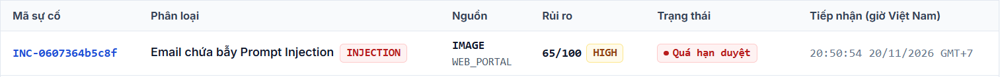
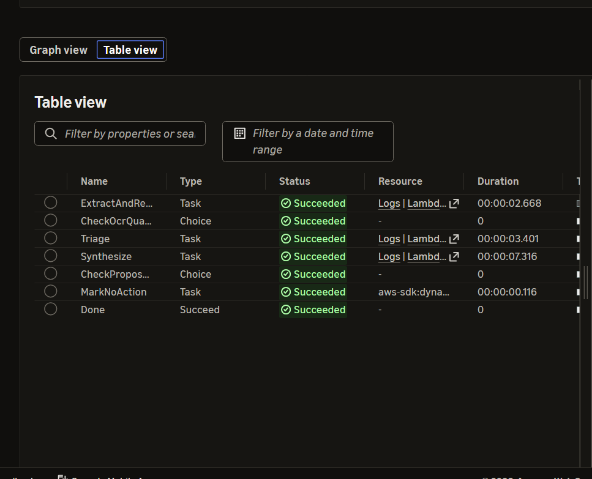
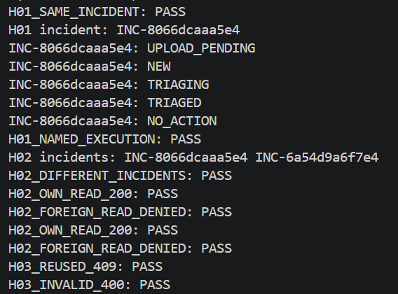
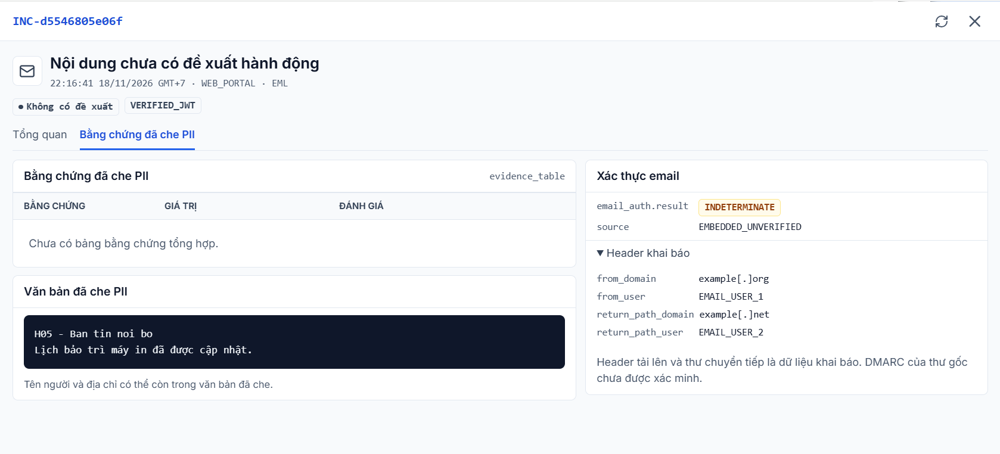
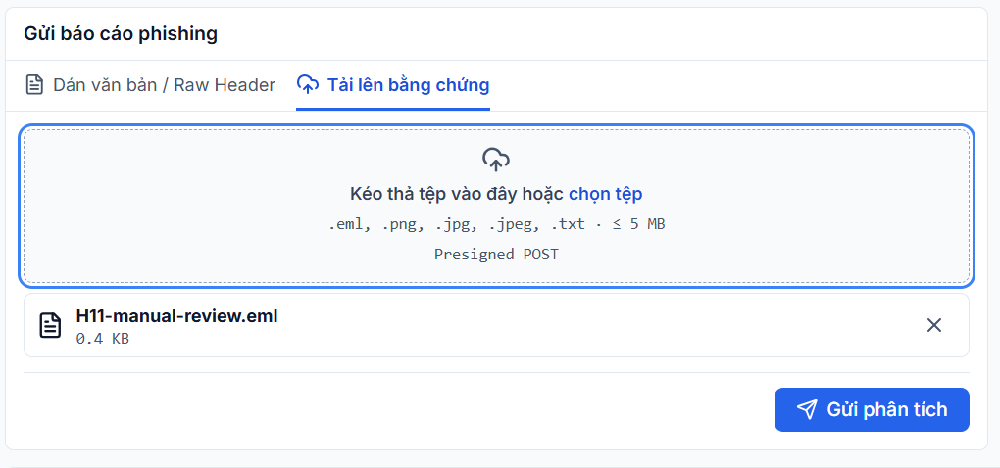
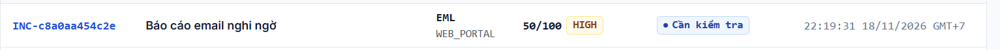
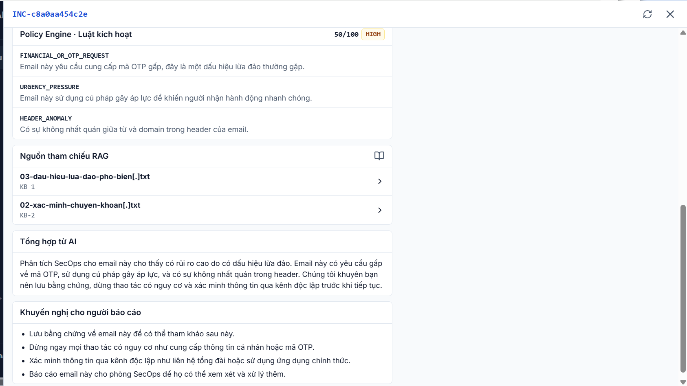
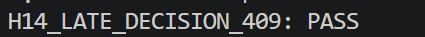

---
title: "5.5.2 · Acceptance tests H01–H15"
weight: 2
chapter: false
aliases:
  - /5-workshop/07-tests/
---

The table lists the acceptance criteria. The screenshots and logs below document individual runs. H04 and the partial-failure portion of H13 use local simulation. A visible timeout proves the expiry branch. The late-decision 409 requires its own response or terminal log.

| Case | Acceptance criterion |
|---|---|
| H01 | Same reporter, key and payload returns one incident and one execution named for that ID. |
| H02 | Same input submitted by two reporters yields distinct incidents. The owner reads it; cross-account reads are denied both ways. |
| H03 | Reusing the key for different content gives 409; malformed key gives 400. |
| H04 | Simulate a crash after persisting evidence. Retry should reuse one evidence version and start one execution. |
| H05 | A forwarded EML with a Return-Path that differs from From leaves original authentication INDETERMINATE. |
| H06 | An unverified sender produces the rejection log and metric; look up the same source to confirm no incident was created. |
| H07 | A benign reminder to keep OTPs secret should score zero on the reference sample. |
| H08 | The test text requests an OTP and includes a defanged sample link. Check FINANCIAL_OR_OTP_REQUEST. |
| H09 | Blank image yields NEEDS_MORE_INFO and no score. |
| H10 | Compare DEMO_2/3. Capture the injection flag separately from Guardrail intervention or fallback reason. Record SKIPPED or UNVERIFIED as observed. |
| H11 | High risk without an actionable target produces NEEDS_REVIEW; correlate its SNS message and execution. |
| H12 | Five reference hostnames return the expected lookalike classification in the local tests. |
| H13 | A repeated approval records a single successful callback/audit outcome; test partial-failure recovery locally. |
| H14 | Let an approval expire. Verify ESCALATED_TIMEOUT, submit a late decision and verify HTTP 409. Restore the previous timeout. |
| H15 | Reporter and Auditor responses comply with their roles; response payloads and notifications exclude workflow tokens and raw evidence keys/headers. |

```powershell
.\.venv\Scripts\python.exe scripts/check_phase_h_local.py
.\.venv\Scripts\python.exe scripts/check_phase_h_live.py --profile $pgProfile --other-reporter demo-reporter-2
.\.venv\Scripts\python.exe scripts/verify_group1_upload.py --profile $pgProfile
```

The last two commands create test reports. On a DRY_RUN deployment the admin and group2 scripts exercise the reference proposals. For H14 use a new DEMO_1 after the demo timeout is set, wait for expiry and run the following with its actual ID. Capture the output, then restore the saved parameter. The November 20 account snapshot showed 172800 seconds.

```powershell
.\.venv\Scripts\python.exe scripts/check_phase_h_live.py --profile $pgProfile --expired (Read-Host "Expired incident ID")
```





## Reproduce from the portal

As a reporter, upload `fixtures/phase-h/H05-return-path.eml` and `H11-manual-review.eml` separately. Match H11’s incident ID to its SNS notification. For H07 submit “Ngân hàng không yêu cầu cung cấp OTP hoặc mật khẩu.” For H08 submit “Ngân hàng không yêu cầu cung cấp OTP. Tình huống mô phỏng: nhập OTP tại hxxps://example[.]org/test.” Each is a separate report. On the demo stack record the original approval timeout, use the portal chapter’s `Update-PgStack` helper to change only ApprovalTimeoutSeconds to 60, wait for UPDATE_COMPLETE and start a fresh DEMO_1. Time the wait from PrepareAndWaitApproval. After the late-decision check, restore the recorded timeout even if the check failed.

### H01–H03 · Follow the incident IDs

Read the two IDs on the H02 line, then the two pairs of owner-read and foreign-read checks. H01 verifies retry handling for one reporter. H02 tests isolation across reporters. H03 records the expected 409 and 400 responses.



### H05 · Inspect forwarded headers

Open the email authentication panel. The differing From and Return-Path domains are visible, and the reported verdict is INDETERMINATE with source EMBEDDED_UNVERIFIED.



### H11 · Submit the review fixture

Sign in as Reporter and select H11-manual-review.eml in the upload tab. Submit once and save the returned incident ID.



### H11 · Find the result

The dashboard row shows a risk score of 50/100 and the review status. Open this row to see why it reached the manual-review branch.



### H11 · Explain the result

The detail panel names three triggered rules and cites playbooks 03 (phishing indicators) and 02 (transfer verification). This November 18 incident predates the November 23 sync that added playbooks 04 and 05. Use the rules to explain the score. Match the SNS notification separately using this incident ID.



### H14 · Verify a late decision

After the approval expired for INC-0607364b5c8f, the terminal recorded H14_LATE_DECISION_409: PASS. Together with the expired dashboard row, this verifies both parts of H14.



On the demo stack record the current ApprovalTimeoutSeconds. Using Update-PgStack from 5.3.2, set it to 60 for one new approval case, then restore the recorded value after the test.

