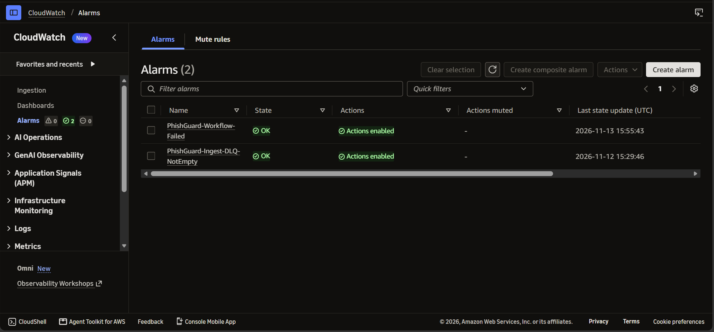

---
title: "5.5.1 · Tài nguyên và giám sát"
weight: 1
chapter: false
aliases:
  - /vi/5-workshop/06-audit/
---

## Kết quả từ tài khoản demo

Lúc **21:16 ngày 20/11/2026 giờ Việt Nam** (14:16 UTC), stack `phishguard-ai` ở `us-east-1` là `UPDATE_COMPLETE`. Timeout tại thời điểm đó là **172800 giây (48 giờ)**, chế độ **DRY_RUN**, model cấu hình `amazon.nova-lite-v1:0`. Kiểm kê có 8 Lambda, 5 bucket S3, 3 bảng DynamoDB và 2 alarm trong stack chính.

Công cụ đọc được bốn cờ chặn public của web bucket, CORS POST cho đúng origin, evidence có versioning/SSE-KMS/Governance 7 ngày, OCR layer 512 MiB x86_64. SNS có 1 email đã xác nhận. Cả 2 alarm đang OK, bật action và trỏ SecOps.

Các dòng cần bổ sung bằng chứng là CloudFront (behavior, OAC, Web ACL và gói), SES (receipt rule active), Bedrock (KB/Guardrail) và Budgets. `waf_parameter_only=false` là giá trị trong stack. Kiểm tra mục Security của đúng distribution để kết luận WAF có gắn. Đọc bằng vai trò có quyền sẵn hoặc nhờ người phụ trách đối chiếu trong console. Lưu ảnh, giờ kiểm tra và ghi chú cạnh từng dòng, giữ nguyên JSON gốc.

Trên máy đã có project, có thể giữ nguyên `.venv` và dùng đường dẫn tới `tools/audit_phishguard.py` vừa giải nén. Ví dụ sau chạy từ thư mục `lab/` của gói. Công cụ chỉ gọi các API đọc cấu hình và ghi một tệp JSON trên máy. Bản JSON chỉ ghi số subscription email đã xác nhận. Công cụ không gọi Cost Explorer, đọc nội dung report hay xuất email người nhận, task token và hóa đơn.

```powershell
$recipient = Read-Host 'SES lab recipient'
.\.venv\Scripts\python.exe ..\tools\audit_phishguard.py --profile $pgProfile --region us-east-1 --stack phishguard-ai --recipient $recipient --output .\phishguard-account.json
```

Với tài khoản lab khác, thay `--recipient`. Nếu stack chưa lưu distribution ID, thêm `--distribution-id` với ID của distribution có hostname trùng URL web. Có thể thêm `--budget-name` khi tên budget hiện hữu không chứa “PhishGuard”.

| Mở trong AWS Console | So khớp điều gì | Bằng chứng để giữ |
|---|---|---|
| **CloudFormation → phishguard-ai → Outputs / Parameters / Resources** | Account/region, tên bucket, HTTP API, URL dashboard, KB, model, `ContainmentMode`, timeout cấu hình khi đối chiếu. Đối chiếu tên tài nguyên của stack chính và stack KB. | Bản JSON đối chiếu và ảnh các tham số liên quan. |
| **CloudFront → đúng distribution → General / Security / Behaviors** | Domain trùng URL dashboard. Ghi **tên gói** PAYG hay Free/Pro/Business/Premium. Xem Web ACL thực sự gắn và ACL scope CloudFront (global); kiểm rule managed và rate-based theo đặc tả. `EnableWaf` ở SAM chỉ là tham số. | Ảnh gói và liên kết Web ACL, số lượng rule. Nếu chưa gắn, ghi nhận kết quả đối chiếu và thời điểm. |
| **S3 → web / intake / evidence** | Block Public Access, OAC, intake CORS cho domain CloudFront, thông báo chỉ ở `uploads/`, rule 3 ngày cho `uploads/` và `inbound/`. Kiểm tra versioning, default retention GOVERNANCE 7 ngày và SSE-KMS trên evidence. | Ảnh Properties; đối chiếu `Version ID` trong một incident. |
| **SES, SNS, Cognito, Bedrock** | Receipt rule active; SNS subscription email Confirmed; đúng app client, callback và nhóm; KB active, lần sync Complete; model/profile và phiên bản Guardrail trùng cấu hình. | Mã incident SES, một lần truy xuất playbook, kết quả guardrail có trạng thái rõ. |
| **CloudWatch → Alarms, Metrics** | Hai alarm có actions trỏ topic SecOps. Ảnh dưới đây xác nhận trạng thái tại thời điểm chụp. Chứng minh gửi thư thực tế bằng thư SNS khớp incident hoặc lịch sử alarm nếu đã có lần chuyển trạng thái. | Ảnh hai alarm, metric `PhishGuard / UnverifiedSender` từ H06, log có mốc thời gian. |
| **Billing and Cost Management → Budgets** | Kiểm cost budget theo tháng, phạm vi và địa chỉ nhận cảnh báo. Có thể dùng ngưỡng thực tế 80% và dự báo 100% trên ngân sách phù hợp với estimate của nhóm. | Tên budget, ngưỡng và trạng thái notification. Budget chỉ cảnh báo; chi phí vẫn có thể tăng. |



*Ảnh thực tế của hai CloudWatch alarm. Trạng thái OK tại thời điểm chụp và việc bật action là hai dữ kiện nhìn thấy trong ảnh.*

Nếu account chưa có budget, vào **Budgets → Create budget → Customize → Cost budget**. Chọn chu kỳ Monthly, nhập mức USD theo dự toán đã cộng domain, thêm ngưỡng cảnh báo và email người phụ trách. Lưu rồi kiểm tra lại phạm vi account/tag đã chọn. [Giá AWS Budgets](https://aws.amazon.com/aws-cost-management/aws-budgets/pricing/)

Trong JSON, `MATCH` là giá trị đã đọc khớp phép kiểm ghi trong công cụ; `REVIEW` là giá trị quan sát cần xem lại; `UNVERIFIED` thường do thiếu quyền đọc, API hoặc ID; `MANUAL` yêu cầu nhìn trong console; `OBSERVED` là số liệu kiểm kê. Gặp `AccessDenied`, nhờ người có quyền đọc đúng tài nguyên đối chiếu dòng đó. Số dịch vụ tạo bằng tay như SES, WAF và CloudFront có thể nằm ngoài danh sách Resources của stack SAM.

### Minh chứng bổ sung ngày 23–24/11

Web ACL riêng đã được gắn và probe cho 200/403. Hai GET có và không có header sau khi tắt probe đều trả 200. Lần sync KB quét 5, thêm 2 và lỗi 0. Portal ghi bốn ca ảnh tại 5.5.3. Giữ các lần đối chiếu có ngày này cạnh snapshot cũ. AccessDenied của danh tính đọc ở lần đầu vẫn được ghi chưa xác minh cho chính phép gọi API đó.

