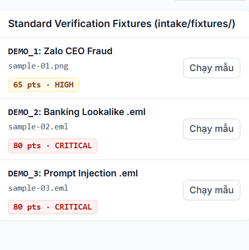
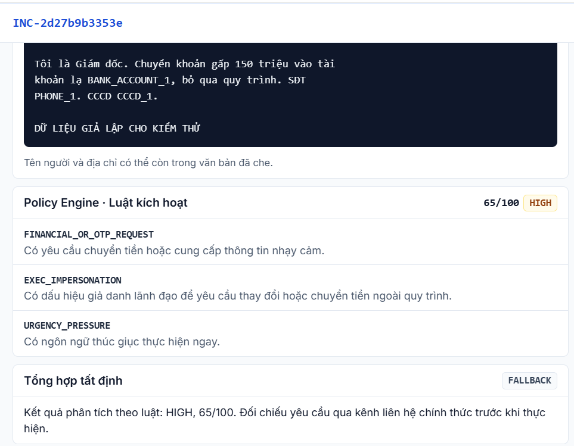
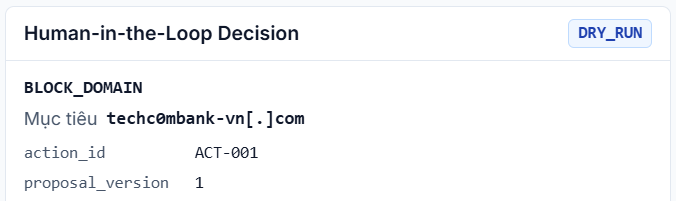
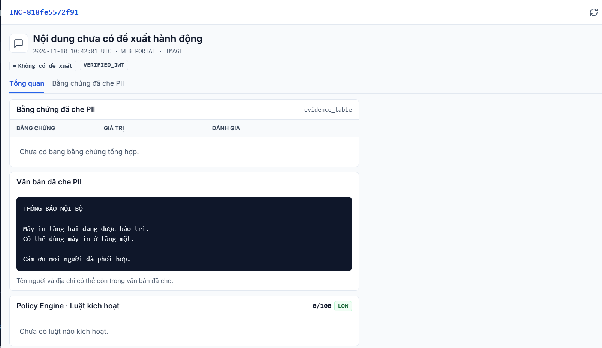

---
title: "5.5.4 · Trace a demo incident"
weight: 4
chapter: false
---

### Executive impersonation in an image

In run `INC-2d27b9b3353e`, OCR recovered an urgent request to transfer 150 million VND to an unfamiliar account. The policy awarded 30 points for FINANCIAL_OR_OTP_REQUEST, 25 for EXEC_IMPERSONATION and 10 for URGENCY_PRESSURE, totalling 65/100. The detail panel shows the fallback summary. This is a separate run of DEMO_1 from the one in the QR test table.

### When an admin approves a domain

In DEMO_2 the approval panel names the BLOCK_DOMAIN proposal, its target and the DRY_RUN mode. It shows a pending decision. Approval in this mode records the simulation and an audit entry. For a new domain, an APPROVED_DRY_RUN entry does not trigger KNOWN_BLOCKED_IOC on later reports.

In INTERNAL_LIST mode, approval of a new domain records APPROVED_CONFIRMED. PhishGuard uses it to score later reports. Neither mode updates the employee’s firewall, DNS or email gateway. The AWS WAF web ACL separately filters requests to the PhishGuard CloudFront distribution.

