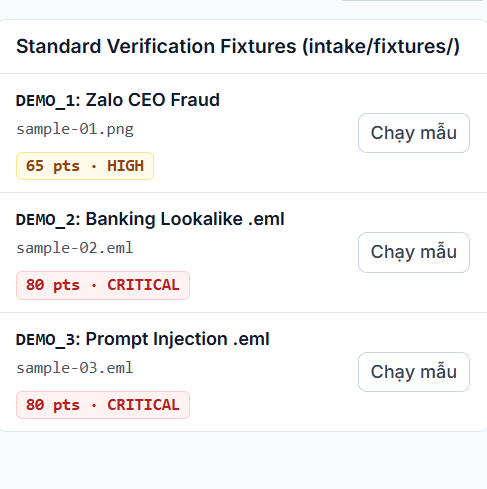
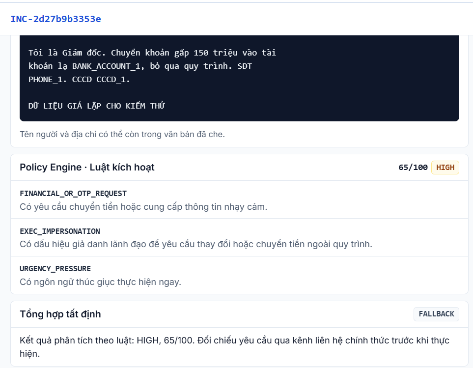
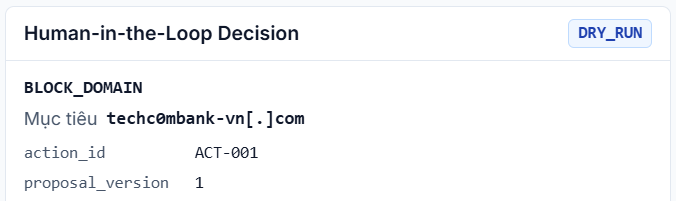
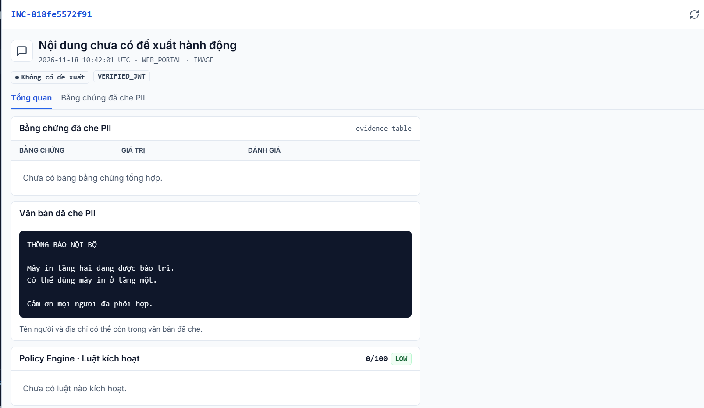

---
title: "5.5.4 · Theo dấu một sự cố demo"
weight: 4
chapter: false
---

*Các fixture giúp hai người chạy trên cùng một bản deploy so sánh cùng đầu vào.*

| Mẫu | Đường đi cần cho người xem thấy | Dữ kiện để chốt |
|---|---|---|
| **1 · Ảnh giả danh lãnh đạo** | Đăng nhập reporter, chạy mẫu ảnh, mở nội dung OCR và từng luật. Chuyển sang admin, đọc mục tiêu và chế độ rồi duyệt. | Mẫu chuẩn kỳ vọng 65/HIGH, `FINANCE_VERIFICATION_ALERT`, SNS và audit, kết thúc `SIMULATED`. Chất lượng OCR có thể làm thay đổi luật. |
| **2 · Email giả mạo ngân hàng** | Mở IOC đã đổi sang dạng văn bản an toàn, chỉ ra vì sao miền giống thương hiệu, rồi mở đề xuất chặn miền. | Mẫu chuẩn 80/CRITICAL, `BLOCK_DOMAIN`, sau duyệt DRY_RUN có bản ghi nội bộ `APPROVED_DRY_RUN`. Chưa có chặn ở firewall/email gateway. |
| **3 · Email chứa prompt injection** | So các luật và điểm với mẫu 2, kiểm cờ injection, trạng thái tổng hợp và lý do fallback nếu có. Cho xem quyền của Synthesize và role được phép duyệt. | Model không tự thay điểm hoặc thực thi containment. Ghi đúng kết quả Guardrail của lần chạy. IOC có nguồn SEED/APPROVED_CONFIRMED từ lần trước có thể làm điểm lên 100. |

### Ảnh giả danh lãnh đạo

Ở lượt `INC-2d27b9b3353e`, OCR đọc được yêu cầu chuyển gấp 150 triệu vào tài khoản lạ. Ba luật khớp là `FINANCIAL_OR_OTP_REQUEST` (30), `EXEC_IMPERSONATION` (25) và `URGENCY_PRESSURE` (10), tổng cộng 65/100. Ảnh chi tiết cho thấy bản tổng hợp dự phòng. Đây là một lượt chạy DEMO_1 khác với lượt trong bảng kiểm thử QR.

### Khi admin duyệt một miền

Trong DEMO_2, màn hình duyệt ghi rõ hành động `BLOCK_DOMAIN`, miền đích và chế độ `DRY_RUN`. Đây là đề xuất đang chờ quyết định. Sau khi admin duyệt, bộ lab ghi kết quả mô phỏng và audit. Với một miền mới, bản ghi `APPROVED_DRY_RUN` không kích hoạt luật `KNOWN_BLOCKED_IOC` ở lần báo cáo tiếp theo.

Ở chế độ `INTERNAL_LIST`, một miền mới được duyệt mang nguồn `APPROVED_CONFIRMED`. PhishGuard dùng miền đó để chấm báo cáo sau. Cả hai chế độ đều không cập nhật firewall, DNS hay email gateway của nhân viên. AWS WAF có nhiệm vụ riêng là lọc request gửi tới cổng PhishGuard qua CloudFront.

*Thông báo bảo trì máy in cho thấy hệ thống đọc được dấu tiếng Việt và hiển thị rủi ro thấp trên đầu vào đối chứng.*

PhishGuard đặt ra một câu hỏi ở cấp tổ chức: “Báo cáo này đã được ai xử lý, theo căn cứ nào và kết quả có truy lại được không?” Với một email đơn lẻ, một chatbot có thể giải thích các dấu hiệu đáng ngờ rất tốt. Trong môi trường nhiều nhân viên, việc gắn báo cáo với đúng người, giữ một phiên bản bằng chứng, kiểm quyền đọc, chờ phê duyệt và đối chiếu nhật ký là những phần việc nhóm đang giải quyết. AI trong project hỗ trợ viết giải thích từ những bằng chứng và tài liệu mà hệ thống cung cấp.

**Hạn chế nên trình bày thẳng.** Fixture cho thấy hệ thống đi đúng một số nhánh xác định. H01–H15 đo hành vi, phân quyền và khả năng phục hồi của MVP. Độ chính xác trên thư ngoài tập mẫu, tỷ lệ cảnh báo nhầm và thời gian tiết kiệm cho SecOps vẫn cần đo. Tên và địa chỉ trong nội dung đã che PII có thể còn sót; S3 Governance có quyền bypass; containment của demo ghi mô phỏng trong phạm vi hệ thống.

