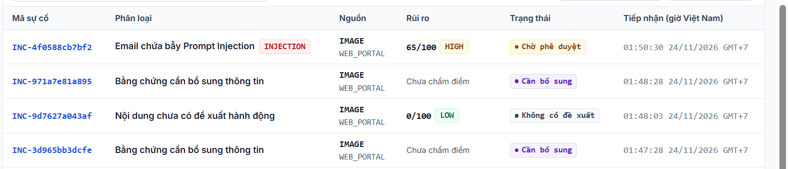
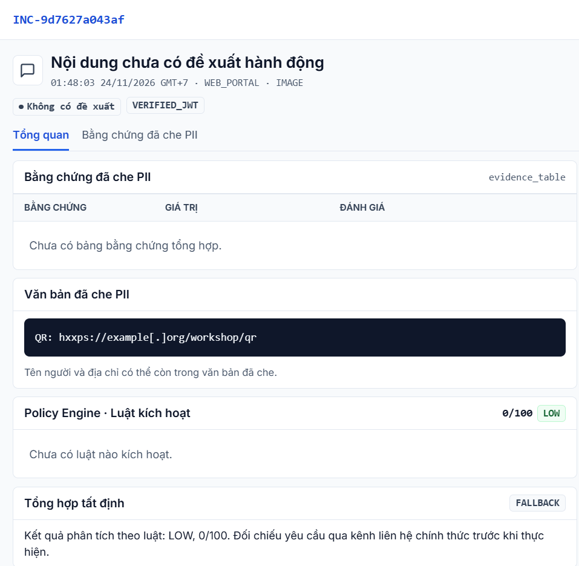

---
title: "5.5.3 · OCR and QR test cases"
weight: 3
chapter: false
---

Sign in as a lab reporter. Open the portal through CloudFront and use **file upload** to submit each image from `lab/fixtures/qr/` separately. Save each incident ID and inspect the source, extracted indicators, risk and status. Finally run the built-in DEMO_1 to check ordinary OCR after adding QR support.

| Submission order | Observed dashboard result | Detail to inspect |
|---|---|---|
| 1. `blank.png` | More information required, no score | The image provides neither usable text nor a URL indicator. |
| 2. `qr-url.png` | 0/100, LOW, no proposed action | Look for `hxxps://example[.]org/workshop/qr`. Check that query and fragment are absent. With a clean blocklist, a valid URL alone need not raise the score. |
| 3. `qr-text.png` | More information required, no score | The QR carries ordinary text. The image extractor retains eligible HTTP(S) URL indicators. |
| 4. Built-in DEMO_1 image | 65/100, HIGH, pending approval | Inspect the OCR and triggered rules. This screenshot records the state before the admin decision. |

The newest submission appears first. The bottom row is the blank image. The second row from the bottom is the QR code containing a URL.

Open incident `INC-9d7627a043af`. Its redacted evidence contains the line `QR: hxxps://example[.]org/workshop/qr`. This confirms which URL the Lambda decoded. The decoder processes the image locally without visiting the destination.

The policy engine scored this report 0/100 because it found no matching rule. The domain’s reputation remains unverified. The FALLBACK badge identifies a rule-based summary for this run. The screenshot does not show the fallback reason.

The DEMO_1 row at the top has source IMAGE, even though its Vietnamese classification mentions email. The dashboard uses that label whenever the prompt-injection flag is set, including on images. The evidence type, OCR text and triggered rules identify the executive impersonation scenario. The list alone does not establish what set the flag.

