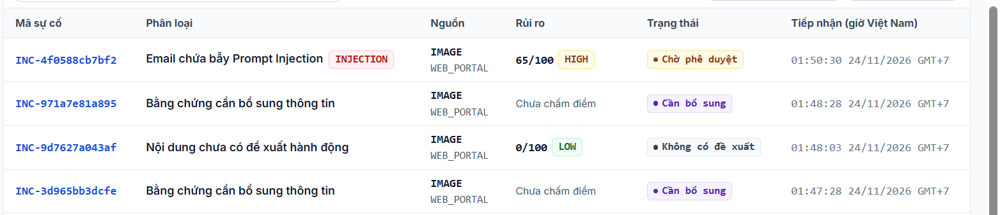
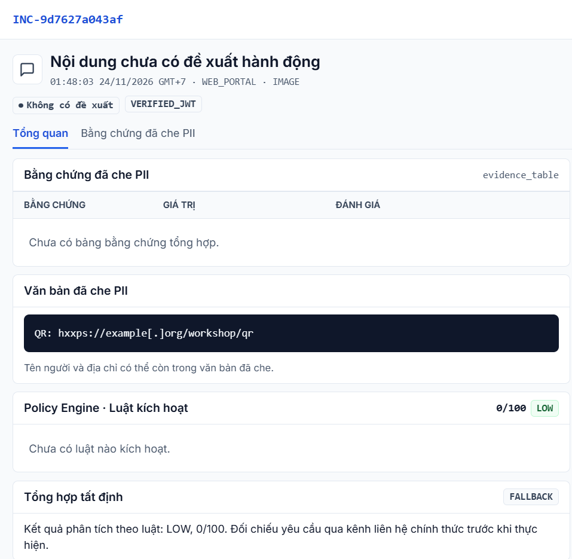

---
title: "5.5.3 · Kiểm thử OCR và QR"
weight: 3
chapter: false
---

Dùng reporter của lab. Mở portal qua CloudFront, chọn **tải file** và gửi riêng từng ảnh từ `lab/fixtures/qr/`. Với mỗi lượt, giữ mã incident, mở trang chi tiết và kiểm nguồn ảnh, chỉ dấu trích được, điểm và trạng thái. Cuối cùng chạy mẫu demo 1 có sẵn để kiểm lại OCR thông thường.

| Thứ tự gửi | Kết quả trong lần demo | Đọc thêm trong chi tiết |
|---|---|---|
| 1. `blank.png` | Cần bổ sung, chưa chấm điểm | Không có chữ hay URL dùng được làm bằng chứng. |
| 2. `qr-url.png` | 0/100, LOW, không có đề xuất | Tìm IOC `hxxps://example[.]org/workshop/qr`. Kiểm query và fragment đã được bỏ. Với blocklist sạch, một URL hợp lệ tự nó chưa tạo điểm rủi ro. |
| 3. `qr-text.png` | Cần bổ sung, chưa chấm điểm | Nội dung trong QR là văn bản. Bộ trích chỉ đưa URL HTTP(S) hợp lệ vào danh sách chỉ dấu. |
| 4. DEMO_1, ảnh mẫu | 65/100, HIGH, chờ phê duyệt | Xem chữ OCR và luật đã kích hoạt. Trạng thái này ghi nhận tại lúc chụp, trước quyết định của admin. |

Bảng xếp sự cố mới nhất ở trên. Dòng dưới cùng là ảnh trắng. Dòng thứ hai từ dưới lên là ca QR chứa URL.

Mở sự cố `INC-9d7627a043af`. Trong bản đã che thông tin, dòng `QR:` hiển thị `hxxps://example[.]org/workshop/qr`. Đó là URL PhishGuard đã đọc từ mã QR. Bộ giải mã xử lý ngay tại Lambda, không mở trang đích.

Trong cùng hồ sơ, Policy Engine ghi 0/100 vì chưa có luật nào khớp. Uy tín của miền vẫn chưa được xác minh. Nhãn `FALLBACK` cho biết phần tóm tắt của lượt này được tạo từ kết quả theo luật. Ảnh không ghi nguyên nhân fallback.

Lưu ý dòng DEMO_1 ở đầu bảng: cột nguồn ghi IMAGE nhưng nhãn phân loại có chữ “Email”. Giao diện dùng nhãn này khi có cờ prompt injection, kể cả với ảnh. Dùng loại bằng chứng, chữ OCR và các luật trong hồ sơ để giải thích ca giả danh lãnh đạo. Dòng danh sách chưa cho biết vì sao cờ xuất hiện.

